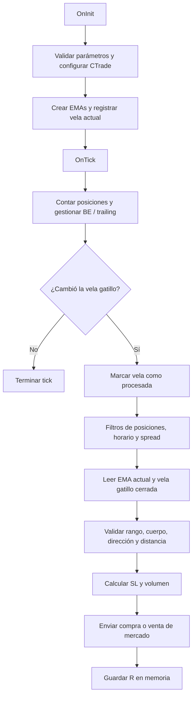

# Auditoría integral de `OneMinuteCandle_EA`

**Dictamen: NO APTO para operación real en su estado actual.** El EA contiene defectos demostrables de dimensionamiento, protección de posiciones y compatibilidad con netting. Puede utilizarse en un entorno de pruebas aislado para reproducirlos, pero todavía no como sistema de ejecución confiable.

**No modifiqué ningún archivo del proyecto.** La fuente, el compilado y el README conservaron sus hashes; el repositorio quedó sin cambios.

## 1. Resumen ejecutivo

### Alcance y verificaciones realizadas

Revisé íntegramente:

- [OneMinuteCandle_EA.mq5](<G:/Candle Behavior Research/OneMinuteCandle_EA.mq5>): 802 líneas, todas sus funciones, estructuras y parámetros.
- [README.md](<G:/Candle Behavior Research/README.md>): documentación disponible.
- Los métodos relevantes de la biblioteca [Trade.mqh instalada](<C:/Users/Dany/AppData/Roaming/MetaQuotes/Terminal/10CE948A1DFC9A8C27E56E827008EBD4/MQL5/Include/Trade/Trade.mqh>), incluyendo configuración, apertura, modificación, validación de órdenes, filling y envío.

También realicé:

| Verificación | Resultado |
|---|---|
| Compilación de una copia temporal, fuera del proyecto | **0 errores, 0 advertencias** |
| Compilador | MetaEditor 5.0, build 6230 |
| Comprobaciones aritméticas independientes | Reproducidos problemas de lote mínimo, normalización de volumen, StopsLevel, BE/TS, recuperación de R y unidades de pip |
| Contraste de semántica de API | Documentación oficial de MetaQuotes |
| Integridad del proyecto al finalizar | Sin modificaciones |

La compilación está documentada en este [log temporal](<C:/Users/Dany/AppData/Local/Temp/OMC-audit-51754be07bb94ed091bef10f00f0e534/OneMinuteCandle_EA.log>).

**No ejecuté backtests, pruebas contra un servidor ni operaciones.** Las reproducciones matemáticas no equivalen a ejecuciones MQL5. Aunque existe una instalación de MT5, el proyecto no proporciona una configuración de ensayo reproducible con símbolo, especificaciones contractuales, cuenta, período, datos y parámetros.

La revisión corresponde al commit `7afbaaedcefb77215412427432a18642fc37c55a`. SHA-256 de la fuente:

```text
9BE3C243243B3F6972657C0A40CC469D4530744776FD555024CF5A050FFE6818
```

### Principales conclusiones

1. **El riesgo configurado no es un límite efectivo.** El código puede elevar el volumen hasta el mínimo del contrato aunque eso multiplique la pérdida prevista.
2. **Puede abrir o conservar posiciones sin SL.** Hay una ruta concreta en la biblioteca instalada que elimina el SL solicitado cuando el símbolo no lo admite; el EA no lo detecta.
3. **La gestión no es compatible con adiciones netting.** Una nueva entrada puede cambiar el SL de toda la exposición y conservar un `1R` incompatible.
4. **Magic Number no protege posiciones ajenas en netting.** El EA puede compensar, cerrar o aumentar una posición externa del mismo símbolo.
5. **Las respuestas del servidor no se reconcilian suficientemente.** No se distingue de forma explícita entre solicitud aceptada, ejecución completa, parcial, rechazo o ejecución todavía pendiente.
6. **Reiniciar puede cambiar las reglas de salida.** El `1R` guardado en memoria puede diferir del recuperado desde el comentario.
7. **Los backtests dependen de la trayectoria intrabar.** BE y trailing impiden considerar equivalentes los resultados de modelos simplificados y ticks reales.

**No encontré look-ahead bias demostrado.** La EMA abierta merece una aclaración estratégica y pruebas de sincronización, pero leer una barra abierta con información disponible en ese tick no constituye automáticamente uso de información futura.

### Aspectos positivos verificados

- El análisis de la vela gatillo usa `CopyRates(..., 1, 1, ...)`: última vela cerrada disponible.
- Los buffers de un elemento se leen después de verificar la cantidad copiada.
- Se evita dividir por un rango de vela nulo o negativo.
- Los handles se crean una sola vez y se liberan en `OnDeinit`.
- El avance favorable se mide con Bid para compras y Ask para ventas.
- Se usa `PositionModify` por **ticket**, adecuado para identificar posiciones individuales en hedging.
- La gestión de posiciones continúa fuera del horario de entradas y cuando el spread excede el filtro.
- El cruce de medianoche está contemplado en el filtro horario.
- El TP existente se conserva al solicitar una modificación de SL.
- No observé accesos ordinarios fuera de rango en los buffers de precios e indicadores. El riesgo excepcional de asignación del registro se trata en H30.

### Información que falta

No se encontraron en el proyecto:

- Archivos `.set`.
- Reportes del Strategy Tester.
- Historial de operaciones o logs operativos.
- Datos de ticks y especificaciones de símbolos.
- Especificación formal de la estrategia.
- Reglas de una cuenta de fondeo concreta.
- Registro del compilador y dependencias utilizados para generar el `.ex5` distribuido.
- Pruebas automatizadas o criterios de aceptación.

Estas ausencias impiden verificar rentabilidad, robustez estadística, compatibilidad con un broker concreto y equivalencia entre el binario existente y la fuente auditada.

### Mapa funcional y arquitectura

El proyecto tiene un único archivo de lógica propia. Su dependencia directa es `Trade/Trade.mqh`; la compilación incorpora además `Object.mqh`, `StdLibErr.mqh`, `OrderInfo.mqh`, `HistoryOrderInfo.mqh`, `PositionInfo.mqh` y `DealInfo.mqh`.

No hay indicadores personalizados, DLL, servicios web ni archivos externos de configuración utilizados por el EA.



El orden es relevante: **la vela se marca como procesada antes de obtener todos los datos y antes de conocer el resultado de la operación**.

| Componente | Líneas | Función efectiva |
|---|---:|---|
| Enumeraciones | 17–45 | Selección de temporalidades, dirección y unidades |
| `DatosPosicionRiesgo` | 84–88 | Conserva únicamente ticket y distancia inicial |
| `ConvertirTimeframe` | 106–119 | Traduce selector; valor no reconocido cae en M1 |
| `CalcularTamanoPip` | 124–146 | Heurística basada en dígitos, modo de cálculo y nombre |
| `GuardarRiesgoPosicion` | 151–169 | Inserta o actualiza R en un array |
| `ObtenerRiesgoPosicion` | 174–206 | Busca en memoria, comentario y finalmente SL actual |
| `LimpiarRegistroRiesgo` | 211–227 | Elimina registros sin posición seleccionable |
| `OnInit` | 232–313 | Validaciones, `CTrade`, indicadores y vela inicial |
| `OnDeinit` | 318–330 | Libera handles |
| `GestionarPosicionesYContar` | 335–447 | Cuenta posiciones identificadas y solicita BE/TS |
| `EstaEnHorarioOperativo` | 452–469 | Ventana por minutos de hora del servidor |
| `CumpleFiltroSpread` | 474–483 | Límite opcional de Ask−Bid |
| `CalcularLotajePorRiesgo` | 488–531 | Riesgo sobre balance, tick value y ajuste de volumen |
| `ObtenerValoresEMA` | 536–556 | Lee el valor actual, índice 0 |
| `OnTick` | 561–801 | Orquesta gestión, detección y apertura |

No existen `OnTimer`, `OnTradeTransaction` ni `OnTester`. El EA no genera órdenes pendientes estratégicas.

### Reglas reconstruidas exclusivamente del código

**Entradas:**

- Una instancia opera únicamente `_Symbol`.
- En condiciones normales evalúa una oportunidad por nueva vela gatillo.
- Vela alcista → posible compra. Vela bajista → posible venta.
- Exige rango positivo, rango mínimo, máximo opcional y porcentaje mínimo de cuerpo.
- Reversión:
  - Compra si el máximo de la vela está debajo de todas las EMAs habilitadas.
  - Venta si el mínimo está encima.
- Tendencia:
  - Compra si el mínimo está encima de las EMAs.
  - Venta si el máximo está debajo.
- Ignorar EMA elimina tanto la comparación direccional como la distancia mínima a EMA.
- La distancia mínima se mide desde **Ask/Bid actual**, no desde el extremo de la vela.
- Sin simultáneas, cualquier posición identificada bloquea nuevas entradas.
- Con simultáneas, solo bloquea posiciones identificadas de dirección contraria; no limita cantidad.
- Se envía una orden de mercado con SL en el extremo de la vela y **TP igual a cero**.

**Salidas:**

Definiendo `R` como la distancia guardada:

```text
Activación BE = (1 + InpAjusteBE_R) × R
Activación TS = (1 + InpAjusteTrailing_R) × R
Distancia TS  = max(R, Activación TS)
```

El BE coloca el SL en el precio de apertura nominal.

No hay cierre por:

- Regreso a la EMA.
- Señal contraria.
- Fin del horario.
- Cambio de día.
- Duración máxima.
- Límite diario o de drawdown.

Por tanto, **“reversión a EMA” es un filtro de entrada; no implica una salida en la EMA**. Asimismo, `1:1` describe activaciones y no un take profit de 1R.

### Parámetros y efectos

| Parámetros | Predeterminado | Efecto |
|---|---|---|
| `InpModoDireccion` | Reversión | Selecciona relación de la vela con EMA |
| `InpCantidadEMAs` | 1 | Exige una o dos comparaciones |
| `InpEMA1_Timeframe`, `InpEMA1_Periodo` | M15, 200 | Primera EMA |
| `InpEMA2_Timeframe`, `InpEMA2_Periodo` | H1, 200 | Segunda EMA |
| `InpDistMinEMA_Pips` | 0 | Distancia mínima desde precio ejecutable; desactivada por defecto |
| `InpGatillo_Timeframe` | M1 | Temporalidad de señales |
| `InpPorcentajeCuerpo` | 80 | Cuerpo/rango mínimo |
| `InpRangoMin_Pips` | 2,5 | Rango mínimo |
| `InpRangoMax_Pips` | 0 | Sin máximo por defecto |
| `InpRiesgoPorcentaje` | 1 | Presupuesto teórico por entrada sobre balance |
| `InpAjusteBE_R` | 0 | BE a 1R |
| `InpAjusteTrailing_R` | 0 | TS desde 1R y a distancia 1R |
| `InpPermitirSimultaneas` | `false` | Bloquea entradas si detecta una posición propia |
| `InpSpreadMax_Pips` | 0 | Sin límite de spread por defecto |
| `InpUsarFiltroHorario` | `false` | Desactiva restricción de entradas por horario |
| `InpHoraInicio`, `InpMinInicio` | 08:00 | Inicio en hora del servidor |
| `InpHoraFin`, `InpMinFin` | 20:00 | Fin inclusivo por minuto |
| `InpModoPips` | Automático | Heurística de conversión |
| `InpMagicNumber` | 200150 | Identificación; no exclusión mutua entre instancias |

---

## 2. Tabla maestra de problemas

**Certeza:** **C** = ERROR CONFIRMADO; **P** = ERROR POTENCIAL con escenario concreto; **V** = REQUIERE VERIFICACIÓN; **R** = RECOMENDACIÓN.

En la tabla, `EA` corresponde a [OneMinuteCandle_EA.mq5](<G:/Candle Behavior Research/OneMinuteCandle_EA.mq5>) y `Trade` a la biblioteca instalada indicada anteriormente.

| ID | Severidad | Categoría | Archivo / Línea | Problema | Consecuencia | Solución propuesta |
|---|---|---|---|---|---|---|
| H01 | CRÍTICO | Riesgo | EA 493–515 | **C:** eleva volumen al mínimo aunque exceda presupuesto | Riesgo muy superior al configurado | Rechazar entrada y verificar riesgo final |
| H02 | CRÍTICO | Protección | EA 768–798; Trade 1638–1643 | **P:** biblioteca puede eliminar SL no soportado | Apertura sin protección | Validar flags y SL efectivamente instalado |
| H03 | CRÍTICO | Netting | EA 577, 768–798, 174–180 | **C:** adiciones usan modelo de posiciones independientes | Cambia SL global y conserva R incorrecto | Restringir modalidad o implementar gestión de cesta |
| H04 | CRÍTICO | Aislamiento | EA 362–366, 576–578 | **P:** ignora exposición ajena en netting | Compensa, cierra o mezcla operaciones externas | Exclusividad del símbolo y comprobación global |
| H05 | CRÍTICO | Protección | EA 379–441 | **P:** no recupera SL ausente en pérdidas | Exposición sin límite protector | Vigilancia separada de SL y política de emergencia |
| H06 | ALTO | Volumen | EA 511–530 | **C:** decimales del volumen calculados incorrectamente | Volumen inválido o riesgo aumentado | Cuantizar por step y revalidar |
| H07 | ALTO | Valoración | EA 488–505 | **P:** fórmula universal con tick value de beneficio | Pérdida monetaria mal estimada | `OrderCalcProfit` con dirección y precios |
| H08 | ALTO | Stops | EA 755–758, 779–782 | **C:** StopsLevel inicial usa lado incorrecto del spread | Órdenes inválidas y señales perdidas | Separar distancia de riesgo y distancia regulatoria |
| H09 | ALTO | Precios | EA 403–408, 431–436 | **P:** SL no ajustado a tick size | BE/TS rechazados | Redondeo direccional a tick |
| H10 | ALTO | Ejecución | EA 413, 441, 768–798 | **C:** no confirma ni reconcilia resultados completos | Estado incorrecto, parciales y rechazos mal tratados | Retcodes, deals, posiciones y solicitudes en curso |
| H11 | ALTO | Persistencia | EA 183–205, 765–798 | **C/P:** R previo al fill en comentario y fallback mutable | Reinicios alteran BE/TS o los detienen | Persistir R ejecutado con identidad estable |
| H12 | ALTO | Concurrencia | EA 79, 100–101, 566, 768–792 | **P:** instancias comparten posiciones sin coordinación | Duplicados y regresión de SL | Unicidad o coordinación atómica |
| H13 | ALTO | Riesgo de cuenta | EA 65–79, 493–494, 575–578 | **R:** no hay presupuesto agregado ni límites diarios/DD | Exposición y pérdidas acumuladas sin control del EA | Definir e implementar política de cuenta |
| H14 | ALTO | Riesgo ejecutado | EA 755–798, 397, 425 | **P:** slippage y costes exceden riesgo bruto; BE no es neto | Pérdida superior al porcentaje nominal | Reservas, reconciliación y definición de BE |
| H15 | MEDIO | BE/TS | EA 384–413, 422–441 | **C:** candidato TS inválido desplaza BE válido | No se aplica protección disponible | Validar candidatos por separado |
| H16 | MEDIO | Restricciones | EA 350–351, 411–441 | **P:** FreezeLevel ignorado | Modificaciones rechazadas repetidamente | Comprobar congelamiento y reintentos acotados |
| H17 | MEDIO | Filling | EA 279; Trade 1432–1447, 1492–1521 | **P:** Exchange solo RETURN no se configura | Imposibilidad de operar símbolos compatibles | Política explícita por modo de ejecución |
| H18 | ALTO | Datos/señales | EA 569–573, 595–596, 619–620 | **C:** consume señal antes de obtener datos | Omisiones según latencia/carga | Estado de datos pendientes y vigencia |
| H19 | ALTO | Caducidad | EA 617–625, 753–798 | **P:** no valida antigüedad de vela gatillo | Entradas con señales de antes del hueco | Política temporal explícita |
| H20 | MEDIO | Estrategia/EMA | EA 539, 546, 687–741 | **V:** compara vela cerrada con EMA actual abierta | Interpretaciones y resultados diferentes | Definir instante de referencia |
| H21 | MEDIO | Inicialización | EA 309–312, 536–555, 569–573 | **P/V:** arranque sin serie y calentamiento no definidos | Entrada prematura o indicador no comparable | Arranque en frío y validación de series |
| H22 | MEDIO | Invalidez de señal | EA 674–695, 719–740 | **V:** precio actual puede cruzar EMA sin invalidar señal | Operación fuera de la interpretación pretendida | Especificar invalidación al ejecutar |
| H23 | MEDIO | Unidades | EA 129–143 | **C:** pip cambia por decimales, nombre y modo de cálculo | Filtros diferentes hasta ×10 | Unidad explícita por instrumento |
| H24 | MEDIO | Tiempo | EA 452–469 | **V:** horario servidor, fin inclusivo y DST sin especificar | Ventana operativa distinta de la esperada | Documentar zona y límites |
| H25 | MEDIO | Parámetros | EA 234–275, 476, 599, 636 | **C:** negativos desactivan filtros silenciosamente | Configuración inválida aceptada | Validación coherente |
| H26 | MEDIO | Cotizaciones | EA 348–349, 585–586 | **P:** lecturas separadas sin comprobar estado | Decisiones con cotización incompleta o inconsistente | Snapshot `SymbolInfoTick` validado |
| H27 | ALTO | Disponibilidad | EA 561–566 | **P:** BE/TS dependen del terminal y sus ticks | Beneficios no protegidos durante interrupciones | Política operativa y prueba de recuperación |
| H28 | ALTO | Backtesting | EA 335–447; README 29 | **V:** no existe validación del modelado intrabar | Aceptación de resultados no representativos | Ticks reales y pruebas de sensibilidad |
| H29 | BAJO | Especificación | EA 67–68, 384–386, 768, 792 | **V:** ajuste TS y “reversión” incompletamente documentados | Optimización de una regla mal interpretada | Documentar fórmulas y salidas |
| H30 | MEDIO | Memoria | EA 166–168 | **P:** no comprueba `ArrayResize` antes de indexar | Error fuera de rango ante fallo de asignación | Verificar retorno y propagar fallo |
| H31 | OPTIMIZACIÓN | Rendimiento | EA 156–181, 211–225, 356–446 | **R:** búsquedas cuadráticas y limpieza por tick | Coste creciente con muchas posiciones | Índice de registros y conciliación eficiente |
| H32 | MEDIO | Reproducibilidad | EX5; README 26–29 | **V:** no hay trazabilidad fuente–binario–entorno | Probar u operar una versión diferente | Build reproducible y manifiesto de prueba |

La severidad de una limitación de operación no significa que contradiga una regla estratégica documentada. En particular, H13 propone controles adicionales de cuenta; no convierte automáticamente el uso de `% del balance por operación` en un error.

---

## 3. Análisis individual de los problemas

Los fragmentos siguientes son **propuestas**, no cambios aplicados. Las modificaciones de arquitectura requieren integración y pruebas; no se presentan como parches completos ya validados.

### H01 — El volumen mínimo puede multiplicar el riesgo solicitado

**Estado:** ERROR CONFIRMADO. **Severidad:** CRÍTICO.

**Ubicación:** `CalcularLotajePorRiesgo`, líneas 493–515.

**Evidencia:**

```mql5
double lotes = montoRiesgo / perdidaPorLote;
lotes = MathFloor(lotes / volStep) * volStep;

if(lotes < volMin)
   lotes = volMin;
```

**Descripción y reproducción:** con balance 100, riesgo 1%, pérdida por lote de 1.000 y mínimo 0,10:

```text
Presupuesto             = 1
Volumen admisible       = 0,001
Volumen impuesto por EA = 0,10
Pérdida prevista al SL  = 100
```

El cálculo pasa de arriesgar 1% a **100% del balance**. La aceptación depende del margen disponible; la violación del presupuesto existe antes de consultar al broker.

**Consecuencia:** sobreexposición especialmente grave en cuentas pequeñas, contratos grandes o stops amplios.

**Solución y reemplazo mínimo de 514–515:**

```mql5
if(lotes < volMin)
   return 0.0;
```

Debe añadirse una comprobación monetaria después de toda normalización: el volumen final debe respetar el presupuesto o rechazarse.

**Validación:** volumen teórico inferior al mínimo, exactamente mínimo y un step superior. Verificar cero entrada cuando el mínimo exceda el presupuesto.

**Impacto potencial:** elimina operaciones históricas sobredimensionadas; cambia beneficios, pérdidas y drawdown.

---

### H02 — CTrade puede retirar el SL antes de enviar la apertura

**Estado:** ERROR POTENCIAL; ruta de código confirmada en la biblioteca local. **Severidad:** CRÍTICO.

**Ubicación:** aperturas 768–798; `Trade.mqh`, `OrderTypeCheck`, 1638–1643.

**Evidencia de la dependencia:**

```mql5
if((flags&SYMBOL_ORDER_SL)==0)
   m_request.sl=0.0;
```

**Descripción:** el EA entrega un SL a `Buy/Sell`, pero eso no garantiza que la solicitud final lo conserve. La biblioteca comprobada elimina ese campo si el símbolo no permite SL, siempre que la operación de mercado sí esté permitida.

**Reproducción:** símbolo con `SYMBOL_ORDER_MARKET` habilitado y `SYMBOL_ORDER_SL` deshabilitado. La orden puede abrirse con volumen calculado para un stop que finalmente no existe.

**Consecuencia:** exposición sin la protección usada para dimensionar el riesgo.

**Solución:** validar capacidades antes de abrir y reconciliar después el SL realmente instalado.

Fragmento previo a las aperturas:

```mql5
long flags = 0;
if(!SymbolInfoInteger(_Symbol, SYMBOL_ORDER_MODE, flags))
   return;

if((flags & SYMBOL_ORDER_MARKET) == 0 ||
   (flags & SYMBOL_ORDER_SL) == 0)
   return;
```

La comprobación posterior debe activar una política explícita si la posición queda desprotegida: reparar y, si no resulta posible, actuar según el procedimiento de emergencia definido.

**Validación:** configuración de prueba sin soporte SL; exigir que no se envíe ninguna apertura. Probar por separado una posición detectada sin protección.

**Impacto potencial:** bloquea operaciones antes permitidas en instrumentos incompatibles. El comportamiento del `.ex5` existente requiere conocer su biblioteca de compilación.

---

### H03 — Las adiciones netting alteran el riesgo de toda la posición

**Estado:** ERROR CONFIRMADO para netting con adiciones. **Severidad:** CRÍTICO.

**Ubicación:** control de simultáneas 575–578; aperturas 768–798; recuperación 174–180.

**Evidencia:**

```mql5
ulong ticketPosicion = g_trade.ResultOrder();
GuardarRiesgoPosicion(ticketPosicion, distanciaR);
```

**Descripción:** en netting existe una posición por símbolo. Una nueva operación en el mismo sentido aumenta esa posición y cambia su precio medio. Los stops de la nueva orden pueden aplicarse al conjunto. La documentación oficial describe esa sustitución de niveles al agregar una operación. [Modificación de posiciones](https://www.metatrader5.com/en/mobile-trading/android/help/trade/change_positions).

El EA, en cambio:

- Dimensiona solo la nueva entrada.
- Guarda R bajo el ticket de la nueva orden.
- Puede seguir recuperando el R antiguo de la posición original.
- No calcula el riesgo del volumen agregado con el SL resultante.

**Reproducción:** primera compra con SL ya en BE. Una segunda señal tiene un mínimo inferior al SL protegido. La adición instala ese mínimo para toda la exposición y modifica el precio medio.

**Consecuencia:** pérdida de protección ya ganada y BE/TS calculados con una referencia incompatible.

**Solución:** declarar la gestión simultánea exclusiva de hedging o diseñar una cesta netting con un único SL, precio medio, presupuesto y definición de R. `SetMarginMode()` no resuelve esta diferencia.

**Validación:** dos adiciones con distinto R, incluyendo una después del BE; verificar volumen, precio medio, SL, identificador y riesgo conjunto antes/después.

**Impacto potencial:** alto sobre operaciones y resultados netting. No se corrige únicamente cambiando el ticket utilizado.

---

### H04 — Magic Number no aísla exposición ajena en netting

**Estado:** ERROR POTENCIAL. **Severidad:** CRÍTICO.

**Ubicación:** `GestionarPosicionesYContar`, 362–366; bloqueo 576–578; aperturas.

**Evidencia:**

```mql5
if((ulong)PositionGetInteger(POSITION_MAGIC) != InpMagicNumber)
   continue;
```

**Reproducción:** existe una venta manual del mismo símbolo con otro magic. El EA cuenta cero posiciones propias y envía una compra. En netting esa compra reduce, cierra o revierte la posición existente.

**Consecuencia:** modificación de operaciones externas y pérdida de separación entre estrategias. También puede ocurrir en el mismo sentido, mezclando volumen y protección.

**Solución:** exigir exclusividad del símbolo en cuentas netting o coordinación de cartera explícita. Antes de abrir deben considerarse todas las posiciones y órdenes relevantes del símbolo, no solamente las del magic.

**Validación:** exposición externa compradora/vendedora, con volumen menor, igual y mayor al solicitado por el EA. Verificar el bloqueo o la política acordada.

**Impacto potencial:** impide operaciones que antes interferían con exposición ajena. Este problema no debe trasladarse automáticamente a hedging, donde las posiciones sí pueden ser independientes.

---

### H05 — Una posición sin SL puede permanecer indefinidamente desprotegida

**Estado:** ERROR POTENCIAL; ausencia de recuperación confirmada. **Severidad:** CRÍTICO.

**Ubicación:** `GestionarPosicionesYContar`, 379–441.

**Evidencia:**

```mql5
double nuevoSL = slActual;

if(recorridoFavor >= distActivacionBE)
   ...
if(recorridoFavor >= distActivacionTS)
   ...
```

**Reproducción:** eliminar el SL mientras la posición está en pérdida. Aunque R siga disponible, no se cumple ningún umbral favorable y el SL permanece en cero.

También puede aparecer por H02 o por reglas del símbolo que retiren stops al cambiar el día. MT5 contempla modalidades de vigencia diaria que pueden eliminar SL/TP. [Propiedades de vigencia del símbolo](https://www.mql5.com/en/docs/constants/environment_state/marketinfoconstants).

**Consecuencia:** el EA no conserva el límite protector que presupone su sizing. Alejar manualmente el SL también puede ampliar el riesgo sin reacción inmediata.

**Solución:** separar vigilancia de protección y gestión de beneficios. Guardar SL inicial/último aceptado, detectar ausencia o alteración y aplicar una política definida. La restauración automática de cambios manuales debe ser una decisión explícita.

**Validación:** SL eliminado o alejado en pérdida, antes de BE, después de BE y tras reinicio; comprobar detección y respuesta.

**Impacto potencial:** puede modificar intervenciones manuales y salidas; exige documentar la autoridad del EA sobre la posición.

---

### H06 — La normalización del volumen rompe la retícula contractual

**Estado:** ERROR CONFIRMADO. **Severidad:** ALTO.

**Ubicación:** `CalcularLotajePorRiesgo`, 511–530.

**Evidencia:**

```mql5
int digitosLote = 2;
if(volStep >= 1.0)
   digitosLote = 0;
else if(volStep >= 0.1)
   digitosLote = 1;
...
return NormalizeDouble(lotes, digitosLote);
```

**Reproducciones aritméticas:**

| Step | Volumen antes de normalizar | Resultado | Problema |
|---:|---:|---:|---|
| 0,25 | 0,75 | 0,8 | No es múltiplo de 0,25 |
| 1,5 | 1,5 | 2 | No es múltiplo de 1,5 |
| 0,0001 | 0,0056 | 0,01 | Incremento de volumen del 78,57% |
| 0,0001 | 0,0049 | 0 | Descarta volumen válido |

**Consecuencia:** rechazos por volumen inválido o riesgo superior al calculado.

**Solución:** representar el volumen como número entero de pasos; conservar la precisión necesaria y comprobar nuevamente mínimos, máximos, retícula y riesgo. La magnitud del step no determina sus decimales. Tampoco basta usar `-log10(step)`.

**Código corregido:** no conviene sustituir solo la tabla por otra aproximación. La corrección debe abarcar 511–530 y la comprobación monetaria final. Para los ejemplos anteriores, mantener ocho decimales evita el redondeo defectuoso, pero no sustituye esas validaciones.

**Validación:** steps `1`, `1.5`, `0.5`, `0.25`, `0.1`, `0.01`, `0.001`, `0.0001`, cerca de cada límite.

**Impacto potencial:** modifica lotes, aceptación de operaciones y backtests.

---

### H07 — La fórmula de pérdida no es universal para todos los instrumentos

**Estado:** ERROR POTENCIAL; cuantía pendiente del símbolo/cuenta. **Severidad:** ALTO.

**Ubicación:** `CalcularLotajePorRiesgo`, 488–505.

**Evidencia:**

```mql5
double tickValue = SymbolInfoDouble(_Symbol, SYMBOL_TRADE_TICK_VALUE);
double perdidaPorLote = (distanciaSL / tickSize) * tickValue;
```

`SYMBOL_TRADE_TICK_VALUE` corresponde al valor de tick de beneficio; existe un valor diferenciado para pérdida. La función tampoco recibe dirección ni precios absolutos. [Propiedades de tick](https://www.mql5.com/en/docs/constants/environment_state/marketinfoconstants).

**Reproducción:** comparar su estimación con `OrderCalcProfit` para BUY y SELL, especialmente cuando la moneda de cuenta difiere de la de beneficio o la valoración depende del precio.

**Consecuencia:** puede subestimar o sobreestimar la pérdida al stop. No afirmo que falle en todos los pares Forex.

**Solución:** cambiar la firma para recibir tipo de orden, entrada y SL. Usar un volumen de referencia válido:

```mql5
double resultado = 0.0;
if(!OrderCalcProfit(tipoOrden, _Symbol, volumenReferencia,
                    precioEntrada, precioSL, resultado) ||
   resultado >= 0.0)
   return 0.0;

double perdidaPorLote = -resultado / volumenReferencia;
```

Volver a verificar con el volumen final. `OrderCalcProfit` devuelve una estimación en moneda de cuenta bajo las condiciones actuales. [Referencia oficial](https://www.mql5.com/en/docs/trading/ordercalcprofit).

**Validación:** matriz Forex/metales/índices/futuros y distintas monedas de depósito.

**Impacto potencial:** cambia lotajes. No garantiza el coste de conversión futuro ni incluye por sí solo todos los costes de transacción.

---

### H08 — La distancia mínima del SL se comprueba contra el precio equivocado

**Estado:** ERROR CONFIRMADO. **Severidad:** ALTO.

**Ubicación:** `OnTick`, 755–758 y 779–782.

**Evidencia:**

```mql5
double distanciaR = ask - slCompra;
if(distanciaR <= 0.0 || distanciaR < distMinSL)
   return;
```

La distancia de riesgo de compra parte de Ask, pero la validez de su SL se comprueba contra Bid. Para ventas corresponde Ask. [Reglas oficiales de distancias](https://www.mql5.com/en/book/automation/symbols/symbols_spreads_levels).

**Reproducción:** Bid=100, Ask=100,20, SL=99,10, distancia mínima=1. El EA calcula 1,10 y permite solicitar; la distancia válida es 0,90.

**Consecuencia:** solicitudes rechazables, con la señal ya consumida.

**Reemplazo localizado:**

```mql5
// Compra
double distanciaR = ask - slCompra;
if(distanciaR <= 0.0 || bid - slCompra < distMinSL)
   return;

// Venta
double distanciaR = slVenta - bid;
if(distanciaR <= 0.0 || slVenta - ask < distMinSL)
   return;
```

Aplicar después de ajustar el precio a tick y usando una cotización coherente. No ampliar automáticamente el SL sin recalcular lotaje y explicitar el cambio.

**Validación:** límites inferior/exacto/superior con spreads normales y extremos.

**Impacto potencial:** modifica solicitudes y descartes; no debería cambiar la definición del SL estratégico.

---

### H09 — `NormalizeDouble` no ajusta el SL al tick size

**Estado:** ERROR POTENCIAL con cálculo demostrable. **Severidad:** ALTO.

**Ubicación:** trailing 403–408 y 431–436; SL inicial 755/779.

**Evidencia:**

```mql5
double slTrailing = bid - distPersecucionTS;
nuevoSL = NormalizeDouble(nuevoSL, _Digits);
```

**Reproducción:** tick size=0,25, R=0,50, ajuste TS=0,10. La distancia de seguimiento es 0,55. Con Bid=100, el candidato 99,45 tiene dos decimales pero no pertenece a la retícula de 0,25.

**Consecuencia:** modificaciones rechazadas. Los extremos de velas normales suelen estar alineados; el caso más claro afecta al trailing y a precios medios de posiciones.

**Solución propuesta para cada candidato:**

```mql5
// Validar tickSize > 0 antes.
slCompra = NormalizeDouble(
   MathFloor(candidato / tickSize) * tickSize, _Digits);

slVenta = NormalizeDouble(
   MathCeil(candidato / tickSize) * tickSize, _Digits);
```

Tratar tolerancias de coma flotante en fronteras y volver a validar distancia/mejora. Si cambia el SL inicial, recalcular el volumen.

**Validación:** ticks distintos de `_Point`, ratios fraccionarios y precios medios.

**Impacto potencial:** cambia stops y salidas de contratos afectados.

---

### H10 — Falta confirmación y conciliación del ciclo de ejecución

**Estado:** ERROR CONFIRMADO de control de resultados. **Severidad:** ALTO.

**Ubicación:** 413, 441, 768–798.

**Evidencia:**

```mql5
g_trade.PositionModify(ticket, nuevoSL, tpActual);

if(g_trade.Buy(...))
  {
   ulong ticketPosicion = g_trade.ResultOrder();
   ...
  }
```

El booleano de `Buy` no garantiza una ejecución completada. MetaQuotes exige examinar el resultado del servidor. [CTrade::Buy](https://www.mql5.com/en/docs/standardlibrary/tradeclasses/ctrade/ctradebuy). La misma precaución se aplica a modificaciones. [PositionModify](https://www.mql5.com/en/docs/standardlibrary/tradeclasses/ctrade/ctradepositionmodify).

**Reproducción:** rechazo, `DONE_PARTIAL`, `PLACED`, timeout, o ejecución formada por varios deals. La posición puede no coincidir con `ResultOrder`, precio y volumen asumidos.

**Consecuencia:** estado incompleto, protección no aplicada, exposición en tránsito no contada y pérdida de oportunidades sin diagnóstico suficiente.

**Solución:** procesar retcodes y conciliar solicitud, órdenes, deals y posición. Usar una identidad estable de posición y registrar:

```text
señal → solicitud → aceptación/rechazo → fills → posición protegida
```

`OnTradeTransaction` es una vía apropiada, acompañada de reconciliación de respaldo. No reintentar un timeout sin comprobar si ya hubo ejecución. [Eventos de transacciones](https://www.mql5.com/en/docs/event_handlers/ontradetransaction).

Añadir preflight de margen, permisos y límites agregados del símbolo mejora los descartes, pero no sustituye la respuesta del servidor.

**Validación:** éxito, rechazo, parcial, aceptación diferida, desconexión y margen insuficiente; verificar concordancia entre estado interno y servidor.

**Impacto potencial:** cambia recuperación y tratamiento de operaciones. La biblioteca sí genera ciertos logs; el defecto es la ausencia de diagnóstico contextual y decisiones completas, no una ausencia absoluta de registros.

---

### H11 — El riesgo inicial no se conserva de forma estable

**Estado:** ERROR CONFIRMADO para diferencia de fill; ERROR POTENCIAL en recuperación incompleta. **Severidad:** ALTO.

**Ubicación:** 183–205; 765–774; 789–798.

**Evidencia:**

```mql5
string comentario = "OMC|R:" + IntegerToString(puntosR);
// Después del fill:
distanciaR = precioReal - slCompra;
GuardarRiesgoPosicion(ticketPosicion, distanciaR);
```

**Reproducción A:** entrada prevista 100, SL90, fill102. Comentario guarda R10; memoria utiliza R12. Al reiniciar, BE cambia de 114 a 112.

**Reproducción B:** se pierde memoria y el comentario no es utilizable. El fallback hace:

```mql5
double distActual = MathAbs(precioApertura - slActual);
```

Si el SL está en BE, devuelve cero y se omite la gestión. Si está en beneficio, esa ganancia protegida se interpreta como riesgo inicial.

**Consecuencia:** reinicios, cambios de ticket o pérdida del comentario alteran salidas; el trailing puede dejar de funcionar.

**Solución:** persistir R ejecutado y SL original después de conciliar fills, identificados por cuenta/servidor/símbolo/identificador de posición. No tratar un stop mutable como evidencia del stop inicial. Los tickets pueden cambiar en determinadas operaciones de servicio; debe distinguirse ticket de identificador. [Propiedades de posición](https://www.mql5.com/en/docs/constants/tradingconstants/positionproperties).

**Validación:** ejecución continua frente a reinicios, con slippage favorable/adverso, SL inicial/BE/beneficio y comentario válido/inválido.

**Impacto potencial:** modifica trayectorias que antes dependían del reinicio.

---

### H12 — Varias instancias pueden duplicar entradas y competir por la protección

**Estado:** ERROR POTENCIAL. **Severidad:** ALTO.

**Ubicación:** magic 79; estado local 100–101; conteo 566; aperturas 768/792.

**Evidencia:** cada instancia tiene su propio `g_ultimaVelaGatillo` y registro, pero selecciona las mismas posiciones por símbolo y magic.

**Reproducción:** dos gráficos cuentan cero posiciones antes de que se confirme la primera solicitud. Ambos abren, incluso con simultáneas desactivadas.

Con parámetros distintos, ambas instancias modifican el mismo SL. Una lectura antigua puede permitir que una solicitud posterior retroceda un SL que la otra instancia ya mejoró.

**Consecuencia:** exposición duplicada y gestión inconsistente.

**Solución:** controlar unicidad de instancia o coordinar de manera atómica cuenta/símbolo/magic y señales en curso. Reconciliar justo antes de operar. Cambiar magics no resuelve la agregación de netting.

**Validación:** dos instancias con latencia, misma señal y distintas configuraciones de salida. Exigir ausencia de duplicados y monotonicidad del SL efectivo.

**Impacto potencial:** cambia operaciones y modificaciones en escenarios concurrentes.

---

### H13 — El porcentaje por entrada no controla el riesgo de la cuenta

**Estado:** RECOMENDACIÓN; ausencia de controles confirmada. **Severidad:** ALTO para uso con límites de cuenta.

**Ubicación:** inputs 65–79; cálculo 493–494; simultáneas 575–578.

**Evidencia:**

```mql5
double montoRiesgo = balance * (InpRiesgoPorcentaje / 100.0);
```

**Reproducción:** varias posiciones independientes de 1% pueden acumular una pérdida potencial muy superior a 1%. Otras instancias/símbolos no participan en un presupuesto común.

Tampoco hay límite diario, drawdown máximo, máximo de posiciones ni bloqueo por pérdidas flotantes.

**Consecuencia:** puede incumplir restricciones de una cuenta aunque cada entrada respete su presupuesto individual.

**Solución:** definir límites agregados, exposición en tránsito, posiciones externas, pérdidas realizadas/flotantes, comisiones, zona horaria y comportamiento al alcanzar límites. Las reglas de fondeo deben especificarse para la cuenta concreta.

**Validación:** varias señales, símbolos y pérdidas alrededor del cambio de día; comparar contabilidad con el servidor.

**Impacto potencial:** añadir estos controles cambia operaciones. **Usar balance en lugar de equity no es un bug**, porque coincide con el README; sería una decisión distinta de gestión monetaria.

---

### H14 — El riesgo efectivo puede superar el bruto previsto; BE no significa resultado neto cero

**Estado:** ERROR POTENCIAL de exceso; exclusión de costes confirmada. **Severidad:** ALTO.

**Ubicación:** sizing y fills 755–798; BE 397/425.

**Evidencia:** se calcula el lote antes de ejecutar y después solo se actualiza `distanciaR`. El BE asigna `precioEntrada`.

**Reproducción:** distancia prevista 10 pips y ejecutada 12 pips por slippage adverso → aproximadamente 20% más pérdida al SL con el mismo volumen. Presupuesto100 y comisión total7 → pérdida107 incluso ejecutando exactamente el stop.

**Consecuencia:** el porcentaje no representa una pérdida neta máxima; el BE puede terminar negativo por comisión, swap o deslizamiento.

**Solución:** documentar riesgo bruto/neto, reservar costes y deslizamiento cuando corresponda y comprobar riesgo después del fill. La biblioteca local hereda una desviación de **10 puntos**; no es correcto afirmar que no existe ninguna configuración de desviación. Su efecto depende del modo de ejecución.

**Validación:** retardo, gaps, distintos modos de ejecución, comisión mínima/por lote y swap.

**Impacto potencial:** reservas y BE neto cambian volúmenes y salidas. Un SL convencional no garantiza una pérdida máxima ante gaps. El spread ya interviene en la distancia entrada–SL y no debe sumarse dos veces mecánicamente.

---

### H15 — Un trailing inválido puede bloquear un BE válido

**Estado:** ERROR CONFIRMADO por traza aritmética. **Severidad:** MEDIO.

**Ubicación:** 384–413 y 422–441.

**Evidencia:** primero se selecciona el mejor precio entre BE/TS y después se valida únicamente ese candidato.

```mql5
if(slTrailing > nuevoSL)
   nuevoSL = slTrailing;

if(... && (bid - nuevoSL) >= distMinSL)
   g_trade.PositionModify(...);
```

**Reproducción:** compra E100, SL90, R10; el broker aumenta la distancia mínima a20; Bid130:

- BE100: válido, distancia30.
- TS120: inválido, distancia10.
- El EA elige TS120 y descarta la modificación completa.
- SL permanece en90.

La venta tiene el caso simétrico.

**Consecuencia:** no se aplica una protección admisible aunque esté activada.

**Solución:** construir, ajustar y validar cada candidato por separado; escoger el mejor de los válidos. No ampliar silenciosamente la distancia estratégica del trailing.

**Validación:** restricciones aumentadas después de abrir; exigir que se aplique BE cuando TS sea inadmisible.

**Impacto potencial:** cambia salidas en estas condiciones; conserva las fórmulas de activación.

---

### H16 — FreezeLevel y rechazos persistentes no se gestionan

**Estado:** ERROR POTENCIAL. **Severidad:** MEDIO.

**Ubicación:** 350–351, 411–413 y 439–441.

**Evidencia:** solo se lee `SYMBOL_TRADE_STOPS_LEVEL`.

**Reproducción:** StopsLevel permite el candidato, pero el SL o TP actual se encuentra dentro de una zona congelada por el broker. La modificación puede ser rechazada y repetirse en cada tick.

**Consecuencia:** retraso de protección, solicitudes innecesarias y posibles restricciones por frecuencia.

**Solución:** comprobar FreezeLevel y las condiciones aplicables a la posición, incluidos niveles existentes; procesar retcode y reintentar por cambios relevantes o con espera acotada. FreezeLevel no debe reducirse a comprobar solamente la distancia del nuevo candidato. [Restricciones de congelamiento](https://www.mql5.com/en/book/automation/symbols/symbols_spreads_levels).

**Validación:** precio dentro/fuera de zonas de SL y TP; contar solicitudes, rechazos y recuperación.

**Impacto potencial:** mejora ejecución y carga. Cualquier retraso añadido debe comprobarse para no degradar protección válida.

---

### H17 — La selección de filling no cubre Exchange con RETURN

**Estado:** ERROR POTENCIAL confirmado para la dependencia y configuración descritas. **Severidad:** MEDIO.

**Ubicación:** EA279; `Trade.mqh` 1432–1447 y 1492–1521.

**Evidencia:**

```mql5
g_trade.SetTypeFillingBySymbol(_Symbol);
```

Se ignora el resultado. La biblioteca local intenta FOK/IOC y mantiene FOK si ninguno está disponible; en Exchange esa selección puede terminar en `INVALID_FILL`.

**Reproducción:** instrumento Exchange cuya configuración admite RETURN pero no FOK/IOC.

**Consecuencia:** no abre operaciones aunque exista una política válida.

**Solución:** seleccionar explícitamente según modo y flags. Si se usa RETURN, implementar también el seguimiento de cantidades no completadas. No aplicar RETURN indiscriminadamente: no es válido para toda ejecución Market. [Políticas de ejecución](https://www.mql5.com/en/docs/constants/environment_state/marketinfoconstants).

**Validación:** Request, Instant, Market y Exchange con combinaciones compatibles de filling.

**Impacto potencial:** habilita operaciones antes fallidas; puede introducir ejecuciones parciales/en curso que deben estar conciliadas.

---

### H18 — Un fallo transitorio de datos pierde la señal completa

**Estado:** ERROR CONFIRMADO en el flujo. **Severidad:** ALTO.

**Ubicación:** 569–573, 595–596, 619–620.

**Evidencia:**

```mql5
g_ultimaVelaGatillo = tiempoVelaActual;
...
if(!ObtenerValoresEMA(ema1, ema2))
   return;
...
if(CopyRates(...) < 1)
   return;
```

**Reproducción:** primer tick de nueva M1: el histórico/indicador aún no está disponible. Segundo tick: ya está disponible, pero el EA sale porque la vela se considera procesada.

**Consecuencia:** oportunidades omitidas según latencia de carga, especialmente en arranques y reconexiones. `CopyBuffer` puede no entregar todos los datos mientras la serie se construye o descarga. [CopyBuffer](https://www.mql5.com/en/docs/series/copybuffer).

**Solución:** distinguir vela observada, datos pendientes y decisión completada. Reintentar errores transitorios dentro de una vigencia definida.

**Código corregido:** mover simplemente la asignación al final no es una solución completa: también reintentaría filtros y aperturas. Hace falta una pequeña máquina de estados que preserve la política de evaluación.

**Validación:** primera lectura fallida y segunda válida; exigir una decisión y como máximo una entrada.

**Impacto potencial:** recupera oportunidades antes omitidas y puede cambiar el instante/precio de ejecución.

---

### H19 — La última vela disponible puede estar caducada

**Estado:** ERROR POTENCIAL. **Severidad:** ALTO.

**Ubicación:** lectura 617–625; aperturas 753–798.

**Evidencia:**

```mql5
CopyRates(_Symbol, g_tfGatillo, 1, 1, vela);
```

Nunca se comprueba `vela[0].time`.

**Reproducción:** EA activo durante el cierre semanal. El primer tick de reapertura crea una nueva barra; la última cerrada disponible todavía puede ser la del viernes. También ocurre tras minutos sin cotizaciones.

**Consecuencia:** combina una señal antigua con precio, EMA y spread actuales.

**Solución:** definir antigüedad máxima, continuidad requerida y retraso tolerado desde la apertura de la barra actual.

Una política estricta de continuidad podría usar:

```mql5
if(vela[0].time + PeriodSeconds(g_tfGatillo) != tiempoVelaActual)
   return;
```

Ese criterio **cambia la política estratégica** al excluir huecos y debe documentarse.

**Validación:** hueco de cinco minutos, fin de semana, festivo y primer tick retrasado.

**Impacto potencial:** elimina determinadas entradas posteriores a interrupciones.

---

### H20 — La referencia temporal de las EMAs es ambigua

**Estado:** REQUIERE VERIFICACIÓN de intención. **Severidad:** MEDIO.

**Ubicación:** 539/546 y comparaciones 687–741.

**Evidencia:**

```mql5
CopyBuffer(g_handleEMA1, 0, 0, 1, buf1);
```

**Descripción:** se compara una vela gatillo cerrada con la EMA de la barra abierta en el tick de decisión. Si las temporalidades coinciden, es la EMA de la nueva vela; si difieren, puede ser una EMA superior parcialmente formada.

**Reproducción:** misma vela gatillo y distintos primeros ticks de la barra siguiente desplazan la EMA a lados distintos del extremo de la señal.

**Consecuencia:** “la vela cerró debajo de la EMA” no describe necesariamente lo calculado. Una inspección posterior de la EMA final tampoco reconstruye su estado intrabar.

**Solución:** elegir explícitamente:

1. EMA actual al decidir.
2. Última EMA cerrada.
3. Estado de EMA en el instante de cierre del gatillo.

**Validación:** registrar tiempos de ambas series y valores usados; repetir cerca de cruces de temporalidad.

**Impacto potencial:** cambiar a índice1 modifica estrategia e histórico. **No hay evidencia suficiente para calificar el índice0 como look-ahead**: el valor puede ser causal y conocido en ese tick.

---

### H21 — El arranque en frío y el calentamiento no están definidos

**Estado:** ERROR POTENCIAL para arranque; REQUIERE VERIFICACIÓN para valores de indicador. **Severidad:** MEDIO.

**Ubicación:** 309–312, 536–555, 569–573.

**Evidencia:**

```mql5
g_ultimaVelaGatillo = iTime(_Symbol, g_tfGatillo, 0);
return INIT_SUCCEEDED;
```

**Reproducción A:** `iTime` devuelve cero al iniciar. Los datos llegan a mitad de una vela; el primer tick válido evalúa la vela anterior, aunque el comentario promete esperar al próximo cierre.

**Corrección localizada para esa intención:**

```mql5
if(tiempoVelaActual == 0)
   return;

if(g_ultimaVelaGatillo == 0)
  {
   g_ultimaVelaGatillo = tiempoVelaActual;
   return;
  }
```

Debe integrarse con H18.

**Reproducción B:** historial insuficiente para una EMA extensa. Solo se comprueba cantidad copiada, sin política de calentamiento, sincronización o validación numérica.

```mql5
if(!MathIsValidNumber(ema1) || ema1 == EMPTY_VALUE)
   return false;
```

Ese control es necesario pero no suficiente. No afirmo que `iMA` necesariamente entregue `EMPTY_VALUE` en ese escenario; debe probarse en el build objetivo.

**Validación:** 0, 1, N−1, N y varios N de barras; arranque frío/caliente.

**Impacto potencial:** cambia operaciones iniciales y de históricos incompletos.

---

### H22 — No se define si un salto de precio invalida la relación con la EMA

**Estado:** REQUIERE VERIFICACIÓN. **Severidad:** MEDIO.

**Ubicación:** 674–695 y 719–740.

**Evidencia:**

```mql5
double distEMA = MathAbs(ask - ema1);
...
bool debajoEMA1 = (highVela < ema1);
```

**Reproducción:** vela alcista completamente debajo de EMA; el siguiente Ask salta por encima. El máximo histórico sigue debajo y la distancia absoluta puede ser suficiente; la compra de reversión sigue habilitada.

**Consecuencia:** el precio de ejecución puede estar al otro lado de la referencia que motivó la señal.

**Solución:** especificar si la validez depende exclusivamente de la vela o también del precio ejecutable. Si exige mantenerse del mismo lado, usar una condición direccional adicional y un límite de desplazamiento definido.

**Validación:** gaps a favor/en contra y cruce de EMA entre señal y ejecución.

**Impacto potencial:** añadir invalidación cambia señales. No es un bug inequívoco mientras la regla original solo exija la posición de la vela cerrada.

---

### H23 — El pip automático no es portable entre cotizaciones equivalentes

**Estado:** ERROR CONFIRMADO de inconsistencia; convención deseada pendiente. **Severidad:** MEDIO.

**Ubicación:** `CalcularTamanoPip`, 129–143.

**Evidencia:**

```mql5
if(_Digits == 3 || _Digits == 5)
   return _Point * 10.0;
...
if(_Digits == 2 && StringFind(_Symbol, "XAU") >= 0)
   return _Point * 10.0;
```

**Reproducción para CFD no-Forex:**

- XAU, dos decimales: pip=0,10.
- XAU, tres decimales: pip=0,01.
- Alias `GOLD`, dos decimales: pip=0,01.

Además, el modo de cálculo Forex puede retornar antes de la excepción XAU.

**Consecuencia:** rango mínimo predeterminado de2,5 equivale a0,25 o0,025 de precio; spread y distancia EMA también cambian.

**Solución:** unidad explícita por instrumento: precio, ticks, puntos o tamaño de pip configurable. No existe una convención universal de pip para todos los CFDs.

**Validación:** mismos movimientos económicos con distinta precisión y alias.

**Impacto potencial:** cambia filtros y optimizaciones transferidas entre brokers; no altera directamente la distanciaSL en precio usada para el lote.

---

### H24 — La semántica horaria no está suficientemente especificada

**Estado:** REQUIERE VERIFICACIÓN de intención. **Severidad:** MEDIO.

**Ubicación:** 452–469.

**Evidencia:**

```mql5
TimeCurrent(dt);
...
return (minutosActual >= minutosInicio &&
        minutosActual <= minutosFin);
```

**Comportamiento confirmado:**

- Hora del servidor.
- Fin20:00 permite operar hasta20:00:59.
- Inicio=fin permite ese minuto; no equivale a24horas.
- La ventana nocturna sí funciona.
- Solo restringe entradas.
- No hay conversión de UTC ni política DST/calendario.

**Reproducción:** intención de sesión de Londres/Nueva York y cambio de offset del broker; o expectativa de cierre exclusivo a20:00.

**Consecuencia:** ventana económica diferente de la esperada.

**Solución:** documentar zona y extremos. Solo si la especificación lo exige, implementar intervalos exclusivos, calendario y offsets históricos. No usar el offset actual para reinterpretar todo el pasado.

**Validación:** fronteras de minuto, medianoche, inicio=fin, cambio de offset y ausencia de tick exacto.

**Impacto potencial:** cambiar ventana altera operaciones. No se requiere por sí mismo reiniciar estados diarios que la estrategia no posee.

---

### H25 — La validación de parámetros permite desactivar filtros por error

**Estado:** ERROR CONFIRMADO; observaciones adicionales de usabilidad. **Severidad:** MEDIO.

**Ubicación:** validaciones 234–275; filtros 476, 599, 636.

**Reproducción:** `InpRangoMax_Pips=-1`, `InpSpreadMax_Pips=-1` o `InpDistMinEMA_Pips=-1` pasan inicialización y se interpretan como filtro desactivado.

**Consecuencia:** un valor inválido puede retirar una restricción silenciosamente.

**Corrección adicional en `OnInit`:**

```mql5
if(InpRangoMax_Pips < 0.0 ||
   InpSpreadMax_Pips < 0.0 ||
   InpDistMinEMA_Pips < 0.0)
  {
   Print("Error: máximos y distancias no pueden ser negativos.");
   return INIT_PARAMETERS_INCORRECT;
  }
```

**Otros puntos:** se validan períodos EMA incluso ignorando EMA y horarios aunque el filtro esté apagado. Esto puede ser una política deliberada de validación global; conviene documentarla. El comentario del cuerpo indica0–100, mientras el código rechaza0.

No existe techo de riesgo positivo. Sin un máximo especificado no lo clasifico automáticamente como bug, pero debe fijarse una política de seguridad.

**Validación:** negativos, cero, límites y módulos activos/inactivos.

**Impacto potencial:** rechaza configuraciones antes aceptadas; no cambia parámetros válidos.

---

### H26 — Las cotizaciones no se obtienen como una instantánea validada

**Estado:** ERROR POTENCIAL. **Severidad:** MEDIO.

**Ubicación:** 348–349 y 585–586.

**Evidencia:**

```mql5
double ask = SymbolInfoDouble(_Symbol, SYMBOL_ASK);
double bid = SymbolInfoDouble(_Symbol, SYMBOL_BID);
```

No se comprueban errores, antigüedad ni coherencia. En instrumentos con ticks de transacción y cotización incompleta, o condiciones transitorias, puede no existir un par utilizable.

**Consecuencia:** spread, distancia y modificaciones calculados con datos inadecuados.

**Solución:**

```mql5
MqlTick tick;
if(!SymbolInfoTick(_Symbol, tick))
   return;

if(!MathIsValidNumber(tick.bid) ||
   !MathIsValidNumber(tick.ask) ||
   tick.ask < tick.bid)
   return;
```

Completar con disponibilidad y antigüedad admisible para los instrumentos soportados. No imponer universalmente precios positivos si se pretende soportar contratos que pueden cotizar a valores no positivos. `SymbolInfoTick` obtiene el conjunto de datos de un tick. [Referencia](https://www.mql5.com/en/docs/marketinformation/symbolinfotick).

**Validación:** cotización incompleta, tick Last, reconexión y cambios rápidos.

**Impacto potencial:** descarta decisiones con datos inválidos; puede cambiar operaciones en esos escenarios.

---

### H27 — BE y trailing dejan de actuar durante interrupciones

**Estado:** ERROR POTENCIAL operativo; dependencia confirmada. **Severidad:** ALTO.

**Ubicación:** gestión llamada exclusivamente desde `OnTick`, 561–566.

**Evidencia:**

```mql5
GestionarPosicionesYContar(comprasAbiertas, ventasAbiertas);
```

**Reproducción:** desconectar el terminal; el mercado supera BE y luego retrocede antes de la reconexión. El EA no observó ni ejecutó el movimiento protector.

**Consecuencia:** el resultado puede diferir mucho del tester continuo. Un SL previamente instalado puede permanecer en servidor, pero no recibe el trailing del cliente.

**Solución:** especificar disponibilidad requerida, supervisión y reconciliación al recuperar conexión. Un `OnTimer` no recupera precios ni ejecuta órdenes cuando el terminal está apagado o desconectado.

**Validación:** interrupciones antes/después de umbrales, con reversión durante el corte; verificar el último SL confirmado y estado al reconectar.

**Impacto potencial:** las medidas operativas no cambian la fórmula; cualquier cierre o recuperación adicional sí puede cambiar operaciones. No es un defecto exclusivo de este EA ni puede prometerse protección continua por software local.

---

### H28 — La confiabilidad del backtest depende del modelado intrabar

**Estado:** REQUIERE VERIFICACIÓN; no se aportaron reportes. **Severidad:** ALTO para aceptar resultados.

**Ubicación:** gestión 335–447; llamada 563–566; README29.

**Evidencia:** BE y TS se ejecutan en cada tick disponible.

**Reproducción:** dos recorridos con el mismo OHLC, uno alcanza el umbral favorable antes de retroceder y el otro visita primero el extremo adverso. Las modificaciones y la salida pueden diferir.

**Consecuencia:** “Solo precios de apertura” y OHLC M1 pueden alterar la gestión. No se puede aceptar su rentabilidad como equivalente a ticks reales. La documentación del tester distingue los eventos y precios generados por cada modo. [Pruebas de estrategias](https://www.mql5.com/en/docs/runtime/testing).

**Solución:** validación con ticks reales y cobertura documentada, spread variable, costes, retrasos, gaps y restricciones contractuales.

Para robustez estadística: separar entrenamiento y fuera de muestra, evaluar vecinos paramétricos, distintos regímenes y estabilidad entre períodos/brokers. No hay evidencia para afirmar sobreoptimización existente; tampoco para descartarla.

**Validación:** comparación de modos y trayectorias, más resultados fuera de muestra con todas las configuraciones guardadas.

**Impacto potencial:** puede cambiar completamente la evaluación económica sin cambiar una sola línea del EA.

---

### H29 — Los ajustes del trailing y las salidas requieren una especificación explícita

**Estado:** REQUIERE VERIFICACIÓN / RECOMENDACIÓN documental. **Severidad:** BAJO.

**Ubicación:** 67–68, 384–386, 768 y792.

**Evidencia:**

```mql5
double distPersecucionTS = MathMax(riesgo1R, distActivacionTS);
```

**Comportamiento:**

| Ajuste TS | Activación | Distancia de seguimiento |
|---:|---:|---:|
| −0,2 | 0,8R | 1R |
| 0 | 1R | 1R |
| +0,5 | 1,5R | 1,5R |

**Consecuencia:** un ajuste positivo cambia simultáneamente activación y distancia; uno negativo no reduce la distancia por debajo de1R. Además, “reversión” no incluye un TP en EMA y no existe un beneficio/riesgo objetivo fijo.

**Solución:** documentar estas fórmulas y ejemplos. Separar parámetros de activación y distancia solo si se desea cambiar la parametrización.

**Validación:** probar los tres casos y combinarlos con BE anterior/posterior al TS.

**Impacto potencial:** documentación no cambia el histórico; separar parámetros o añadir TP sí cambia estrategia. No hay base para declarar incorrecta la fórmula actual solo por preferencia.

---

### H30 — Un fallo de `ArrayResize` provoca acceso fuera de rango

**Estado:** ERROR POTENCIAL. **Severidad:** MEDIO.

**Ubicación:** `GuardarRiesgoPosicion`, 166–168.

**Evidencia:**

```mql5
ArrayResize(g_registroRiesgo, total + 1);
g_registroRiesgo[total].ticket = ticket;
```

**Reproducción:** fallo de asignación de memoria. El array conserva su tamaño previo y el índice `total` queda fuera de rango.

**Consecuencia:** interrupción de la gestión del EA en una condición de recursos insuficientes. Es poco probable con pocos registros, pero el mecanismo es concreto.

**Corrección mínima:**

```mql5
if(ArrayResize(g_registroRiesgo, total + 1, 32) != total + 1)
  {
   Print("No se pudo ampliar el registro de riesgo: ",
         GetLastError());
   return;
  }
```

Preferiblemente la función devolvería `bool` y el llamador trataría el registro fallido, especialmente si la operación ya fue ejecutada.

**Validación:** inyección de fallo en un wrapper de asignación; comprobar que no se indexa y que el estado se recupera o se declara desconocido.

**Impacto potencial:** técnico salvo durante el fallo; la reserva también reduce asignaciones.

---

### H31 — La gestión escala de forma innecesariamente costosa

**Estado:** RECOMENDACIÓN. **Severidad:** OPTIMIZACIÓN.

**Ubicación:** búsquedas 156–181; limpieza211–225; gestión356–446.

**Evidencia:** por cada posición se recorre linealmente `g_registroRiesgo`; además se limpia el registro en cada tick.

**Reproducción:** muchas posiciones propias y externas, con alta frecuencia de ticks.

**Consecuencia:** la búsqueda puede crecer como O(N²) para N posiciones propias. No se ha medido un cuello de botella y con el valor predeterminado de simultáneas desactivadas la prioridad es baja.

**Solución:** indexar registros, reservar capacidad y actualizar cierres mediante conciliación de transacciones, conservando comprobaciones de respaldo. Reducir duplicación de cálculos de distancia EMA también es posible.

**Validación:** perfilar1/10/100 posiciones y comparar todas las decisiones y operaciones antes/después.

**Impacto potencial:** debería ser exclusivamente técnico. Reducir la frecuencia del trailing para ganar velocidad sí modificaría resultados y no es una optimización neutral.

---

### H32 — No está demostrada la correspondencia entre fuente, binario y pruebas

**Estado:** REQUIERE VERIFICACIÓN. **Severidad:** MEDIO.

**Ubicación:** `OneMinuteCandle_EA.ex5`; README26–29.

**Evidencia:** el repositorio permite instalar directamente el `.ex5`, pero no contiene su log de compilación ni un manifiesto de build.

**Reproducción:** compilar la fuente con otra biblioteca o ejecutar un binario de otra ubicación/versión. La revisión del `.mq5` deja de describir necesariamente lo que se prueba.

**Consecuencia:** backtests y diagnóstico no reproducibles.

**Solución:** registrar hash de fuente/binario, build de MetaEditor, dependencias, `.set`, símbolo, especificaciones, cuenta, período, modo y origen de datos.

**Validación:** reconstruir un build de prueba conocido y repetir el ensayo usando su hash. La diferencia de tamaño entre binarios no demuestra por sí sola que la fuente sea diferente.

**Impacto potencial:** trazabilidad técnica; podría revelar que los resultados anteriores pertenecían a otra versión.

---

## 4. Matriz de pruebas recomendadas

**Estado de esta matriz: pendiente de ejecución en MT5**, salvo la compilación y las reproducciones aritméticas descritas. Los resultados esperados corresponden a la implementación corregida y a políticas estratégicas previamente definidas.

| Prueba / hallazgos | Condiciones iniciales | Procedimiento | Resultado esperado | Evidencia para aprobar |
|---|---|---|---|---|
| T01 — Señales normales | Datos completos, sin posición, parámetros válidos | Construir velas alcistas/bajistas válidas en los tres modos | Entrada según tabla de reglas; máximo una por señal | Vela, EMA, timestamps y deal |
| T02 — Fronteras de vela | Rango y cuerpo cerca de umbrales | Probar inferior, exacto, superior, doji y rango cero | Comparaciones consistentes; sin división inválida | Valores calculados y motivo de descarte |
| T03 — Lote mínimo, H01 | Presupuesto menor que pérdida del mínimo | Ejecutar casos inferior/exacto/superior | No abrir cuando mínimo exceda presupuesto | Volumen y pérdida estimada final |
| T04 — Retícula, H06 | Steps ordinarios y fraccionarios | Barrer los steps indicados en H06 | Volumen válido, nunca redondeado por encima del presupuesto | Retícula, solicitud y retcode |
| T05 — Valoración, H07 | Varios instrumentos y monedas de cuenta | Comparar fórmula con `OrderCalcProfit` BUY/SELL | Cálculo consistente; fallo de valoración bloquea entrada | Propiedades y pérdidas por ambos métodos |
| T06 — Spread/Stops, H08 | Stops conocido, spread variable | Casos por debajo/en/encima del límite | Solo solicitudes válidas al lado correcto | Tick usado, SL y retcode |
| T07 — Tick size, H09 | Tick diferente de point | Activar BE/TS con ratios fraccionarios | Todos los candidatos enviados en retícula | Precios candidatos/finales |
| T08 — SL no soportado, H02 | Mercado permitido, SL no permitido | Generar señal válida | Ninguna apertura desprotegida | Flags y ausencia de solicitud |
| T09 — SL retirado, H05 | Posición en pérdida y R conocido | Quitar SL; repetir después de reinicio | Detectar y aplicar política de protección | Estado antes/después y resultado servidor |
| T10 — SL/TP manuales | Posición propia abierta | Acercar/alejar SL y cambiar TP | Política manual respetada; TP no alterado accidentalmente | Historial de modificaciones |
| T11 — Cierre manual | Posición y registro existentes | Cerrar total/parcialmente | Estado reconciliado, sin registro que bloquee indebidamente | Posición y registro posterior |
| T12 — Netting agregado, H03 | Una posición propia netting | Añadir entrada con SL y R distintos, después de BE | Bloqueo o gestión de cesta conforme especificación | Volumen, precio medio, SL y riesgo total |
| T13 — Netting externo, H04 | Posición manual/otro EA | Señal opuesta y del mismo sentido | No alterar exposición ajena fuera de política | Tickets, identificadores y deals |
| T14 — Multinstancia, H12 | Dos gráficos mismo símbolo/magic | Señal simultánea con latencia | Sin duplicados; SL efectivo no retrocede | Solicitudes identificadas por instancia |
| T15 — Retcodes, H10 | Entorno con errores controlables | Rechazo, no dinero, precio cambiado, timeout | Estado explícito; ningún reintento duplicado | Solicitud, retcode y conciliación |
| T16 — Parciales, H10/H17 | IOC o Exchange compatible | Forzar liquidez parcial | Volumen/precio final correctos; remanente tratado | Órdenes, todos los deals y posición |
| T17 — Filling, H17 | Modos de ejecución variados | Probar políticas permitidas y no permitidas | Selección compatible o bloqueo justificado | Especificaciones y request final |
| T18 — R persistente, H11 | Slippage favorable/adverso | Comparar corrida continua con reinicios antes/después BE | Mismo R y mismas decisiones posteriores | Estado persistido y trazas comparadas |
| T19 — R irrecuperable, H11 | Comentario ausente, SL movido | Reiniciar en SL original/BE/beneficio/cero | No inventar R; activar política explícita | Fuente de recuperación y diagnóstico |
| T20 — Conflicto BE/TS, H15 | R10, entrada100, SL90 | Subir StopsLevel a20 y llevar Bid130 | Aplicar BE100 aunque TS120 no sea válido | Candidatos, validación y SL confirmado |
| T21 — Freeze, H16 | FreezeLevel positivo | Acercar SL/TP a zona congelada y salir de ella | Reintentos controlados y recuperación | Conteo de solicitudes y retcodes |
| T22 — Datos transitorios, H18 | Nueva barra con copia inicialmente fallida | Habilitar datos en segundo tick | Tratamiento de señal conforme vigencia, sin duplicar | Estados de evaluación |
| T23 — Arranque frío, H21 | Histórico ausente/parcial | Iniciar y cargar series a mitad de vela | Esperar al cierre previsto y al calentamiento definido | `iTime`, barras y copias |
| T24 — Huecos, H19 | Señal anterior a interrupción | Hueco de minutos, fin de semana y festivo | Descartar señales caducadas según política | Tiempo de señal y decisión |
| T25 — EMA temporal, H20/H22 | Gatillo M1, EMA M1/M15/H1 | Variar primer tick y provocar gap sobre EMA | Decisión reproducible con datos disponibles entonces | Valor y barra de cada EMA |
| T26 — Pip, H23 | XAU2/XAU3/GOLD equivalentes | Repetir el mismo movimiento económico | Umbral físico según unidad declarada | Conversión de todos los filtros |
| T27 — Horario, H24 | Ventana diurna/nocturna | Probar límites, inicio=fin y cambio de offset | Resultado conforme semántica documentada | Hora servidor, offset y descarte |
| T28 — Parámetros, H25 | Conjuntos extremos/inválidos | Negativos, cero, módulos desactivados | Rechazos claros y coherentes | Resultado de `OnInit` |
| T29 — Cotización, H26 | Datos incompletos o transición de conexión | Ticks Last, Bid/Ask no utilizables y actualización rápida | No operar con snapshot inválido | `MqlTick` y diagnóstico |
| T30 — Corte de conexión, H27 | Posición con SL confirmado | Cortar, cruzar BE y revertir durante corte | Reconocer ausencia de gestión; reconciliar al volver | SL servidor y cronología |
| T31 — Riesgo real, H14 | Reserva/costes conocidos | Slippage, gaps, comisiones y swap | Registrar riesgo previsto/ejecutado y activar política de exceso | P&L bruto/neto y fills |
| T32 — Riesgo de cuenta, H13 | Varias posiciones/instancias | Acumular exposición y pérdidas alrededor del cambio de día | Límites conforme reglas concretas | Contabilidad de balance/equity/costes |
| T33 — Modelado, H28 | Mismo período y parámetros | Comparar apertura, OHLC M1 y ticks reales | Diferencias explicadas; aceptación basada en modelo adecuado | Configuraciones y reportes completos |
| T34 — Orden intrabar, H28 | Mismo OHLC, dos secuencias de ticks | Invertir orden de extremos | Salidas coherentes con cada trayectoria | Secuencia tick–SL–deal |
| T35 — Robustez estadística | Parámetros fijados antes de evaluar | OOS, walk-forward y vecinos paramétricos | Evaluación sin selección retrospectiva del mejor resultado | Sets y resultados de todos los segmentos |
| T36 — Memoria/rendimiento, H30/H31 | Fallo inyectado y muchas posiciones | Forzar asignación fallida y perfilar carga | Sin acceso inválido; optimización sin alterar operaciones | Logs, perfil y comparación de decisiones |
| T37 — Reproducibilidad, H32 | Build identificado | Repetir ensayo con mismo manifiesto | Mismo programa y condiciones verificables | Hashes, build, datos y reporte |

**Órdenes pendientes:** el EA no las genera como parte de la estrategia, por lo que una prueba de “reinicio con sus órdenes pendientes estratégicas” no aplica al flujo normal. Sí deben probarse órdenes externas y solicitudes aceptadas cuya ejecución todavía no terminó, cubiertas en T13, T15 y T16.

---

## 5. Plan de corrección priorizado

### Etapa 1 — Correcciones indispensables

1. **Cerrar las rutas de exposición sin protección: H02, H05 y H10.**  
   Validar soporte de SL, confirmar protección real y establecer respuesta ante posición desprotegida.

2. **Hacer respetar el presupuesto de volumen: H01 y H06.**  
   No elevar al mínimo; corregir step y comprobar monetariamente el volumen final.

3. **Definir compatibilidad de cuentas: H03 y H04.**  
   La opción de menor ambigüedad es limitar el modelo de posiciones independientes a hedging y declarar las restricciones de netting.

4. **Completar el ciclo de ejecución: H10, H12 y H17.**  
   Solicitudes en curso, parciales, rechazos, timeouts y coordinación de instancias.

5. **Corregir validación contractual: H07, H08 y H09.**  
   Valoración, Bid/Ask y tick size.

6. **Estabilizar el estado de riesgo: H11.**  
   Persistencia del R ejecutado, recuperación verificable y tratamiento de estado desconocido.

7. **Definir límites económicos y operativos: H13 y H14.**  
   Separar presupuesto por entrada, riesgo agregado y restricciones concretas de la cuenta.

**Criterio para terminar esta etapa:** ninguna apertura fuera del presupuesto calculado por normalización, ninguna posición propia desprotegida sin detección/respuesta y ninguna exposición o ejecución desconocida tratada como resuelta.

### Etapa 2 — Correcciones funcionales

1. H15–H16: selección de BE/TS válidos y restricciones dinámicas.
2. H18–H19–H21: datos transitorios, arranque, calentamiento y caducidad.
3. H20–H22–H29: cerrar la especificación temporal y estratégica antes de cambiar señales.
4. H23–H25: unidades, horario y validación de parámetros.
5. H26–H27: snapshots, interrupciones y reconciliación.
6. H30: tratamiento de fallos de memoria.
7. Ejecutar la matriz funcional y de ejecución, conservando evidencia.

**Criterio para terminar esta etapa:** decisiones reproducibles con las mismas entradas y políticas; reiniciar o recuperar datos no debe alterar arbitrariamente R ni duplicar operaciones.

### Etapa 3 — Optimización y validación

1. H31: perfilar antes de optimizar; preservar gestión por tick.
2. H32: manifiesto reproducible de build y ensayo.
3. Instrumentar motivos de descarte, riesgos previstos/efectivos y cambios de SL aceptados.
4. H28: repetir evaluación con ticks reales, costes y escenarios adversos.
5. Separar validación técnica de análisis estadístico; evaluar fuera de muestra y estabilidad paramétrica.

Las correcciones de seguridad y ejecución **obligan a repetir los backtests**. Los resultados obtenidos con lotes, stops o estados incorrectos no son una base válida para evaluar la versión corregida.

---

## 6. Evaluación final

| Dimensión | Evaluación |
|---|---|
| Confiabilidad del código | Compila limpiamente, pero contiene defectos funcionales materiales |
| Seguridad de ejecución | Insuficiente: protección y conciliación no garantizadas por el programa |
| Gestión monetaria | No respeta siempre el presupuesto solicitado |
| Compatibilidad hedging | Parcial; requiere corregir riesgo, ejecución, persistencia y concurrencia |
| Compatibilidad netting | Inadecuada para adiciones y convivencia con otras operaciones |
| Look-ahead bias | No demostrado; referencia temporal EMA pendiente de especificación |
| Confiabilidad del backtesting | No establecida; fuerte dependencia intrabar y ausencia de reportes reproducibles |
| Ventaja estadística | No evaluable con la información disponible |
| Divergencia simulación/real | Material por datos, fills, reinicios, restricciones e interrupciones |
| Preparación para demo | Solo laboratorio aislado para reproducir y corregir fallos |
| Preparación para dinero real | **NO APTO** |

El problema principal no es que falte demostrar rentabilidad: **hay condiciones concretas en las que la implementación incumple su propio presupuesto de riesgo, pierde la referencia de R o mantiene exposición sin la protección esperada**. Corregir y verificar esas condiciones es un requisito previo a evaluar la estrategia económicamente.

No se implementó ninguna corrección.
