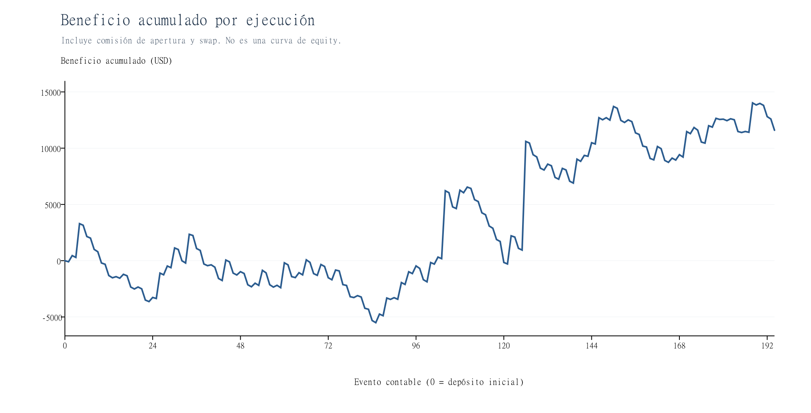
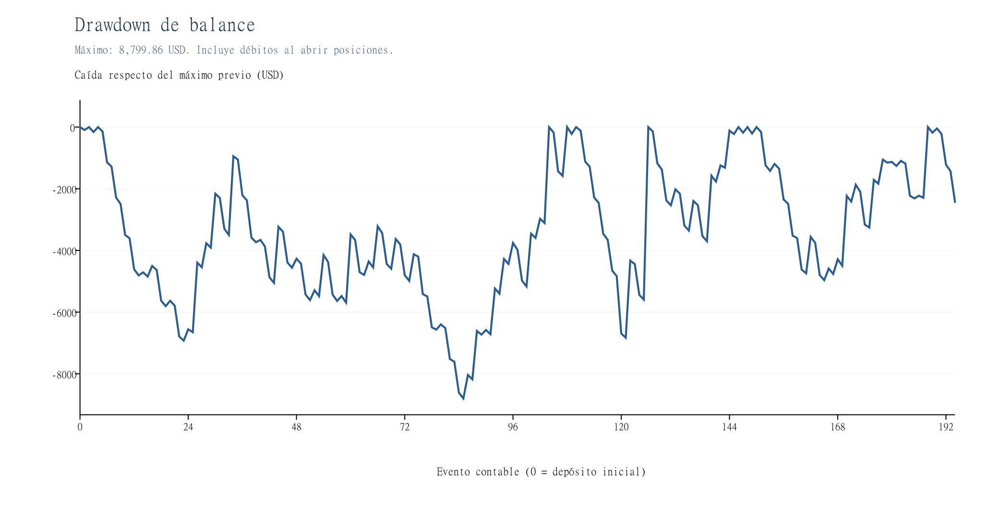
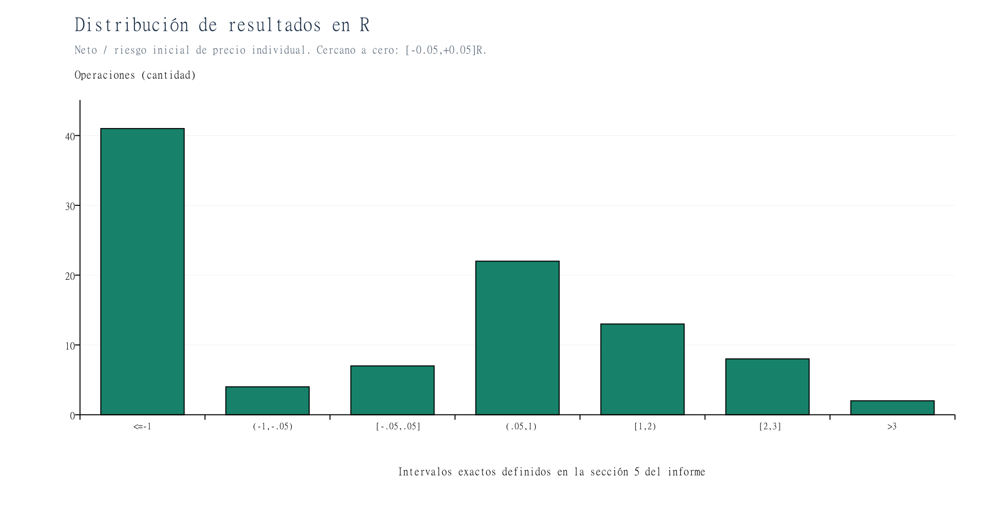
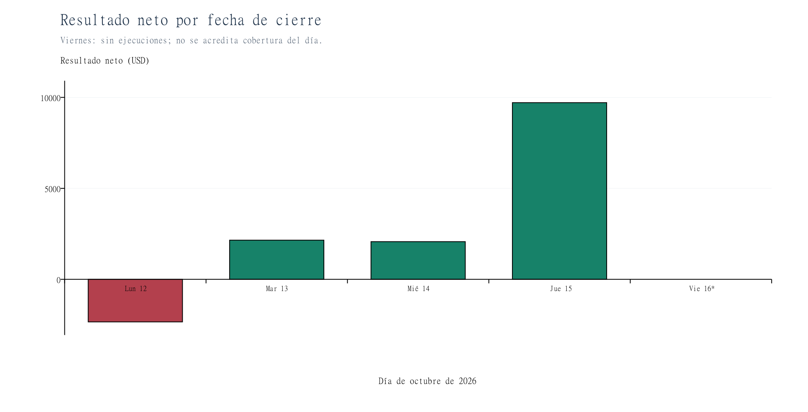
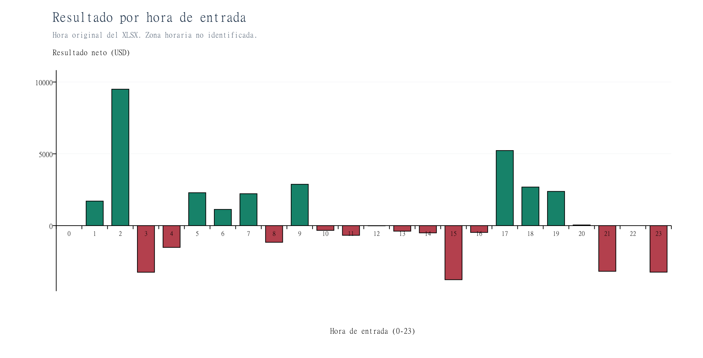
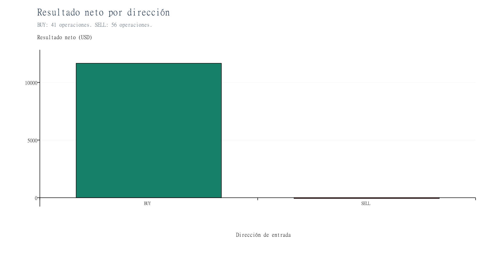
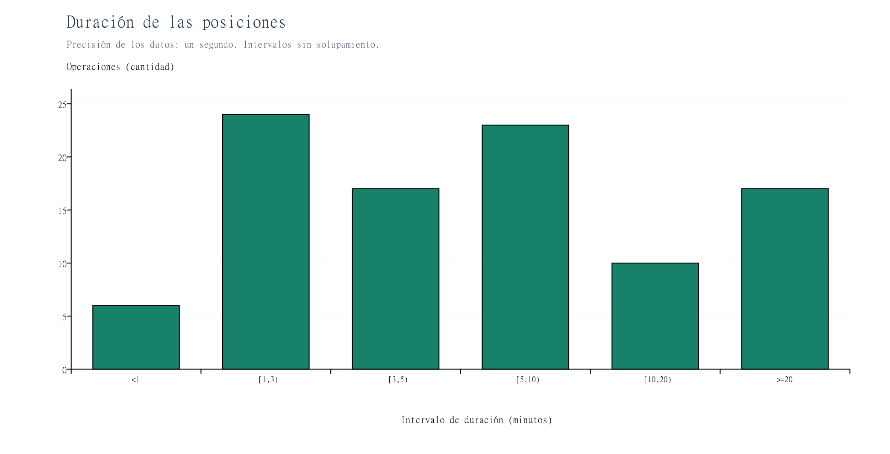
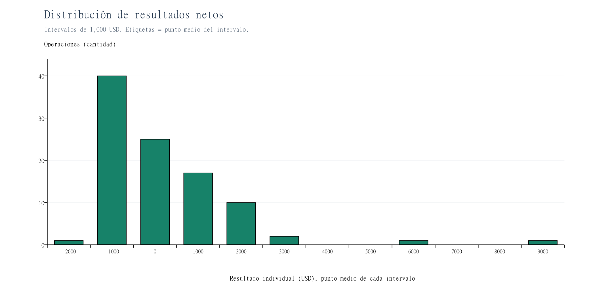
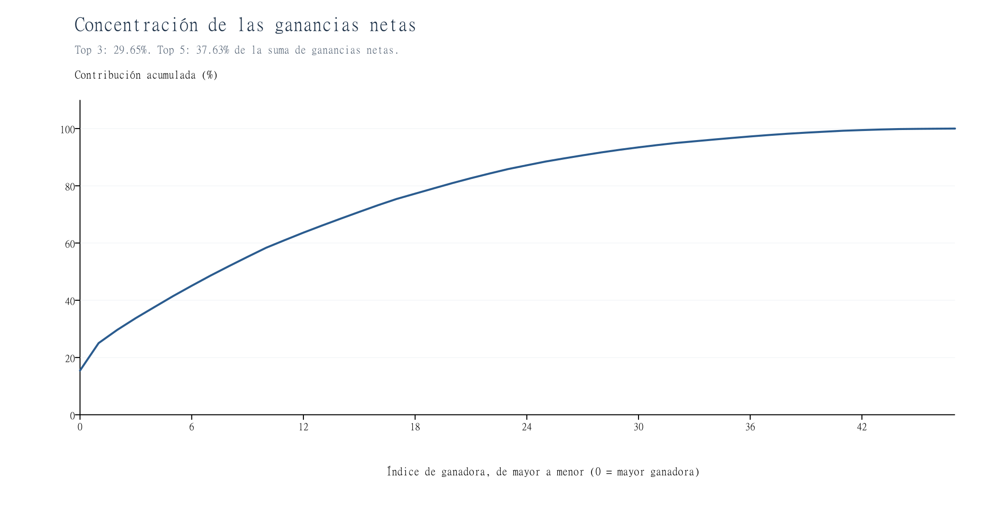

# Informe cuantitativo — EMA200 Mean Reversion M1

Fecha de elaboración: 17/10/2026. Fuente única de resultados: `ReportTester-26316626.xlsx`, hoja `Sheet1`. Moneda: USD. Separadores del informe: coma decimal y punto de miles. No se modificaron el Excel, el EA ni los parámetros. El análisis describe esta muestra, sin optimización ni extrapolación de rendimientos.

## 1. Resumen ejecutivo

La muestra registrada obtuvo **USD 11.592,70 netos (+11,5927% sobre USD 100.000)** en **97 posiciones completas**. La esperanza observada fue **USD 119,51 por operación**, equivalente a **+0,11953R**, con un total de **+11,59437R**. El Profit Factor calculado sobre posiciones completas después de costes es **1,23231**.

Hay tres advertencias esenciales para interpretar esos números:

- **No están acreditados cinco días completos.** El encabezado dice `M1 (2026.10.12 - 2026.10.16)`, pero todas las ejecuciones corresponden al 12–15 de octubre. No hay operaciones del viernes ni una serie de ticks que permita establecer si fue simulado. El viernes no puede interpretarse como un día verificado sin señales.
- **Los costes cambian la clasificación.** Hay 48 ganadoras netas, 46 perdedoras y 3 breakeven. Las 56 rentables del resumen MT5 corresponden a resultados de salida antes de imputar la comisión de entrada.
- **La rentabilidad depende de la cola positiva.** Las tres mayores ganadoras aportan USD 18.235,70. Excluirlas como sensibilidad aritmética deja **−USD 6.643,00**. El jueves concentra el **83,76%** del neto observado.

El drawdown máximo de balance, incluyendo las comisiones en el instante de apertura, fue **USD 8.799,86 (8,5194%)**. MT5 informa un drawdown de equity mayor, **USD 9.839,86 (9,43%)**, que no se puede reconstruir con estos datos. La peor posición perdió **USD 2.038,74 (−2,03913R)**.

## 2. Validación del XLSX y reconstrucción

### Estructura y condiciones

Una sola hoja visible: `Sheet1`, rango ocupado `A1:N463`. No hay hojas ocultas ni imágenes. Contiene un gráfico de balance que referencia `A268:A462` y `L268:L462`, sin una serie intratrade adicional.

| Ubicación | Contenido |
|---|---|
| Filas 1–25 | Identificación y configuración |
| Filas 26–47 | Estadísticas agregadas MT5 |
| Filas 48–69 | Sin valores tabulares, área del gráfico |
| Filas 70–71 | Título y encabezado de órdenes |
| Filas 72–265 | 194 órdenes, todas `filled` |
| Filas 266–267 | Título y encabezado de transacciones |
| Fila 268 | Depósito inicial; no es una operación |
| Filas 269–462 | 194 ejecuciones de mercado: 97 `in` y 97 `out` |
| Fila 463 | Totales de comisión, swap, beneficio y balance |

El experto es `EMA200_MeanReversion_M1_V1`, instrumento EURUSD, servidor `FivePercentOnline-Real (Build 6230)`, empresa Five Percent Online Ltd, divisa USD, apalancamiento 1:100 y depósito inicial USD 100.000. El resumen declara `100% ticks reales`, 5.720 barras y 477.853 ticks. Es una declaración del probador; el XLSX no contiene esos ticks para auditarlos. La zona horaria no figura y no se convierte a UTC−3.

Parámetros exportados:

```text
EMA_Period=200
MinBodyPercent=80.0
MinCandleRangePips=2.0
MaxCandleRangePips=0.0
RiskPercent=1.0
FixedInitialBalance=0.0
UseSpreadFilter=true
MaxSpreadPips=1.0
TrailingActivationRR=1.0
TrailingDistanceRR=1.0
MaxOpenPositions=1
MagicNumber=2001501001
MaxSlippagePoints=10
EnableDebugLogs=false
ExportTradesCSV=false
```

El timeframe M15 de la EMA, la verificación de las velas y la ausencia de filtros de sesión no se pueden demostrar con estos parámetros y ejecuciones. Son reglas declaradas por el usuario, pendientes de validación con registros de señales. `FixedInitialBalance=0.0` no identifica por sí solo la implementación de la base de riesgo; las cantidades reconstruidas sí son compatibles con USD 1.000 por operación antes de comisión.

### Órdenes, ejecuciones y posiciones

Una orden es una instrucción, un deal es su ejecución y una posición completa reúne los flujos de entrada y salida. Se enlazaron deals con órdenes mediante el campo `Orden`; no se contó cada deal como un trade. El archivo no exporta identificador de posición. Por ello se reconstruyeron episodios de exposición, comprobando secuencialmente que cada entrada encuentre una única salida posterior, con igual símbolo, volumen y dirección opuesta, antes de la siguiente entrada. Las 97 parejas son inequívocas bajo los registros disponibles: no hay solapamientos, reversiones, entradas múltiples, cierres parciales ni posiciones sin cerrar. El ID del CSV es analítico, no un ticket de posición MT5.

Se comprobaron 194 IDs de deal únicos y 194 órdenes únicas, volúmenes solicitados/ejecutados iguales, horas y direcciones concordantes entre órdenes y deals, orden cronológico, duraciones no negativas y ausencia de depósitos/retiros adicionales. Todos los cierres contienen comentario `sl <precio>`; no hay comentarios de cierre forzado al finalizar. Las entradas ocurren entre 12/10 01:01:00 y 15/10 19:58:01; la última salida es 15/10 20:04:50. Una posición cruza medianoche.

Se inspeccionaron también las fórmulas: I463 y J463 contienen sumas de comisión y swap, y sus valores guardados concuerdan con la suma independiente de los registros. No se detectaron celdas de error Excel.

El balance se reprodujo en **cada uno de los 194 eventos**: balance previo + beneficio + comisión + swap = balance exportado. Diferencia máxima numérica inferior a USD 0,000001. El precio de las órdenes de mercado aparece como 0: no es un precio solicitado utilizable para medir slippage de entrada. Los precios efectivos se toman de los deals. Los campos T/P están vacíos.

### Conciliación con MT5

| Concepto | Reconstrucción | MT5 | Lectura |
|---|---:|---:|---|
| Posiciones completas | 97 | 97 | Coincide |
| Deals de trading | 194 | 194 | Excluye depósito |
| Suma de beneficios de precio | 27.005,69 | 27.005,69, K463 | Coincide |
| Comisión | −14.982,64 | −14.982,64, I463 | Coincide |
| Swap | −430,35 | −430,35, J463 | Coincide |
| Beneficio neto | 11.592,70 | 11.592,70, D29 | Coincide |
| Balance final | 111.592,70 | 111.592,70, L463 | Coincide |
| Payoff | 119,512371 | 119,512371, H33 | Coincide |
| Drawdown absoluto de balance | 5.507,66 | 5.507,66, H29 | Coincide |
| Drawdown máximo de balance | 8.799,86; 8,5194% | 8.799,86; 8,52%, H30 | Coincide al redondear |

El resumen muestra beneficio bruto 69.734,47 y pérdidas brutas −58.141,77. Se reconcilian así: **69.734,47** son los beneficios positivos de precio; **−58.141,77 = −42.728,78 de pérdidas de precio −430,35 de swap −14.982,64 de comisiones**. Ese agregado no equivale a sumar solamente las posiciones que terminaron negativas después de todos los costes.

El PF publicado **1,199387 = 69.734,47 / 58.141,77** se reproduce. La clasificación publicada de 56 rentables y 41 no rentables, los porcentajes BUY 53,66% y SELL 60,71%, el máximo 9.653,46, el mínimo −1.864,86 y los promedios +1.245,258393/−1.052,661707 se reproducen usando **beneficio de salida + swap, sin comisión de entrada**. Por eso difieren de las métricas netas del informe. No es una diferencia en el beneficio total ni una prueba de corrupción del archivo.

Las rachas publicadas se reproducen en esa misma base: seis ganancias consecutivas que suman 7.576,49 y cinco pérdidas consecutivas que suman −5.864,45. Con costes por posición cambian las sumas y algunos componentes de las rachas. Las duraciones mínima 17 s y máxima 3.947 s coinciden; la media exacta es 639,619 s frente a los 639 s mostrados por MT5, diferencia inferior a un segundo atribuible a la presentación entera.

El Recovery Factor de MT5, **1,178137**, concilia con neto / drawdown de equity informado. No se valida independientemente el drawdown de equity, Sharpe 16,833066, Z-score, AHPR/GHPR ni las correlaciones MFE/MAE: faltan series y/o convenciones de cálculo suficientes. No se usan para afirmar una ventaja estadística.


## 3. Estadísticas generales

Importes en USD salvo indicación contraria. Ganadora: neto > 0; perdedora: neto < 0; breakeven: neto exactamente 0,00 a la precisión monetaria del archivo. No se excluyen los breakeven del denominador del win rate.

| Métrica | Valor |
|---|---|
| Operaciones completas | 97 |
| Ganadoras / perdedoras / breakeven netas | 48 / 46 / 3 |
| Win rate sobre todas las posiciones | 49,48% |
| Suma de ganadoras netas (beneficio bruto agregado neto de costes) | 61.494,54 |
| Suma de perdedoras netas | -49.901,84 |
| Resultado de precio, antes de comisión y swap | 27.005,69 |
| Beneficio neto | 11.592,70 |
| Balance final | 111.592,70 |
| Profit Factor de posiciones netas | 1,23231 |
| Ganancia media ganadora | 1.281,14 |
| Pérdida media perdedora (magnitud) | 1.084,82 |
| Ganancia media / pérdida media | 1,1810 |
| Payoff / esperanza por posición | 119,51 |
| Mejor / peor posición neta | 9.499,62 / −2.038,74 |
| Mayor racha ganadora | 6 posiciones; +4.852,92 |
| Mayor racha perdedora | 5 posiciones; peor racha de esa longitud −6.696,49 |
| Drawdown absoluto: depósito menos mínimo balance | 5.507,66 (5,5077% del depósito) |
| Drawdown máximo entre máximo y mínimo posteriores | 8.799,86 (8,5194% del máximo previo) |
| Recovery Factor sobre balance | 1,31737 |
| Recovery Factor sobre equity informado | 1,17814 |

El drawdown máximo se mide desde el balance 103.292,20 del 12/10 09:34:00 hasta 94.492,34 del 14/10 16:23:00, justo después de pagar una comisión de entrada. Medir solo posiciones al cierre omitiría esa comisión temporalmente y daría USD 8.609,42. “Drawdown absoluto” y “máximo drawdown monetario” son conceptos distintos y se presentan por separado. La secuencia de balance incorpora flujos realizados, no ganancias/pérdidas flotantes. Los breakeven interrumpen rachas.



La curva termina positiva después de atravesar un mínimo inferior al depósito. Los saltos incluyen comisiones al abrir y resultados al cerrar.



El drawdown de balance alcanza USD 8.799,86; el riesgo intratrade puede ser mayor, como sugiere el agregado de equity de MT5.


## 4. Esperanza matemática y evaluación estadística

Con pérdida media expresada como magnitud positiva:

`E = (48/97 × 1.281,13625) − (46/97 × 1.084,822609) = +119,512371 USD por operación`.

Los tres breakeven aportan cero. La suma neta / 97 produce el mismo resultado. La esperanza observada es positiva; no es una predicción de la próxima operación ni prueba de estabilidad futura. La relación de ganancia/pérdida media es 1,1810: una tasa de acierto inferior al 50% puede coexistir con neto positivo porque las ganancias medias superan las pérdidas medias.

Como referencia exclusivamente descriptiva, un intervalo t aproximado al 95% para la media, **si las 97 posiciones fueran independientes e idénticamente distribuidas**, sería **[-211,47; 450,49] USD por operación**. Se usa media ± 1,985 × desviación muestral / √97. Incluye cero. La dependencia temporal, la asimetría y apenas cuatro fechas con ejecuciones debilitan esas condiciones: este intervalo no establece una confianza robusta sobre el sistema. No se interpreta el Sharpe exportado como evidencia concluyente.

Los cortes por hora, día, dirección y duración son exploratorios, con múltiples comparaciones sobre los mismos datos. Una hora con un solo trade no caracteriza una distribución. Tampoco hay un período fuera de muestra ni variedad suficiente de regímenes. Las conclusiones sobre horarios persistentes, superioridad BUY y funcionamiento óptimo del trailing serían estadísticamente débiles.

## 5. Resultados expresados en R

### Definición y trazabilidad

Se usa **R inicial de precio**, en USD: distancia entre el precio ejecutado de entrada y el SL de la orden de apertura × volumen × factor monetario. El SL proviene de H72:H265, enlazado a cada entrada; no se utiliza el SL final del comentario como riesgo inicial.

`R_i = abs(entrada_i − SL_orden_entrada_i) × lotes_i × 100.000`.

El factor 100.000 USD por unidad de precio y lote **no figura como especificación contractual**. Se infiere de los propios precios y beneficios y se valida en las **97 posiciones**, reproduciendo su beneficio de precio al centavo mediante `signo × (salida − entrada) × lotes × 100.000`. Esta consistencia interna permite la reconstrucción monetaria sin asignar USD 1.000 automáticamente. Falta una especificación del símbolo y un snapshot de la posición para una auditoría independiente del contrato y del SL efectivamente aceptado en cada instante.

Los R individuales varían entre **999,46 y 1.000,00 USD**, media **999,86423**. Esta definición corresponde a la distancia usada por el trailing descrito y **excluye comisión, swap futuro y desviación de ejecución**. El resultado del numerador sí incorpora todos los costes disponibles: `ResultadoR = neto_i / R_i`. Por eso una pérdida al SL puede superar −1R sin que el riesgo de precio fuera superior a USD 1.000.

Para evitar confundir riesgo de precio con pérdida monetaria total, el CSV incluye también `riesgo_con_comision_usd = R_i + comisión observada en magnitud` y `resultado_r_con_comision`. Este denominador alternativo varía entre 1.067,22 y 1.235,22 USD. Su suma de resultados es **10,35123**, media **0,10671**. Es una sensibilidad de definición; no incorpora swap futuro ni garantías de ejecución al stop. No se mezcla con las tablas principales en R.

| Métrica en R inicial de precio | Valor |
|---|---:|
| Resultado acumulado | +11,59437R |
| Esperanza media | +0,11953R |
| Ganancia media entre ganadoras netas | +1,28131R |
| Pérdida media entre perdedoras netas | −1,08496R |
| Mejor / peor | +9,50000R / −2,03913R |
| Drawdown de suma acumulada al cierre | 8,61086R |
| Cercanas a −1R, intervalo [−1,05;−0,95] | 0 |
| Cercanas a cero, intervalo [−0,05;+0,05] | 7 |
| Estrictamente > +1R / +2R / +3R / +5R | 22 / 9 / 2 / 2 |

Los umbrales se comparan redondeando R a ocho decimales para evitar clasificar un +1R exacto como superior por aritmética binaria. La operación ID 75 tiene +1R exacto. Los conteos de superación son acumulativos, no intervalos excluyentes. El drawdown en R corresponde a suma de R individuales al cierre, no es drawdown de equity ni una simple división del drawdown USD por 1.000. Los 33 resultados de **precio antes de costes** cercanos a −1R se desplazan a pérdidas más negativas al incluir costes.

Distribución sin solapamiento; el grupo “cerca de cero” absorbe su zona y se resta de los intervalos contiguos:

| Intervalo R neto | Trades | Neto USD | Suma R |
|---|---|---|---|
| ≤−1R | 41 | -49.556,53 | -49,56296 |
| (−1,−0.05)R | 4 | -299,86 | -0,29988 |
| [−0.05,+0.05]R | 7 | 63,63 | 0,06364 |
| (+0.05,+1)R | 22 | 9.550,30 | 9,55148 |
| [+1,+2)R | 13 | 17.905,67 | 17,90886 |
| [+2,+3]R | 8 | 18.533,79 | 18,53668 |
| >+3R | 2 | 15.395,70 | 15,39655 |


La distribución combina 41 pérdidas de al menos 1R neto con una cola positiva extensa. Solo dos posiciones superan 3R y ambas también superan 5R.


## 6. Trailing stop: evidencia y límites

Las 97 salidas presentan comentario de SL. Comparando el nivel del comentario final con el SL de la orden inicial y respetando la dirección:

| Hecho verificable en el reporte | Cantidad |
|---|---:|
| SL final mejorado respecto al inicial | 56 (57,73%) |
| SL final igual al inicial | 41 (42,27%) |
| Ganancia neta entre las 56 con mejora | 48 |
| Breakeven neto entre las 56 con mejora | 3 |
| Pérdida neta entre las 56 con mejora | 5 |
| Pérdida neta entre las 41 sin mejora | 41 |

Los 56 cierres con stop mejorado son **compatibles** con actividad del trailing. No se equipara automáticamente el 57,73% a una tasa de activación comprobada en +1R. El archivo carece del momento de activación, del máximo recorrido favorable y del historial de modificaciones/retcodes. No demuestra que el precio hubiese alcanzado exactamente +1R antes de la primera modificación, ni que la distancia se mantuviera en 1R tick a tick, ni que el SL nunca retrocediera. Un SL final igual al inicial tampoco prueba que nunca se intentara activar un trailing.

La cantidad exacta que alcanzó +1R, la que no lo alcanzó y el porcentaje de activación **no son determinables**. Sí hay una cota parcial observable: 24 cierres tienen beneficio de **precio** de al menos 1R, por lo que su desplazamiento entre ejecuciones evidencia al menos ese recorrido al cierre. Esto no sustituye MFE ni acredita la lógica de activación. Los demás pueden haber alcanzado +1R y devuelto parte del recorrido, o no haberlo alcanzado.

Los 41 cierres al nivel inicial son compatibles con pérdida por SL inicial; las desviaciones entre el nivel del comentario y la ejecución pueden agravarla. Los cinco resultados netos negativos pese al SL mejorado muestran por qué proteger el precio de entrada no garantiza proteger el capital después de costes. El breakeven neto tampoco equivale a SL en entrada.

### Eficiencia y captura de movimiento

No se puede calcular MFE, MAE, porcentaje capturado (`beneficio final/MFE`) ni beneficio devuelto (`MFE−beneficio final`) por operación. Solo constan tres correlaciones agregadas: Profit/MFE 0,991203; Profit/MAE 0,576684; MFE/MAE 0,514947. No permiten invertir el cálculo para recuperar los extremos individuales. Tampoco se estima MFE sumando 1R al beneficio final, porque eso presupondría que el trailing funcionó sin saltos ni restricciones.

Faltan Bid/Ask intratrade con tiempo, extremos favorables/adversos en la convención correcta para cada dirección, SL inicial aceptado, cada solicitud y aceptación de modificación y los errores/restricciones del bróker. La clasificación realizada de resultados está en la sección 5; es independiente de cualquier conjetura sobre la trayectoria.


## 7. Resultados por día

Se agrupan posiciones por **fecha de cierre**, imputando toda su comisión de entrada al día del cierre para medir trades completos.

| Día | Trades | Win rate | Neto USD | PF neto | Suma R | DD diario USD | DD diario % |
|---|---|---|---|---|---|---|---|
| Lunes 12 | 9 | 33,33% | -2.339,83 | 0,599 | -2,34028 | 5.632,03 | 5,45% |
| Martes 13 | 21 | 47,62% | 2.151,80 | 1,218 | 2,15238 | 4.742,84 | 4,63% |
| Miércoles 14 | 29 | 55,17% | 2.070,64 | 1,133 | 2,07003 | 5.582,80 | 5,58% |
| Jueves 15 | 38 | 50,00% | 9.710,09 | 1,520 | 9,71225 | 4.964,67 | 4,37% |
| Viernes 16* | 0 | N/D | 0,00 | N/D | 0,00000 | N/D | N/D |

*Viernes: cero ejecuciones registradas y contribución observada cero, pero cobertura de mercado no acreditada; no se afirma que el EA haya estado funcionando ese día. Su DD no es evaluable. El CSV de agregados contiene 0 para variación de una secuencia vacía: no debe interpretarse como medición de riesgo del viernes.*

El DD diario se calcula con la secuencia real de balance por deal del día, arrancando en el balance contable del cierre anterior y reiniciando el máximo diario. Por ello no se obtiene sumando las posiciones agrupadas al cierre. La operación ID 60 abre el miércoles y cierra el jueves: su comisión de USD 173,88 se cobra el miércoles. Las variaciones contables reales son **+1.896,76 el miércoles y +9.883,97 el jueves**, frente a +2.070,64 y +9.710,09 por atribución al cierre. Lunes y martes coinciden en ambas bases. No se mezcla ese DD con una curva de equity.

El jueves fue el más rentable y el de mayor actividad (38 trades). El lunes fue el menos rentable, el único con pérdida neta diaria y el de mayor DD diario (USD 5.632,03). El miércoles tuvo el mayor win rate neto (55,17%). La contribución al neto total fue: lunes −20,18%, martes +18,56%, miércoles +17,86%, jueves +83,76%. Excluir aritméticamente el jueves deja **+USD 1.882,61**: el resultado no se vuelve negativo, pero pierde la mayor parte de su magnitud. Hasta el martes el acumulado era −USD 188,03; el mínimo intradía de balance se produjo el miércoles.



El jueves concentra el 83,76% del neto. La barra vacía del viernes indica ausencia de ejecuciones, no cobertura comprobada.


## 8. Resultados por hora de entrada

Franjas [hh:00:00, hh+1:00:00), según hora original del archivo, **zona horaria desconocida**. No se asignan sesiones Londres/Nueva York ni se realizan conversiones.

| Hora | Trades | Win rate % | Neto USD | Media USD | PF neto | Media R |
|---|---|---|---|---|---|---|
| 00 | 0 | N/D | 0,00 | N/D | N/D | N/D |
| 01 | 3 | 66,67 | 1.707,83 | 569,28 | 2,537 | 0,56931 |
| 02 | 1 | 100,00 | 9.499,62 | 9.499,62 | Sin pérdidas | 9,50000 |
| 03 | 4 | 25,00 | -3.245,58 | -811,39 | 0,100 | -0,81146 |
| 04 | 3 | 33,33 | -1.516,27 | -505,42 | 0,345 | -0,50550 |
| 05 | 3 | 66,67 | 2.291,29 | 763,76 | Sin pérdidas | 0,76389 |
| 06 | 1 | 100,00 | 1.129,11 | 1.129,11 | Sin pérdidas | 1,12963 |
| 07 | 1 | 100,00 | 2.221,60 | 2.221,60 | Sin pérdidas | 2,22222 |
| 08 | 2 | 0,00 | -1.160,00 | -580,00 | 0,000 | -0,58000 |
| 09 | 5 | 80,00 | 2.878,73 | 575,75 | 3,322 | 0,57576 |
| 10 | 6 | 50,00 | -329,40 | -54,90 | 0,905 | -0,05481 |
| 11 | 8 | 50,00 | -672,68 | -84,08 | 0,857 | -0,08407 |
| 12 | 6 | 50,00 | -12,22 | -2,04 | 0,996 | -0,00207 |
| 13 | 3 | 33,33 | -384,00 | -128,00 | 0,842 | -0,12815 |
| 14 | 5 | 40,00 | -503,49 | -100,70 | 0,675 | -0,10072 |
| 15 | 10 | 40,00 | -3.765,07 | -376,51 | 0,474 | -0,37655 |
| 16 | 11 | 63,64 | -472,76 | -42,98 | 0,863 | -0,04302 |
| 17 | 7 | 71,43 | 5.228,89 | 746,98 | 5,093 | 0,74723 |
| 18 | 6 | 50,00 | 2.686,00 | 447,67 | 3,035 | 0,44771 |
| 19 | 4 | 25,00 | 2.383,15 | 595,79 | 1,678 | 0,59577 |
| 20 | 2 | 50,00 | 46,69 | 23,34 | 1,033 | 0,02335 |
| 21 | 4 | 25,00 | -3.180,00 | -795,00 | 0,080 | -0,79511 |
| 22 | 0 | N/D | 0,00 | N/D | N/D | N/D |
| 23 | 2 | 0,00 | -3.238,74 | -1.619,37 | 0,000 | -1,61956 |

“Sin pérdidas” significa denominador de PF cero, no una estimación finita fiable. N/D en filas sin trades. La franja 02 tiene el mayor neto, **USD 9.499,62**, pero corresponde a una sola posición. La franja 17 aporta **USD 5.228,89**, con 7 posiciones y 71,43% de aciertos; la franja 09 aporta USD 2.878,73, con 5 posiciones y 80%. Las mayores pérdidas agregadas aparecen a las 15 (−3.765,07, 10 trades), 03 (−3.245,58, 4), 23 (−3.238,74, 2) y 21 (−3.180,00, 4).

La hora 16 tiene la mayor actividad (11 trades) y 63,64% de aciertos, pero pierde USD 472,76: frecuencia de acierto y rentabilidad no son equivalentes. Son descripciones de esta muestra, muy sensibles a unas pocas operaciones; no justifican filtros horarios. Las franjas 00 y 22 no tienen entradas registradas.



La aparente superioridad de las 02 proviene de un solo trade. Los tamaños por hora se muestran en la tabla para evitar interpretar barras como patrones persistentes.


## 9. BUY vs SELL

| Dirección | Trades | Win rate % | Neto USD | PF | Ganancia media USD | Pérdida media USD | Esperanza USD | Media R | Mejor USD | Peor USD |
|---|---|---|---|---|---|---|---|---|---|---|
| BUY | 41 | 48,78 | 11.658,16 | 1,5055 | 1.735,96 | 1.153,05 | 284,35 | 0,28434 | 9.499,62 | -2.038,74 |
| SELL | 56 | 50,00 | -65,46 | 0,9976 | 956,26 | 1.032,34 | -1,17 | -0,00113 | 2.541,00 | -1.374,78 |

BUY aporta **USD 11.658,16**, más que el neto total, mientras SELL resta **USD 65,46**. Las compras tienen menor win rate y ganancias medias mayores. Las dos ganancias más grandes son BUY y suman USD 15.395,70; sin ellas el subtotal BUY sería **−USD 3.737,54**. La diferencia observada entre direcciones está fuertemente influida por esas posiciones y por las condiciones del período. No acredita superioridad estructural ni justifica desactivar SELL.



El beneficio agregado procede de BUY, pero su resultado depende de dos operaciones excepcionales en esta muestra.


## 10. Duración de operaciones

Se resta timestamp de apertura a timestamp de cierre, con precisión de **segundos**, sin inferir milisegundos.

| Grupo | Mínima | Media | Mediana | Máxima |
|---|---:|---:|---:|---:|
| Todas | 17 s | 639,62 s (10 min 39,62 s) | 305 s (5 min 5 s) | 3.947 s (1 h 5 min 47 s) |
| Ganadoras netas | 72 s | 819,50 s | 359,50 s | 3.947 s |
| Perdedoras netas | 17 s | 401,22 s | 254 s | 2.040 s |
| Breakeven netas | 390 s | 1.417 s | 1.622 s | 2.239 s |

| Duración | Trades | Win rate % | Neto USD | Media USD | PF neto |
|---|---|---|---|---|---|
| <1 min | 6 | 0,00 | -7.105,63 | -1.184,27 | 0,000 |
| [1,3) min | 24 | 54,17 | -1.783,75 | -74,32 | 0,833 |
| [3,5) min | 17 | 41,18 | -7.550,53 | -444,15 | 0,348 |
| [5,10) min | 23 | 47,83 | -991,54 | -43,11 | 0,910 |
| [10,20) min | 10 | 60,00 | 3.402,79 | 340,28 | 1,699 |
| ≥20 min | 17 | 64,71 | 25.621,36 | 1.507,14 | 6,519 |

Los intervalos son cerrados a izquierda y abiertos a derecha; el último incluye exactamente 20 minutos. Las seis operaciones de menos de un minuto fueron pérdidas. Las de 20 minutos o más aportaron USD 25.621,36; los demás grupos en conjunto perdieron USD 14.028,66. La correlación de rangos de Spearman entre duración y neto es **+0,28158**: asociación positiva moderada/baja en esta muestra, no relación causal ni justificación para imponer una duración. La duración se conoce después del cierre y depende del recorrido que también determina la ganancia; seleccionar por ella retrospectivamente introduce sesgo.



Las operaciones son generalmente breves, con una cola de permanencias largas que contiene gran parte del beneficio.


## 11. Distribución y concentración

| ID analítico | Orden entrada | Apertura | Dirección | Neto USD | R |
|---|---|---|---|---|---|
| 63 | 126 | 2026-10-15 02:07:00 | BUY | 9.499,62 | 9,50000 |
| 52 | 104 | 2026-10-14 19:33:01 | BUY | 5.896,08 | 5,89655 |
| 2 | 4 | 2026-10-12 09:12:00 | BUY | 2.840,00 | 2,84000 |
| 94 | 188 | 2026-10-15 17:44:00 | SELL | 2.541,00 | 2,54237 |
| 61 | 122 | 2026-10-15 01:19:00 | BUY | 2.366,43 | 2,36667 |

Las tres mayores ganadoras netas suman **USD 18.235,70**, el **29,65%** de los USD 61.494,54 de ganancias netas positivas y el **157,30%** del resultado neto total. Las cinco mayores suman **USD 23.143,13**, el **37,63%** de las ganancias netas positivas y el **199,64%** del neto.

Para comparar estrictamente con el “beneficio bruto” MT5 antes de comisiones: esas tres operaciones aportan USD 18.687,46 de precio, **26,80%** de 69.734,47; las cinco aportan USD 23.795,97, **34,12%**. Se indican ambos denominadores para no mezclar beneficios netos con brutos.

Se define ganancia pequeña como **0 < resultado < 1R**, sin incluir +1R exacto. Hay **25**, suman **USD 9.659,38**, un **15,71%** de la suma de ganadoras netas. Las 41 pérdidas de al menos 1R suman **−USD 49.556,53**, el **99,31%** de la pérdida neta agregada. Las cinco peores suman −USD 7.435,67 (14,90% de esa pérdida).

Excluir las tres mayores ganadoras deja **−USD 6.643,00**; excluir solo la mayor deja **+USD 2.093,08**. La segunda mayor también es material. Este ejercicio elimina términos de la suma original: **no es un nuevo backtest**, no simula nuevas entradas, margen ni efectos de trayectoria.

El resultado combina muchas ganancias pequeñas con ganancias medianas y dos ganancias muy grandes. Las pequeñas no compensan por sí mismas las pérdidas. La posibilidad de sostener recorridos largos es compatible con una salida sin TP y trailing, pero no prueba que la distancia elegida capture el movimiento de forma eficiente. Para esa conclusión hace falta MFE.



La distribución es asimétrica: pérdidas concentradas alrededor del riesgo más costes y una cola derecha que llega a USD 9.499,62.



Las tres mayores aportan 29,65% de las ganancias positivas netas y superan el beneficio neto total. El denominador es la suma de ganadoras, no el neto.


## 12. Riesgo, costes y ejecución

Los lotes varían entre **16,94 y 58,82**, media **38,61505**, mediana **40,00**. La distancia inicial al SL varía entre **1,7 y 5,9 pips**, media **2,82371**, mediana **2,5**. Se usa 1 pip = 0,0001 para EURUSD. La distancia entrada–SL **no es** el rango de la vela gatillo: un stop inferior a 2 pips no demuestra incumplimiento del filtro de rango de vela.

La comisión es **USD 4 por lote**, cargada al entrar en las 97 operaciones, sin comisión adicional al salir. Su total es USD 14.982,64, media USD 154,46 por trade, entre USD 67,76 y 235,28. Representa **6,78%–23,53% de R**, media **15,45%**. El único swap, **−USD 430,35**, pertenece a la posición ID 60 que cruza medianoche. No se inventa un swap para posiciones sin cargo.

Comisión + swap totalizan **USD 15.412,99**, **57,07%** de los USD 27.005,69 de resultado de precio previo a esos costes. La comisión sola representa **55,48%** de ese resultado; el swap, **1,59%**. Los costes explícitos equivalen a **22,10%** del beneficio positivo de precio de USD 69.734,47. El spread ya influye en los precios ejecutados y no se resta otra vez. No hay snapshots de spread que permitan aislar su coste o auditar el filtro `MaxSpreadPips=1.0`.

Hay **41 pérdidas netas superiores a su R de precio**; las 41 cierran con SL final igual al inicial. En **15 posiciones**, incluso la pérdida de precio antes de costes supera el riesgo inicial (tolerancia 0,01 USD). En **30 de 97 salidas** la ejecución es peor que el nivel del comentario SL; en 67 coincide. La desviación adversa máxima es **1,1 pips**. La suma monetaria de esas desviaciones, calculada contra el nivel SL del comentario, es **2.579,88 USD**. Es una descomposición de los precios ya registrados, **no un coste adicional para volver a restar** ni una medición de slippage de entrada. El reporte no permite atribuirla a latencia, gap, spread o una falla de código.

La peor posición, **ID 60 / orden de entrada 120**, BUY de 43,47 lotes, entra el 14/10 23:31:00 a 1,11558 y sale el 15/10 00:05:00 a 1,11525; SL inicial y final comentado 1,11535. Riesgo de precio: USD 999,81. Pérdida de precio: USD 1.434,51; comisión: USD 173,88; swap: USD 430,35; neto: **−USD 2.038,74**. El deterioro de 1 pip respecto del SL equivale a USD 434,70. La pérdida neta se explica aritméticamente por riesgo inicial + desviación + comisión + swap. No demuestra por sí sola un error del trailing.

La máxima desviación de 1,1 pips corresponde a **ID 38 / orden 76**, SELL, SL 1,11988 y salida 1,11999. Es un evento a investigar, sin asumir que `MaxSlippagePoints=10` garantice la ejecución de un SL dentro de ese límite. No se puede validar cómo se aplicó ese parámetro.

El nivel de margen mínimo que informa MT5 es **158,83%**; no hay serie de margen para auditarlo. Los grandes volúmenes resultan de combinar riesgo nominal fijo y stops estrechos. Esta muestra acredita exposición a costes y desviaciones significativos en proporción a R; no acredita la capacidad de ejecutar esos volúmenes con idénticas condiciones fuera del probador.

## 13. Datos disponibles y limitaciones

| Variable | Estado en este XLSX | Alcance |
|---|---|---|
| Cierre gatillo y EMA200 M15 | No disponible | No se puede medir distancia a EMA ni validar lado de señal |
| Distancia cierre gatillo–EMA | No disponible | Entrada ejecutada no sustituye cierre gatillo |
| OHLC y rango de vela | No disponible | No se verifica rango >2 pips |
| Porcentaje del cuerpo | No disponible | No se verifica cuerpo ≥80% ni color de vela |
| SL de orden de entrada | Disponible | Base de reconstrucción del riesgo, no historial de SL aceptado |
| Distancia ejecutada inicial–SL | Calculable | Precios de deal y orden vinculados |
| Riesgo monetario de precio | Calculable con factor monetario inferido y validado | Especificación contractual no exportada |
| Lotes y precios ejecutados | Disponible | Entrada y salida |
| Spread al entrar | No disponible | Un parámetro máximo no es un spread observado |
| Precio solicitado válido | No disponible | Precio de órdenes de mercado = 0 |
| Diferencia solicitado–ejecutado entrada | No calculable | Falta cotización/solicitud original |
| Diferencia SL comentado–salida | Calculable | No determina causa ni trayectoria intratrade |
| Hora apertura y cierre | Disponible | Segundos, zona horaria desconocida |
| Permanencia | Calculable | Diferencia entre timestamps |
| Comisión, swap, beneficio, balance | Disponible | Conciliados evento por evento |
| MFE y MAE individuales | No disponible | Solo correlaciones agregadas |
| Historial de modificaciones del SL | No disponible | No verifica activación ni monotonicidad |
| ID de posición nativo | No disponible | Episodios reconstruidos sin solapamiento |
| Equity tick a tick | No disponible | Solo drawdowns agregados de MT5 |
| Cobertura efectiva del viernes | No verificable | Encabezado no sustituye evidencia de ticks |

La relación estadística entre tamaño del stop y resultado puede estudiarse con el CSV, pero no debe rotularse como relación entre **tamaño de vela** y resultado. No se asignan valores proxy a EMA, rango de vela, MFE ni MAE. Las métricas de trailing que faltan quedan explícitamente sin calcular.

## 14. Conclusiones: evidencia, hipótesis y preguntas abiertas

### Lo que sabemos

Las 97 posiciones cierran y sus flujos reproducen el balance final. La muestra es rentable después de los costes exportados; la esperanza muestral es positiva. Los costes convierten ocho cierres rentables antes de comisión en cinco pérdidas y tres ceros netos. Hay concentración de ganancias, drawdown material y pérdidas por encima de R. BUY genera el neto positivo y SELL termina prácticamente plano. Los datos no acreditan cinco jornadas completas ni permiten medir eficiencia del trailing.

### Lo que sospechamos

La estructura de retornos sugiere que la estrategia necesita conservar algunos recorridos grandes para compensar muchas salidas pequeñas y pérdidas próximas al riesgo más costes. Los stops estrechos parecen hacer especialmente relevante la comisión y la desviación al ejecutar. El jueves y algunos horarios destacan, pero pueden reflejar movimientos concretos del mercado y variación muestral. Estas son hipótesis para contrastar, no reglas para incorporar ni configuraciones recomendadas.

### Lo que necesitamos investigar

La estabilidad del resultado en más períodos independientes, la concentración por régimen y la dependencia entre operaciones; la fidelidad de las señales respecto a EMA/velas; el riesgo calculado frente al aceptado; el recorrido MFE/MAE y todas las modificaciones del SL; los costes/quotes alrededor del rollover y de salidas adversas. Hace falta distinguir siempre ejecución real del probador, especificaciones del símbolo y expectativas declaradas del EA.

## 15. Próximos pasos y entregables

Orden de prioridad para el siguiente backtest, manteniendo la estrategia y los parámetros de esta etapa:

1. **Asegurar cobertura y reproducibilidad:** documentar hora/zona del servidor, inicio y fin efectivos con ticks, inclusión completa del viernes, versión exacta del EA, parámetros, símbolo, cuenta y método de simulación. Exportar journal y especificación del símbolo. No interpretar un rango de fechas como prueba suficiente de cobertura.
2. **Registrar trazabilidad:** IDs de posición, órdenes y deals; señal y OHLC M1; EMA M15 y timestamp de la barra utilizada; Bid/Ask; SL solicitado/aceptado; cálculo de riesgo y volumen antes/después del redondeo. Es una propuesta de instrumentación para una etapa posterior, no una modificación aplicada aquí.
3. **Auditar trailing:** guardar primer +1R, primer intento/aceptación, todos los cambios y rechazos, MFE/MAE con timestamps y cotización de salida apropiada. Medir captura y devolución sin inferirlos del resultado final.
4. **Ampliar evidencia sin optimizar:** repetir configuración congelada sobre un período sensiblemente más largo y bloques temporales separados, incluidos distintos regímenes; reservar una evaluación posterior fuera de muestra. Evaluar incertidumbre por bloques/días una vez haya suficientes bloques independientes.
5. **Reevaluar riesgo y concentración:** cuantificar costes/R, frecuencia y severidad de pérdidas >R, drawdown de equity y balance, dependencia de grandes ganadoras y estabilidad BUY/SELL/horarios. Las comparaciones de costes deben mantenerse separadas del backtest original y no confundirse con nuevas reglas.

Entregables: este informe, `Operaciones_Analizadas.csv` (97 filas, con tickets fuente, filas de origen y campos derivados explícitos), tablas diarias/horarias/dirección/duración/R, `Balance_Por_Deal.csv`, nueve gráficos PNG y `Datos_Faltantes.md`. Los CSV emplean coma como separador y punto decimal; UTF-8 con BOM. Los importes se calculan a centavos y los derivados en R se conservan con más decimales. Las fuentes SVG y scripts se conservan como soporte reproducible. `metricas_verificacion.json` registra controles y hash.

SHA-256 del Excel original, sin cambios:

`6a5098461ae5873e0bc7f050525a523e2e9d5621d9fe91878492fcd670a20180`

### Las cinco conclusiones más importantes

1. **Hubo beneficio observado:** USD 11.592,70 netos y +0,11953R por operación, con 48/97 ganadoras netas. Eso no establece una ventaja sostenible.
2. **La base temporal es más limitada de lo solicitado:** el archivo registra operaciones del 12 al 15; no demuestra cobertura del viernes 16 ni cinco días completos.
3. **Los costes son decisivos:** USD 15.412,99 de comisión y swap consumen 57,07% del resultado de precio; el riesgo nominal de USD 1.000 no limita la pérdida neta a ese importe.
4. **La cola positiva sostiene el resultado:** quitar las tres mayores ganadoras deja −USD 6.643,00; el jueves aporta 83,76% del neto y las dos mayores son BUY.
5. **El trailing deja evidencia parcial:** 56 stops finales mejorados, pero faltan activaciones, MFE/MAE e historial del SL para verificar sus reglas y medir eficiencia; el DD de balance fue 8,5194% y la peor posición −2,03913R.

### Las cinco preguntas para el próximo backtest

1. ¿Se simuló todo el intervalo previsto, incluido el último día, con zona horaria y cobertura de ticks verificables?
2. ¿La esperanza neta sigue siendo positiva en más bloques independientes y sin depender de unas pocas ganadoras excepcionales?
3. ¿Cuántas posiciones alcanzan realmente +1R, cuándo se acepta el primer movimiento del SL y cuánto MFE termina capturado o devuelto?
4. ¿Cómo se explican y distribuyen los costes y las pérdidas superiores a R, especialmente al cruzar medianoche y al ejecutar stops?
5. ¿Las diferencias BUY/SELL, por horario y por características de la señal se repiten fuera de muestra o desaparecen al ampliar el período?
