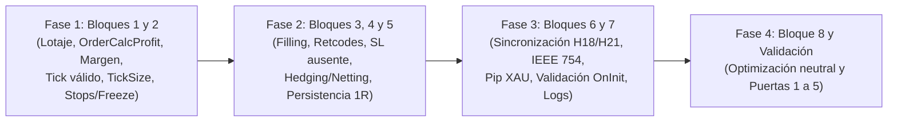

# Plan Consolidado de Corrección y Validación — `OneMinuteCandle_EA`

**Estado del proyecto:** Planificación técnica consolidada previa a implementación.  
**Restricción cumplida:** No se ha modificado [`OneMinuteCandle_EA.mq5`](file:///g:/Candle%20Behavior%20Research/OneMinuteCandle_EA.mq5), `OneMinuteCandle_EA.ex5`, [`README.md`](file:///g:/Candle%20Behavior%20Research/README.md), [`AUDITORIA_INTEGRAL_OneMinuteCandle_EA.md`](file:///g:/Candle%20Behavior%20Research/AUDITORIA_INTEGRAL_OneMinuteCandle_EA.md) ni [`SEGUNDA_AUDITORIA_OneMinuteCandle_EA.md`](file:///g:/Candle%20Behavior%20Research/SEGUNDA_AUDITORIA_OneMinuteCandle_EA.md).

---

## 1. Resumen Ejecutivo

Este documento consolida, depura y arbitra técnicamente los hallazgos de la primera auditoría (`H01`–`H32`) y de la segunda auditoría (`N01`–`N08`) sobre [`OneMinuteCandle_EA.mq5`](file:///g:/Candle%20Behavior%20Research/OneMinuteCandle_EA.mq5), contrastando cada afirmación contra el código fuente original, la biblioteca estándar instalada ([`Trade.mqh`](file:///C:/Users/Dany/AppData/Roaming/MetaQuotes/Terminal/10CE948A1DFC9A8C27E56E827008EBD4/MQL5/Include/Trade/Trade.mqh)) y la especificación oficial de MQL5.

### Conclusiones principales de la consolidación

1. **Defectos críticos y altos confirmados en código (requieren corrección obligatoria antes de cualquier prueba económica):**
   - **Violación del presupuesto de riesgo (`H01`, `H06`):** [`CalcularLotajePorRiesgo`](file:///g:/Candle%20Behavior%20Research/OneMinuteCandle_EA.mq5#L514-L530) impone `lotes = volMin` aunque supere el riesgo porcentual configurado y aplica una tabla de redondeo decimal (`digitosLote`) que rompe retículas como `0.25`, `1.5` o `< 0.001`.
   - **Valoración y margen incompletos (`H07`, `N02`):** Se utiliza `SYMBOL_TRADE_TICK_VALUE` (valor de tick para beneficio, no para pérdida) en lugar de `OrderCalcProfit()`, y no se comprueba el margen requerido (`OrderCalcMargin()` / `OrderCheck()`) ni `SYMBOL_VOLUME_LIMIT`, lo que en velas `M1` de rango estrecho (`2.5` pips) genera rechazos `TRADE_RETCODE_NO_MONEY` bajo apalancamientos estándar (`1:10` a `1:30`).
   - **Validación defectuosa de `StopsLevel` y `TickSize` (`H08`, `H09`, `H15`, `N04`):** El SL inicial se valida contra el lado equivocado del spread (`ask - slCompra` en vez de `bid - slCompra` para compras; `slVenta - bid` en vez de `slVenta - ask` para ventas), pudiendo incluso enviar `slCompra >= bid` cuando `StopsLevel == 0`. Además, los stops no se cuantizan a `SYMBOL_TRADE_TICK_SIZE`, y un candidato de Trailing Stop inválido por `StopsLevel` bloquea la aplicación de un Break Even válido (`H15`) o queda permanentemente inactivo (`N04`).
   - **Incompatibilidad con cuentas *Netting* (`H03`, `H04`):** El modelo de seguimiento por ticket individual y conteo filtrado por `POSITION_MAGIC` no soporta la agregación de posiciones ni protege exposiciones manuales/externas en cuentas *Netting*.
   - **Fragilidad en la confirmación de ejecución y persistencia de `1R` (`H10`, `H11`, `N03`, `N08`):** No se inspecciona `ResultRetcode()`, se asume que `ResultPrice()` contiene siempre el precio de fill, el comentario `"OMC|R:"` almacena el `1R` previo al envío mientras la memoria intenta almacenar el posterior al fill, y el respaldo por distancia actual (`MathAbs(precioApertura - slActual)`) puede corromper `1R` tras un reinicio si el SL ya fue movido.
   - **Pérdida de señales y falta de tolerancia en coma flotante (`H18`, `H21`, `N01`, `N06`, `N07`):** `g_ultimaVelaGatillo` se marca como procesada antes de confirmar la lectura de `CopyBuffer` y `CopyRates` (`H18`), el arranque en frío con `iTime == 0` evalúa a mitad de vela (`H21`), las comparaciones flotantes sin tolerancia descartan velas/spreads en el umbral exacto (`N01`), la excepción `"XAU"` en `CalcularTamanoPip` queda detrás de un `return` prematuro (`N06`), y no se valida que `bid` y `ask` sean estrictamente positivos (`H26`, `N07`).

2. **Corrección de excesos de ambas auditorías previas:**
   - **De la Primera Auditoría:** Se reclasifican puntos que no son bugs de código sino decisiones de producto o limitaciones de la plataforma (`H13` límites diarios de cuenta, `H27` dependencia del terminal encendido para BE/TS, `H28` metodología del Strategy Tester, `H32` trazabilidad de binarios). Asimismo, se descarta su propuesta en `H26` de permitir precios no positivos (`<= 0.0`) y se simplifican sus propuestas de máquinas de estado / `OnTradeTransaction` en `H10` y `H18`.
   - **De la Segunda Auditoría:** Se corrigen afirmaciones demasiado categóricas: `H29` (`distPersecucionTS = MathMax(riesgo1R, distActivacionTS)`) y `N04` (ampliar trailing a `distMinSL`) se reclasifican como **Decisiones Estratégicas** (ya que la fórmula actual preserva la continuidad sin salto brusco del SL al activar TS cuando `InpAjusteTrailing_R > 0`); en `H17` se descarta usar `ORDER_FILLING_RETURN` como fallback universal sin comprobar antes `SYMBOL_TRADE_EXEMODE`; en `N08` se establece que `slActual < precioApertura` tampoco garantiza que el SL no haya sido movido previamente; y en `N01` se separan las tolerancias según la magnitud física de cada unidad (precio, porcentaje y pasos de lote).

---

## 2. Alcance, Versión y Evidencia Revisada

### Artefactos auditados

| Archivo | Ruta | Líneas / Tamaño | Rol en esta consolidación |
|---|---|---:|---|
| Código fuente del EA | [`OneMinuteCandle_EA.mq5`](file:///g:/Candle%20Behavior%20Research/OneMinuteCandle_EA.mq5) | 803 líneas (29.942 bytes) | Evidencia primaria del comportamiento actual |
| Documentación funcional | [`README.md`](file:///g:/Candle%20Behavior%20Research/README.md) | 30 líneas (2.278 bytes) | Especificación funcional base declarada por el autor |
| Biblioteca estándar MQL5 | [`Trade.mqh`](file:///C:/Users/Dany/AppData/Roaming/MetaQuotes/Terminal/10CE948A1DFC9A8C27E56E827008EBD4/MQL5/Include/Trade/Trade.mqh) | 1.709 líneas (69.541 bytes) | Evidencia de implementación de `CTrade` (`Buy`, `Sell`, `PositionModify`, `SetTypeFillingBySymbol`, `FillingCheck`, `OrderTypeCheck`) |
| Primera auditoría | [`AUDITORIA_INTEGRAL_OneMinuteCandle_EA.md`](file:///g:/Candle%20Behavior%20Research/AUDITORIA_INTEGRAL_OneMinuteCandle_EA.md) | 1.373 líneas | Fuente de hallazgos `H01`–`H32` y soluciones propuestas iniciales |
| Segunda auditoría | [`SEGUNDA_AUDITORIA_OneMinuteCandle_EA.md`](file:///g:/Candle%20Behavior%20Research/SEGUNDA_AUDITORIA_OneMinuteCandle_EA.md) | 253 líneas | Fuente de hallazgos `N01`–`N08` y revisión crítica de soluciones |

- **Commit base:** `7afbaaedcefb77215412427432a18642fc37c55a`
- **SHA-256 de `OneMinuteCandle_EA.mq5`:** `9BE3C243243B3F6972657C0A40CC469D4530744776FD555024CF5A050FFE6818`
- **Nota metodológica:** Ninguna de las dos auditorías ejecutó backtests en el Strategy Tester ni operaciones en servidor demo/real. Todas las demostraciones de este documento distinguen explícitamente entre **verificación estática/aritmética demostrada** y **comportamiento en tiempo de ejecución pendiente de prueba en MT5**.

---

## 3. Matriz Consolidada y Trazabilidad Completa (`H01`–`H32` y `N01`–`N08`)

### Taxonomía aplicada

- **Clasificación de estado:**
  - `ERROR CONFIRMADO`: Defecto lógico o aritmético demostrado de forma concluyente en el código actual.
  - `ERROR POTENCIAL`: Defecto real que se activa bajo un escenario concreto de mercado, broker, símbolo o ciclo de vida.
  - `REQUIERE VERIFICACIÓN`: Punto cuya materialidad real depende de pruebas en entorno MT5 / broker o de artefactos ausentes.
  - `DECISIÓN ESTRATÉGICA`: Comportamiento donde el código implementa una regla coherente pero existen alternativas funcionales que alteran la estrategia y requieren definición del autor/usuario.
  - `RECOMENDACIÓN OPCIONAL`: Mejora de producto, control adicional de cuenta o micro-optimización que no constituye un defecto respecto a la especificación actual.
  - `DESCARTADO`: Supuesto problema o solución desestimado con justificación técnica.
- **Separación por naturaleza (5 grupos):**
  1. `1. Defecto de implementación`
  2. `2. Limitación operativa`
  3. `3. Cambio / definición de estrategia`
  4. `4. Control adicional de cuenta`
  5. `5. Optimización`

### Tabla de trazabilidad consolidada (`H01`–`H32` y `N01`–`N08`)

| ID | Grupo Raíz / Bloque | Clasificación Consolidada | Naturaleza (1–5) | Acción de Trazabilidad | Ubicación en Código | Dictamen Técnico y Escenario / Justificación |
|---|---|---|---|---|---|---|
| **H01** | **R-VOL-01** (Bloque 1) | **ERROR CONFIRMADO** | `1. Defecto de implementación` | **Se conserva** | [`CalcularLotajePorRiesgo`](file:///g:/Candle%20Behavior%20Research/OneMinuteCandle_EA.mq5#L514-L515) | `if(lotes < volMin) lotes = volMin;` fuerza la apertura con el lote mínimo del contrato aunque el lote calculado sea inferior o `0.0`, violando el presupuesto de riesgo `InpRiesgoPorcentaje`. |
| **H02** | **R-EXE-02** (Bloque 3) | **ERROR POTENCIAL** | `1. Defecto de implementación` | **Se conserva** | [`OnTick`](file:///g:/Candle%20Behavior%20Research/OneMinuteCandle_EA.mq5#L768-L799); [`Trade.mqh`](file:///C:/Users/Dany/AppData/Roaming/MetaQuotes/Terminal/10CE948A1DFC9A8C27E56E827008EBD4/MQL5/Include/Trade/Trade.mqh#L1638-L1643) | Escenario: símbolo con `SYMBOL_ORDER_MARKET` activo pero `SYMBOL_ORDER_SL` deshabilitado. `CTrade::OrderTypeCheck` pone `m_request.sl = 0.0` y envía la orden sin SL sin que el EA lo valide en `OnInit` ni tras el fill. |
| **H03** | **R-ACC-01** (Bloque 4) | **ERROR CONFIRMADO** | `1. Defecto de implementación` | **Se agrupa con H04** | [`OnTick`](file:///g:/Candle%20Behavior%20Research/OneMinuteCandle_EA.mq5#L576-L578), [768–799](file:///g:/Candle%20Behavior%20Research/OneMinuteCandle_EA.mq5#L768-L799) | En cuentas *Netting* con `InpPermitirSimultaneas = true`, una segunda entrada reemplaza el SL de toda la posición agregada y calcula `recorridoFavor` desde el precio medio `POSITION_PRICE_OPEN` usando un `1R` individual incompatible. |
| **H04** | **R-ACC-01** (Bloque 4) | **ERROR POTENCIAL** | `1. Defecto de implementación` | **Se agrupa con H03** | [`GestionarPosicionesYContar`](file:///g:/Candle%20Behavior%20Research/OneMinuteCandle_EA.mq5#L365-L366), [`OnTick`](file:///g:/Candle%20Behavior%20Research/OneMinuteCandle_EA.mq5#L576-L578) | Escenario: cuenta *Netting* con una posición manual o de otro EA en `_Symbol`. Al filtrar por `POSITION_MAGIC`, el EA cuenta `0` posiciones y envía órdenes que cierran, reducen o modifican la posición ajena. |
| **H05** | **R-EXE-03** (Bloque 3) | **ERROR POTENCIAL** | `1. Defecto de implementación` | **Se conserva (con ajuste de solución)** | [`GestionarPosicionesYContar`](file:///g:/Candle%20Behavior%20Research/OneMinuteCandle_EA.mq5#L388-L443) | Escenario: posición abierta cuyo SL pasa a `0.0` (por `H02`, borrado accidental o expiración diaria del broker) mientras está en pérdida. El EA no restaura la protección ni actúa si el precio ya cruzó el SL inicial. |
| **H06** | **R-VOL-01** (Bloque 1) | **ERROR CONFIRMADO** | `1. Defecto de implementación` | **Se conserva** | [`CalcularLotajePorRiesgo`](file:///g:/Candle%20Behavior%20Research/OneMinuteCandle_EA.mq5#L511-L530) | La cascada `if(volStep >= ...)` asigna `digitosLote = 1` para `volStep = 0.25` (redondeando `0.75` a `0.8`), `digitosLote = 0` para `volStep = 1.5` y `digitosLote = 2` por defecto para `volStep = 0.0001` (redondeando `0.0056` a `0.01`). |
| **H07** | **R-VOL-02** (Bloque 1) | **ERROR CONFIRMADO** | `1. Defecto de implementación` | **Se reclasifica a CONFIRMADO** | [`CalcularLotajePorRiesgo`](file:///g:/Candle%20Behavior%20Research/OneMinuteCandle_EA.mq5#L496-L505) | Usa `SYMBOL_TRADE_TICK_VALUE` (valor de tick para beneficio) en lugar de `SYMBOL_TRADE_TICK_VALUE_LOSS` o `OrderCalcProfit()`. En pares como `USDJPY` en cuenta `USD`, el valor del tick en pérdida difiere matemáticamente del valor en beneficio. |
| **H08** | **R-STP-01** (Bloque 2) | **ERROR CONFIRMADO** | `1. Defecto de implementación` | **Se conserva (ampliado a `StopsLevel == 0`)** | [`OnTick`](file:///g:/Candle%20Behavior%20Research/OneMinuteCandle_EA.mq5#L755-L759), [779–783](file:///g:/Candle%20Behavior%20Research/OneMinuteCandle_EA.mq5#L779-L783) | Comprueba `ask - slCompra < distMinSL` (compra) y `slVenta - bid < distMinSL` (venta). En MT5 la distancia regulatoria del SL se mide desde `Bid` en compras y desde `Ask` en ventas; además, con `StopsLevel == 0` permite `bid <= slCompra < ask`. |
| **H09** | **R-STP-02** (Bloque 2) | **ERROR POTENCIAL** | `1. Defecto de implementación` | **Se conserva** | [`GestionarPosicionesYContar`](file:///g:/Candle%20Behavior%20Research/OneMinuteCandle_EA.mq5#L408), [436](file:///g:/Candle%20Behavior%20Research/OneMinuteCandle_EA.mq5#L436); [`OnTick`](file:///g:/Candle%20Behavior%20Research/OneMinuteCandle_EA.mq5#L755), [779](file:///g:/Candle%20Behavior%20Research/OneMinuteCandle_EA.mq5#L779) | Escenario: instrumentos donde `SYMBOL_TRADE_TICK_SIZE != _Point` (ej. índices o futuros con `_Point = 0.01` y `tickSize = 0.25`). `NormalizeDouble(..., _Digits)` deja precios fuera de la retícula de `tickSize`, provocando rechazo `INVALID_PRICE` / `INVALID_STOPS`. |
| **H10** | **R-EXE-01** (Bloque 3) | **ERROR CONFIRMADO** | `1. Defecto de implementación` | **Se agrupa con N03** | [`GestionarPosicionesYContar`](file:///g:/Candle%20Behavior%20Research/OneMinuteCandle_EA.mq5#L413), [441](file:///g:/Candle%20Behavior%20Research/OneMinuteCandle_EA.mq5#L441); [`OnTick`](file:///g:/Candle%20Behavior%20Research/OneMinuteCandle_EA.mq5#L768-L799) | No se verifica `g_trade.ResultRetcode()` tras `Buy`, `Sell` ni `PositionModify`, ni se contempla que en `OrderSend` síncrono la posición o los fills parciales puedan requerir conciliación en ticks posteriores. |
| **H11** | **R-PER-01** (Bloque 5) | **ERROR CONFIRMADO** | `1. Defecto de implementación` | **Se agrupa con N08** | [`ObtenerRiesgoPosicion`](file:///g:/Candle%20Behavior%20Research/OneMinuteCandle_EA.mq5#L174-L206); [`OnTick`](file:///g:/Candle%20Behavior%20Research/OneMinuteCandle_EA.mq5#L765-L799) | El comentario `"OMC|R:"` codifica `distanciaR` antes de ejecutar la orden (sin *slippage*), mientras que la memoria intenta guardar `precioReal - sl`. Además, si se pierde el comentario y el SL está en BE, el respaldo devuelve `0.0` y detiene el TS. |
| **H12** | **R-ACC-02** (Bloque 4) | **ERROR POTENCIAL** | `2. Limitación operativa` | **Se conserva (severidad ajustada a BAJA)** | [`OnInit`](file:///g:/Candle%20Behavior%20Research/OneMinuteCandle_EA.mq5#L278), [`GestionarPosicionesYContar`](file:///g:/Candle%20Behavior%20Research/OneMinuteCandle_EA.mq5#L365) | Escenario: el usuario adjunta dos instancias del EA en el mismo símbolo con idéntico `InpMagicNumber`. Puede prevenirse mediante un bloqueo semafórico en Global Variables del terminal al inicializar. |
| **H13** | — | **RECOMENDACIÓN OPCIONAL** | `4. Control adicional de cuenta` | **Se reclasifica** | [`OnInit`](file:///g:/Candle%20Behavior%20Research/OneMinuteCandle_EA.mq5#L65-L79), [`CalcularLotajePorRiesgo`](file:///g:/Candle%20Behavior%20Research/OneMinuteCandle_EA.mq5#L493-L494) | El EA implementa `% del Balance Actual` por operación según el `README.md`. No incluir límite de pérdida diaria o *drawdown* máximo de cuenta no es un bug de implementación, sino un módulo opcional de cartera/fondeo. |
| **H14** | — | **DECISIÓN ESTRATÉGICA** | `3. Cambio / definición de estrategia` | **Se reclasifica** | [`GestionarPosicionesYContar`](file:///g:/Candle%20Behavior%20Research/OneMinuteCandle_EA.mq5#L397), [425](file:///g:/Candle%20Behavior%20Research/OneMinuteCandle_EA.mq5#L425); [`OnTick`](file:///g:/Candle%20Behavior%20Research/OneMinuteCandle_EA.mq5#L755-L798) | Colocar el BE en `precioEntrada` (bruto) y calcular el riesgo sin pre-descontar comisiones/swaps/deslizamiento es el estándar habitual, salvo que el usuario decida configurar un colchón de puntos en BE o reserva de costes. |
| **H15** | **R-STP-03** (Bloque 2) | **ERROR CONFIRMADO** | `1. Defecto de implementación` | **Se agrupa con N04** | [`GestionarPosicionesYContar`](file:///g:/Candle%20Behavior%20Research/OneMinuteCandle_EA.mq5#L394-L414), [422–442](file:///g:/Candle%20Behavior%20Research/OneMinuteCandle_EA.mq5#L422-L442) | El candidato `slTrailing` sobrescribe a `nuevoSL` (que ya tenía `precioEntrada` por BE) **antes** de validar `(bid - nuevoSL) >= distMinSL`. Si `slTrailing` viola `StopsLevel`, se aborta la modificación y ni siquiera se protege en BE. |
| **H16** | **R-STP-04** (Bloque 2) | **ERROR POTENCIAL** | `1. Defecto de implementación` | **Se conserva** | [`GestionarPosicionesYContar`](file:///g:/Candle%20Behavior%20Research/OneMinuteCandle_EA.mq5#L350-L351), [411–442](file:///g:/Candle%20Behavior%20Research/OneMinuteCandle_EA.mq5#L411-L442) | Escenario: símbolo con `SYMBOL_TRADE_FREEZE_LEVEL > 0` cuando el precio actual está dentro de la banda de congelamiento del SL o TP actual. El EA intenta `PositionModify` en cada tick sin validar `FreezeLevel`. |
| **H17** | **R-EXE-04** (Bloque 3) | **ERROR POTENCIAL** | `1. Defecto de implementación` | **Se conserva (con corrección de solución)** | [`OnInit`](file:///g:/Candle%20Behavior%20Research/OneMinuteCandle_EA.mq5#L279); [`Trade.mqh`](file:///C:/Users/Dany/AppData/Roaming/MetaQuotes/Terminal/10CE948A1DFC9A8C27E56E827008EBD4/MQL5/Include/Trade/Trade.mqh#L1432-L1558) | Escenario: símbolo en modo `SYMBOL_TRADE_EXECUTION_EXCHANGE` que solo admite `ORDER_FILLING_RETURN`. `SetTypeFillingBySymbol` devuelve `false` y mantiene `ORDER_FILLING_FOK`, provocando `TRADE_RETCODE_INVALID_FILL`. |
| **H18** | **R-SIG-01** (Bloque 6) | **ERROR CONFIRMADO** | `1. Defecto de implementación` | **Se agrupa con H21** | [`OnTick`](file:///g:/Candle%20Behavior%20Research/OneMinuteCandle_EA.mq5#L569-L573), [595](file:///g:/Candle%20Behavior%20Research/OneMinuteCandle_EA.mq5#L595), [619](file:///g:/Candle%20Behavior%20Research/OneMinuteCandle_EA.mq5#L619) | `g_ultimaVelaGatillo = tiempoVelaActual` se asigna en la línea 573 antes de confirmar que `ObtenerValoresEMA` y `CopyRates` devolvieron datos. Un fallo transitorio en el primer tick descarta definitivamente la vela. |
| **H19** | **R-SIG-02** (Bloque 6) | **ERROR POTENCIAL / DECISIÓN ESTRATÉGICA** | `1. Defecto de implementación` / `3. Estrategia` | **Se conserva (separando hueco vs retraso)** | [`OnTick`](file:///g:/Candle%20Behavior%20Research/OneMinuteCandle_EA.mq5#L569-L573), [618–620](file:///g:/Candle%20Behavior%20Research/OneMinuteCandle_EA.mq5#L618-L620) | Escenario A (hueco entre barras): al reabrir el mercado tras fin de semana o pausa diaria, `vela[0]` en índice `1` pertenece a la sesión anterior. Escenario B (retraso intrabar): reconexión tardía dentro de la barra actual. |
| **H20** | — | **DECISIÓN ESTRATÉGICA** | `3. Cambio / definición de estrategia` | **Se reclasifica** | [`ObtenerValoresEMA`](file:///g:/Candle%20Behavior%20Research/OneMinuteCandle_EA.mq5#L539), [546](file:///g:/Candle%20Behavior%20Research/OneMinuteCandle_EA.mq5#L546) | Lee el buffer de EMA en shift `0` (barra actual en formación en `g_tfEMA1`/`g_tfEMA2`). No es *look-ahead bias*, pero difiere de leer la última barra cerrada (shift `1`) o la barra vigente al cierre del gatillo. |
| **H21** | **R-SIG-01** (Bloque 6) | **ERROR CONFIRMADO** | `1. Defecto de implementación` | **Se agrupa con H18** | [`OnInit`](file:///g:/Candle%20Behavior%20Research/OneMinuteCandle_EA.mq5#L310), [`ObtenerValoresEMA`](file:///g:/Candle%20Behavior%20Research/OneMinuteCandle_EA.mq5#L536-L556), [`OnTick`](file:///g:/Candle%20Behavior%20Research/OneMinuteCandle_EA.mq5#L569-L573) | Si `iTime(_Symbol, g_tfGatillo, 0)` devuelve `0` en `OnInit()`, `g_ultimaVelaGatillo` queda en `0` y el primer tick posterior (incluso a mitad de vela) dispara evaluación. Además, `ObtenerValoresEMA` no comprueba `EMPTY_VALUE` ni `BarsCalculated`. |
| **H22** | **R-SIG-03** (Bloque 6) | **DECISIÓN ESTRATÉGICA** | `3. Cambio / definición de estrategia` | **Se agrupa con N05** | [`OnTick`](file:///g:/Candle%20Behavior%20Research/OneMinuteCandle_EA.mq5#L602-L613), [672–700](file:///g:/Candle%20Behavior%20Research/OneMinuteCandle_EA.mq5#L672-L700), [717–745](file:///g:/Candle%20Behavior%20Research/OneMinuteCandle_EA.mq5#L717-L745) | Definir si el precio ejecutable (`ask` en compra, `bid` en venta) también debe permanecer del lado requerido de la EMA en el instante de abrir, especialmente cuando `InpDistMinEMA_Pips > 0` (`N05`). |
| **H23** | **R-SIG-04** (Bloque 6) | **ERROR CONFIRMADO / DECISIÓN ESTRATÉGICA** | `1. Defecto de implementación` / `3. Estrategia` | **Se agrupa con N06** | [`CalcularTamanoPip`](file:///g:/Candle%20Behavior%20Research/OneMinuteCandle_EA.mq5#L124-L146) | La heurística automática de pip produce valores hasta $\times 10$ diferentes entre brokers para un mismo activo no-Forex (ej. `XAUUSD` de 2 vs 3 decimales o alias `GOLD`), agravado por el código muerto detectado en `N06`. |
| **H24** | **R-SIG-05** (Bloque 6) | **DECISIÓN ESTRATÉGICA** | `3. Cambio / definición de estrategia` | **Se reclasifica** | [`EstaEnHorarioOperativo`](file:///g:/Candle%20Behavior%20Research/OneMinuteCandle_EA.mq5#L452-L469) | Usa hora del servidor (`TimeCurrent`) con límite final inclusivo (`minutosActual <= minutosFin`, operando hasta `20:00:59`). Debe documentarse o decidirse si el minuto final debe ser exclusivo (`< minutosFin`). |
| **H25** | **R-SIG-05** (Bloque 6) | **ERROR CONFIRMADO** | `1. Defecto de implementación` | **Se conserva** | [`OnInit`](file:///g:/Candle%20Behavior%20Research/OneMinuteCandle_EA.mq5#L234-L275) | `OnInit()` acepta valores negativos en `InpRangoMax_Pips`, `InpSpreadMax_Pips` e `InpDistMinEMA_Pips` (desactivando silenciosamente los filtros), no limita `InpRiesgoPorcentaje <= 100` y contradice el comentario `(0-100)` de `InpPorcentajeCuerpo`. |
| **H26** | **R-STP-01** (Bloque 2) | **ERROR POTENCIAL** | `1. Defecto de implementación` | **Se agrupa con N07** | [`GestionarPosicionesYContar`](file:///g:/Candle%20Behavior%20Research/OneMinuteCandle_EA.mq5#L348-L349), [`OnTick`](file:///g:/Candle%20Behavior%20Research/OneMinuteCandle_EA.mq5#L585-L586) | Lee `SYMBOL_BID` y `SYMBOL_ASK` en llamadas separadas sin `SymbolInfoTick` y sin validar `bid > 0.0 && ask > 0.0 && ask >= bid`. |
| **H27** | — | **DESCARTADO (como bug de código)** | `2. Limitación operativa` | **Se reclasifica a limitación de plataforma** | [`OnTick`](file:///g:/Candle%20Behavior%20Research/OneMinuteCandle_EA.mq5#L566) | En MetaTrader 5 no existe Trailing Stop nativo en el servidor; todo EA depende de que el terminal cliente/VPS esté conectado. Al reconectar, el primer tick ya ejecuta `GestionarPosicionesYContar`. |
| **H28** | — | **REQUIERE VERIFICACIÓN** | `2. Limitación operativa` | **Se traslada a Puertas de Validación (Sección 7)** | [`GestionarPosicionesYContar`](file:///g:/Candle%20Behavior%20Research/OneMinuteCandle_EA.mq5#L335-L447); [`README.md`](file:///g:/Candle%20Behavior%20Research/README.md#L29) | Por usar BE y TS tick a tick, los backtests con modelos simplificados (`Open prices` / `1 Minute OHLC`) no son representativos. Exige pruebas con ticks reales en el Strategy Tester. |
| **H29** | — | **DECISIÓN ESTRATÉGICA** | `3. Cambio / definición de estrategia` | **Se reclasifica (corrigiendo a la 2.ª auditoría)** | [`GestionarPosicionesYContar`](file:///g:/Candle%20Behavior%20Research/OneMinuteCandle_EA.mq5#L384-L386) | `distPersecucionTS = MathMax(riesgo1R, distActivacionTS)` hace que cuando `InpAjusteTrailing_R > 0` (ej. `+0.5` $\rightarrow 1.5R$) el TS comience en `0.0R` al tocar `+1.5R` y persiga a `1.5R` de distancia, evitando un salto brusco de `0.0R` a `+0.5R`. Cambiarlo o separar inputs es una decisión estratégica. |
| **H30** | **R-PER-02** (Bloque 5) | **ERROR POTENCIAL** | `1. Defecto de implementación` | **Se conserva** | [`GuardarRiesgoPosicion`](file:///g:/Candle%20Behavior%20Research/OneMinuteCandle_EA.mq5#L166-L168) | No comprueba si `ArrayResize(g_registroRiesgo, total + 1)` tuvo éxito antes de escribir en `g_registroRiesgo[total]`. |
| **H31** | **R-OPT-01** (Bloque 8) | **RECOMENDACIÓN OPCIONAL** | `5. Optimización` | **Se conserva en Bloque 8 (post-medición)** | [`GuardarRiesgoPosicion`](file:///g:/Candle%20Behavior%20Research/OneMinuteCandle_EA.mq5#L156-L181), [`LimpiarRegistroRiesgo`](file:///g:/Candle%20Behavior%20Research/OneMinuteCandle_EA.mq5#L211-L227), [`OnTick`](file:///g:/Candle%20Behavior%20Research/OneMinuteCandle_EA.mq5#L599-L614) | Reserva de capacidad en `ArrayResize`, eliminación del cálculo duplicado de distancia a EMA en `OnTick` y limpieza de registros solo cuando cambia el número de posiciones. |
| **H32** | **R-INS-01** (Bloque 7) | **REQUIERE VERIFICACIÓN** | `2. Limitación operativa` | **Se conserva en Bloque 7** | `OneMinuteCandle_EA.ex5`, [`README.md`](file:///g:/Candle%20Behavior%20Research/README.md#L26-L29) | Ausencia de manifiesto de versión/hashes que vincule el binario `.ex5` distribuido con el fuente `.mq5`. |
| **N01** | **R-SIG-03** (Bloque 6) | **ERROR CONFIRMADO** | `1. Defecto de implementación` | **Se conserva (con tolerancias por unidad)** | [`CumpleFiltroSpread`](file:///g:/Candle%20Behavior%20Research/OneMinuteCandle_EA.mq5#L482), [`OnTick`](file:///g:/Candle%20Behavior%20Research/OneMinuteCandle_EA.mq5#L633-L647), [`GestionarPosicionesYContar`](file:///g:/Candle%20Behavior%20Research/OneMinuteCandle_EA.mq5#L394-L440) | Las restas de `double` IEEE 754 sin tolerancia descartan velas con rango exacto `2.5` pips (`1.10025 - 1.10000 = 0.00024999999999986144 < 0.00025`) y spreads exactos de `1.0` pip (`1.10010 - 1.10000 = 0.00010000000000021103 > 0.00010`). |
| **N02** | **R-VOL-02** (Bloque 1) | **ERROR CONFIRMADO** | `1. Defecto de implementación` | **Se conserva** | [`CalcularLotajePorRiesgo`](file:///g:/Candle%20Behavior%20Research/OneMinuteCandle_EA.mq5#L488-L531) | No valida `OrderCalcMargin()`, `ACCOUNT_MARGIN_FREE`, `SYMBOL_VOLUME_LIMIT` ni `OrderCheck()`. Un stop de `2.5` pips al `1%` de riesgo exige apalancamiento `> 44:1` solo para una orden, fallando con `NO_MONEY` en cuentas `1:30` o `1:20`. |
| **N03** | **R-EXE-01** (Bloque 3) | **ERROR POTENCIAL / REQUIERE VERIFICACIÓN** | `1. Defecto de implementación` | **Se agrupa con H10 (matizado)** | [`OnTick`](file:///g:/Candle%20Behavior%20Research/OneMinuteCandle_EA.mq5#L771-L774), [795–798](file:///g:/Candle%20Behavior%20Research/OneMinuteCandle_EA.mq5#L795-L798) | `g_trade.ResultPrice()` puede ser `0.0` (en `TRADE_RETCODE_PLACED` o ciertos puentes de ejecución Market) o no reflejar el precio medio en ejecuciones parciales múltiples. Cuando es `0.0`, el código conserva el `distanciaR` teórico sin actualizarlo al fill real. |
| **N04** | **R-STP-03** (Bloque 2) | **ERROR CONFIRMADO / DECISIÓN ESTRATÉGICA** | `1. Defecto de implementación` / `3. Estrategia` | **Se agrupa con H15** | [`GestionarPosicionesYContar`](file:///g:/Candle%20Behavior%20Research/OneMinuteCandle_EA.mq5#L401-L414), [429–442](file:///g:/Candle%20Behavior%20Research/OneMinuteCandle_EA.mq5#L429-L442) | Como `bid - slTrailing == distPersecucionTS` es constante en todo precio, si `distPersecucionTS < distMinSL` (por *slippage* positivo al entrar, por `H08` o por aumento de `StopsLevel`), `(bid - slTrailing) >= distMinSL` es `false` para siempre a cualquier ganancia (`+2R`, `+20R`). |
| **N05** | **R-SIG-03** (Bloque 6) | **ERROR POTENCIAL / DECISIÓN ESTRATÉGICA** | `1. Defecto de implementación` / `3. Estrategia` | **Se agrupa con H22** | [`OnTick`](file:///g:/Candle%20Behavior%20Research/OneMinuteCandle_EA.mq5#L602-L609), [674–679](file:///g:/Candle%20Behavior%20Research/OneMinuteCandle_EA.mq5#L674-L679), [719–724](file:///g:/Candle%20Behavior%20Research/OneMinuteCandle_EA.mq5#L719-L724) | El filtro `InpDistMinEMA_Pips` usa `MathAbs(ask - ema1)` sin comprobar de qué lado de la EMA está el precio actual `ask`/`bid`, permitiendo entrar en "reversión" cuando un salto de apertura ya situó el precio al otro lado de la EMA. |
| **N06** | **R-SIG-04** (Bloque 6) | **ERROR CONFIRMADO** | `1. Defecto de implementación` | **Se agrupa con H23** | [`CalcularTamanoPip`](file:///g:/Candle%20Behavior%20Research/OneMinuteCandle_EA.mq5#L134-L144) | En brokers donde `XAUUSD` (`_Digits == 2`) tiene `SYMBOL_TRADE_CALC_MODE == SYMBOL_CALC_MODE_FOREX`, el `if` de las líneas 135–139 retorna `_Point` (`0.01`) antes de alcanzar la línea 142 (`StringFind(_Symbol, "XAU") >= 0`), dejando la línea 142 como código inalcanzable. |
| **N07** | **R-STP-01** (Bloque 2) | **ERROR POTENCIAL** | `1. Defecto de implementación` | **Se agrupa con H26** | [`GestionarPosicionesYContar`](file:///g:/Candle%20Behavior%20Research/OneMinuteCandle_EA.mq5#L348-L349), [416–443](file:///g:/Candle%20Behavior%20Research/OneMinuteCandle_EA.mq5#L416-L443) | Escenario: `SymbolInfoDouble(_Symbol, SYMBOL_ASK)` devuelve `0.0` (cotización incompleta o tick `Last`). En una posición `SELL`, `recorridoFavor = precioEntrada - 0.0 = precioEntrada`, activando TS con `nuevoSL = distPersecucionTS` (cerca de `0.0`), que pasa todas las validaciones de la línea 439. |
| **N08** | **R-PER-01** (Bloque 5) | **ERROR CONFIRMADO** | `1. Defecto de implementación` | **Se agrupa con H11** | [`ObtenerRiesgoPosicion`](file:///g:/Candle%20Behavior%20Research/OneMinuteCandle_EA.mq5#L197-L203) | Tras reinicio sin comentario, el Respaldo 2 calcula `distActual = MathAbs(precioApertura - slActual)` y lo guarda con `GuardarRiesgoPosicion`. Si el SL ya había sido movido (en ganancia o en pérdida reducida), corrompe permanentemente el valor de `1R`. |

---

## 4. Resolución Técnica de Discrepancias

A continuación se resuelven mediante evidencia aritmética y de API los doce puntos técnicos de discrepancia entre las auditorías previas:

### 4.1. Precisión flotante en los límites de filtros (`N01`) y tolerancias por unidad
- **Verificación aritmética IEEE 754 (`double` de 64 bits):**
  1. *Rango mínimo de vela (`InpRangoMin_Pips = 2.5`, `_Point = 0.00001`, `g_tamanoPip = 0.0001`):*
     - `rangoMinPrecio = 2.5 * (0.00001 * 10.0)` $= 0.000250000000000000005204...$
     - Para `highVela = 1.10025` y `lowVela = 1.10000`:
       `rangoVela = 1.10025 - 1.10000` $= 0.000249999999999861444166...$
     - Diferencia: $-1.3856 \times 10^{-16}$. En [`OnTick`](file:///g:/Candle%20Behavior%20Research/OneMinuteCandle_EA.mq5#L633), `rangoVela < rangoMinPrecio` evalúa a `true` y rechaza erróneamente la vela.
  2. *Spread máximo (`InpSpreadMax_Pips = 1.0`, `g_tamanoPip = 0.0001`):*
     - Para `ask = 1.10010` y `bid = 1.10000`:
       `spreadActual = 1.10010 - 1.10000` $= 0.000100000000000211031192...$
     - En [`CumpleFiltroSpread`](file:///g:/Candle%20Behavior%20Research/OneMinuteCandle_EA.mq5#L482), `spreadActual <= spreadMaximo` evalúa a `false` por $+2.1103 \times 10^{-16}$.
- **Corrección de la propuesta de la 2.ª auditoría:**  
  No debe usarse un único epsilon fijo (`1e-9` o `_Point * 0.1`) para todas las magnitudes, porque el EA compara **tres unidades dimensionalmente distintas**:
  - **Distancias de precio** (`rangoVela`, `spreadActual`, `distEMA`, `distMinSL`, `recorridoFavor`): tolerancia proporcional al punto del instrumento: $\epsilon_{\text{precio}} = \text{\_Point} \times 10^{-4}$ (o $\text{\_Point} \times 0.01$), suficientemente mayor que el error IEEE 754 ($\sim 10^{-15}$) y diez mil veces menor que un punto completo, por lo que jamás confunde un punto real de diferencia con ruido numérico.
  - **Porcentaje de cuerpo** (`porcentajeCuerpo` en escala `0.0`–`100.0`): tolerancia adimensional en puntos porcentuales: $\epsilon_{\%} = 10^{-7}$ (`porcentajeCuerpo + 1e-7 < InpPorcentajeCuerpo`).
  - **Cociente de pasos de volumen** (`lotes / volStep`): tolerancia adimensional antes de `MathFloor`: $\epsilon_{\text{step}} = 10^{-7}$ (`MathFloor((lotes / volStep) + 1e-7)`), evitando que `0.03 / 0.01 = 2.9999999999999996` trunque a `2` pasos.

### 4.2. `StopsLevel == 0`: el SL también debe quedar del lado válido del mercado (`H08`)
- En MetaTrader 5, muchos brokers ECN reportan `SYMBOL_TRADE_STOPS_LEVEL == 0` (`distMinSL = 0.0`).
- En [`OnTick`](file:///g:/Candle%20Behavior%20Research/OneMinuteCandle_EA.mq5#L756-L759), el código actual solo comprueba `ask - slCompra <= 0.0 || ask - slCompra < distMinSL`. Si en la apertura de la nueva vela el spread se abre de modo que `bid <= slCompra < ask` (en compras) o `bid < slVenta <= ask` (en ventas) con `distMinSL == 0.0`, la validación actual **aprueba** un SL que ya está en o más allá del precio de disparo (`Bid` para compras, `Ask` para ventas).
- Además, incluso si se corrige la referencia a `bid - slCompra >= distMinSL` y `slVenta - ask >= distMinSL`, cuando `distMinSL == 0.0` una igualdad `bid == slCompra` sería inválida.
- **Regla técnica consolidada:** La distancia mínima exigible respecto al lado de disparo debe ser siempre estrictamente positiva y al menos un `tickSize`:
  $$\text{distMinEfectiva} = \max(\text{distMinSL}, \text{tickSize})$$
  De modo que para compras se exija $\text{bid} - \text{slCompra} \ge \text{distMinEfectiva} - \epsilon_{\text{precio}}$ y para ventas $\text{slVenta} - \text{ask} \ge \text{distMinEfectiva} - \epsilon_{\text{precio}}$.

### 4.3. Envío síncrono (`OrderSend`) y disponibilidad de fills/posiciones al retornar (`H10`, `N03`)
- **Resolución entre 1.ª y 2.ª auditoría:**
  - La 1.ª auditoría propuso usar `OnTradeTransaction` para seguir el ciclo de vida de la orden; la 2.ª auditoría sostuvo que al ser `CTrade` síncrono bastaba llamar a `PositionSelectByTicket` inmediatamente después de `Buy()`/`Sell()`.
  - **Evidencia de la API MQL5:** `::OrderSend()` síncrono bloquea hasta recibir la respuesta del servidor en `MqlTradeResult`, pero:
    1. `OrderSend()` devuelve `true` no solo con `TRADE_RETCODE_DONE` (`10009`), sino también con `TRADE_RETCODE_DONE_PARTIAL` (`10010`) y `TRADE_RETCODE_PLACED` (`10008`).
    2. Aun con `TRADE_RETCODE_DONE`, la caché local de posiciones del terminal (`PositionSelectByTicket`) puede tardar unos milisegundos adicionales en reflejar la posición recién creada o el precio medio ponderado de varios *deals* parciales.
- **Solución arquitectónica óptima (sin `OnTradeTransaction` pero tolerante a latencia de caché):**
  En el instante previo a enviar la orden, el EA **sí conoce con certeza absoluta el precio del Stop Loss inicial (`slInicial`)**, mientras que el precio de apertura real definitivo (`POSITION_PRICE_OPEN`) residirá en la propia posición una vez abierta.
  Por tanto, si el EA registra y persiste **`slInicial`** (tanto en `g_registroRiesgo` como en el comentario `"OMC|SL:..."` / variable global) junto con el `riesgo1R` provisional, en cuanto la posición es visible en [`GestionarPosicionesYContar`](file:///g:/Candle%20Behavior%20Research/OneMinuteCandle_EA.mq5#L356-L383) (en ese mismo tick o en el siguiente), `riesgo1R` se calcula de forma exacta e inmutable como:
  $$\text{riesgo1R} = |\text{PositionGetDouble(POSITION\_PRICE\_OPEN)} - \text{slInicial}|$$
  Esto elimina la dependencia de `OnTradeTransaction` y resuelve simultáneamente la latencia de caché local, las ejecuciones parciales múltiples y el caso `ResultPrice() == 0.0`.

### 4.4. `ResultPrice()`: garantías de la API vs. escenarios que requieren logs (`N03`)
- La documentación oficial de [`MqlTradeResult`](https://www.mql5.com/en/docs/constants/structures/mqltraderesult) define `price` como *"Deal price, confirmed by the broker"*.
- En el Strategy Tester y en modos `INSTANT`/`REQUEST`, `ResultPrice()` viene siempre informado. En `SYMBOL_TRADE_EXECUTION_MARKET` o `EXCHANGE`, puede valer `0.0` si el retorno es `TRADE_RETCODE_PLACED`, si el puente de liquidez confirma la orden antes de poblar el campo `price` del resultado, o puede reflejar solo el primer *deal* en un fill parcial múltiple.
- Afirmar qué devuelve un broker específico en producción **requiere logs reales de ese servidor (`REQUIERE VERIFICACIÓN`)**. Sin embargo, el código actual ([líneas 771–774](file:///g:/Candle%20Behavior%20Research/OneMinuteCandle_EA.mq5#L771-L774)) tiene un defecto estructural confirmado: si `ResultPrice() == 0.0`, conserva silenciosamente el `ask`/`bid` previo al envío y nunca vuelve a contrastarlo contra `POSITION_PRICE_OPEN`.

### 4.5. Política de *Filling*: no usar `ORDER_FILLING_RETURN` como fallback universal (`H17`)
- En [`Trade.mqh`](file:///C:/Users/Dany/AppData/Roaming/MetaQuotes/Terminal/10CE948A1DFC9A8C27E56E827008EBD4/MQL5/Include/Trade/Trade.mqh#L1432-L1448), `CTrade::SetTypeFillingBySymbol()` solo comprueba `SYMBOL_FILLING_FOK` y `SYMBOL_FILLING_IOC`.
- La 2.ª auditoría propuso: `if(!g_trade.SetTypeFillingBySymbol(_Symbol)) g_trade.SetTypeFilling(ORDER_FILLING_RETURN);`.
- **Por qué no debe aplicarse como fallback ciego:** En [`CTrade::FillingCheck`](file:///C:/Users/Dany/AppData/Roaming/MetaQuotes/Terminal/10CE948A1DFC9A8C27E56E827008EBD4/MQL5/Include/Trade/Trade.mqh#L1465-L1490), cuando `SYMBOL_TRADE_EXEMODE == SYMBOL_TRADE_EXECUTION_MARKET`, `ORDER_FILLING_RETURN` **no está permitido** para órdenes de mercado (las líneas 1473–1487 exigen `FOK` o `IOC` y de lo contrario devuelven `TRADE_RETCODE_INVALID_FILL`).
- **Solución correcta en `OnInit()`:**
  1. Si `SYMBOL_FILLING_FOK` está activo $\rightarrow$ `ORDER_FILLING_FOK`.
  2. Si no, si `SYMBOL_FILLING_IOC` está activo $\rightarrow$ `ORDER_FILLING_IOC`.
  3. Si no, comprobar `ENUM_SYMBOL_TRADE_EXECUTION exec = (ENUM_SYMBOL_TRADE_EXECUTION)SymbolInfoInteger(_Symbol, SYMBOL_TRADE_EXEMODE)`:
     - Si `exec == SYMBOL_TRADE_EXECUTION_EXCHANGE` (o `INSTANT` / `REQUEST`), configurar `ORDER_FILLING_RETURN`.
     - Si `exec == SYMBOL_TRADE_EXECUTION_MARKET` y no hay ni `FOK` ni `IOC` disponibles, registrar error en log y devolver `INIT_FAILED`.

### 4.6. Recuperación de `1R`: un SL en zona de pérdidas tampoco garantiza ser el SL inicial (`H11`, `N08`)
- En [`ObtenerRiesgoPosicion`](file:///g:/Candle%20Behavior%20Research/OneMinuteCandle_EA.mq5#L197-L203), el Respaldo 2 toma `MathAbs(precioApertura - slActual)` cuando no encuentra el ticket en memoria ni el tag `"OMC|R:"` en el comentario.
- La 2.ª auditoría (`N08`) propuso exigir que `slActual < precioApertura` (en compras) y `slActual > precioApertura` (en ventas) para no tomar un SL ya movido a zona de ganancias.
- **Matiz crítico adicional:** Que `slActual` siga en zona de pérdidas (`slActual < precioApertura` en compras) **tampoco demuestra que sea el SL inicial intacto**:
  - Si el usuario configuró `InpAjusteTrailing_R = -0.2` (`0.8R`) e `InpAjusteBE_R = 0.0` (`1.0R`), cuando el precio avanza a `+0.8R` el Trailing Stop mueve el SL desde `-1.0R` hasta **`-0.2R`** (que sigue estando por debajo de `precioApertura`). Si el EA se reinicia en ese momento sin comentario ni persistencia, `precioApertura - slActual` vale `0.2R`, no `1.0R`.
  - Si el operador ajustó manualmente el SL (acercándolo a `-0.4R` o alejándolo a `-1.5R`), `precioApertura - slActual` tampoco es el `1R` original.
- **Solución consolidada:**
  1. Persistir `slInicial` y `riesgoInicial` en Variables Globales del terminal (`GlobalVariableSet`) indexadas por cuenta, símbolo y `POSITION_IDENTIFIER`, además del comentario de la orden.
  2. Si tras un reinicio no existe registro en memoria, ni en Variables Globales, ni en el comentario (p. ej. borrado externo o posición adoptada), el uso de `slActual` en zona de pérdida (`slActual < precioApertura` en compra / `slActual > precioApertura` en venta) solo debe activarse si el parámetro explícito de política de recuperación lo autoriza (emitiendo un `Print` de advertencia).

### 4.7. Trailing Stop: candidato inválido por broker vs. fórmula estratégica (`H15`, `H29`, `N04`)
- **Separación rigurosa de tres conceptos distintos:**
  1. **Defecto de implementación (`H15` — Confirmado):** En [`GestionarPosicionesYContar`](file:///g:/Candle%20Behavior%20Research/OneMinuteCandle_EA.mq5#L394-L414), el candidato de TS pisa la variable `nuevoSL` antes de verificar `StopsLevel`, impidiendo ejecutar un BE válido. **Corrección obligatoria:** evaluar y validar el candidato BE y el candidato TS de forma independiente y aplicar el mejor de los candidatos que sean legalmente válidos.
  2. **Restricción del broker frente a la distancia de persecución (`N04` — Confirmado + Decisión Estratégica):** Como $\text{bid} - \text{slTrailing} = \text{distPersecucionTS}$, si $\text{distPersecucionTS} < \text{distMinSL}$, el candidato `slTrailing` puro nunca cumplirá `StopsLevel` a ningún nivel de beneficio. Decidir si en ese caso el EA debe **adaptar la distancia de persecución a `distMinSL`** ($\max(\text{distPersecucionTS}, \text{distMinEfectiva})$) o **dejar solo el BE activo sin ampliar la distancia del TS** es una **Decisión Estratégica**.
  3. **Fórmula de distancia de persecución (`H29` — Decisión Estratégica, no bug):** La línea 386 (`double distPersecucionTS = MathMax(riesgo1R, distActivacionTS);`) fue clasificada como defecto en la 2.ª auditoría porque con `InpAjusteTrailing_R = +0.5` (`1.5R`) sitúa el TS inicial en `precioEntrada` (`0.0R`) al alcanzar `+1.5R`. Sin embargo, esa formulación tiene una propiedad matemática deliberada: **garantiza que el SL no pegue un salto discontinuo de `0.0R` a `+0.5R` en el instante de activarse en `+1.5R`**, sino que comience a deslizarse suavemente desde `0.0R` a partir de `+1.5R`. Por tanto, mantener `MathMax(riesgo1R, distActivacionTS)`, fijar `distPersecucionTS = riesgo1R` o separar dos inputs (`InpAjusteActivacionTS_R` e `InpDistanciaTS_R`) es una **Decisión Estratégica del usuario**.

### 4.8. Cotizaciones cero o incompletas y universo de instrumentos soportados (`H26`, `N07`)
- El [`README.md`](file:///g:/Candle%20Behavior%20Research/README.md#L17) define el universo de instrumentos del EA: **Forex, Metales, Índices, Futuros y Cripto**.
- En MetaTrader 5, todos estos instrumentos cotizan a precios estrictamente positivos (`> 0.0`), mientras que el valor `0.0` en `MqlTick.bid` o `MqlTick.ask` indica ausencia de cotización en ese lado del libro, y `0.0` en `POSITION_SL` / `POSITION_TP` es el valor centinela reservado por la plataforma para "sin nivel de stop".
- Permitir `tick.bid == 0.0` o `tick.ask == 0.0` (como ocurría con el fragmento propuesto en `H26` de la 1.ª auditoría) provoca en [`GestionarPosicionesYContar`](file:///g:/Candle%20Behavior%20Research/OneMinuteCandle_EA.mq5#L418-L441) que una posición `SELL` calcule `recorridoFavor = precioEntrada - 0.0 = precioEntrada` y modifique su SL a `distPersecucionTS` (`N07`).
- **Regla técnica consolidada:** Obtener una instantánea mediante `SymbolInfoTick(_Symbol, tick)` y exigir:
  ```mql5
  if(!MathIsValidNumber(tick.bid) || !MathIsValidNumber(tick.ask) ||
     tick.bid <= 0.0 || tick.ask <= 0.0 || tick.ask < tick.bid)
     return;
  ```
  Si en `OnInit()` se detecta que el símbolo no tiene `_Point > 0.0` o `tickSize > 0.0`, fallar con `INIT_FAILED`.

### 4.9. Señales caducadas: separación entre huecos entre barras y retraso intrabar (`H19`, `H21`)
- Existen dos causas independientes por las que una señal puede evaluarse fuera de contexto temporal:
  1. **Retraso dentro de la barra actual (`TimeCurrent() - tiempoVelaActual`):** Ocurre cuando el primer tick de la nueva barra llega con muchos segundos de retraso, tras una reconexión a mitad de vela, o en el arranque en frío cuando `g_ultimaVelaGatillo == 0` (`H21`). Si han transcurrido, por ejemplo, 45 segundos de una vela `M1`, la señal de apertura de esa barra ya está desfasada.
  2. **Hueco entre la vela cerrada y la barra actual (`tiempoVelaActual - vela[0].time > PeriodSeconds(g_tfGatillo)`):** Ocurre en la reapertura semanal del domingo/lunes (donde `vela[0]` en índice `1` es la última vela del viernes), tras cierres diarios de sesión (ej. pausa de 1 hora en `XAUUSD` o índices), o tras minutos ilíquidos sin ticks en `M1`.
- La solución de la 1.ª auditoría (`vela[0].time + PeriodSeconds(g_tfGatillo) != tiempoVelaActual`) mezclaba ambos problemas: **no detectaba** el retraso intrabar (caso 1) y **bloqueaba** cualquier hueco de 1 minuto sin ticks o reapertura diaria (caso 2).
- **Regla técnica consolidada:** Controlar ambos fenómenos por separado:
  - Exigir siempre que `g_ultimaVelaGatillo == 0` se inicialice sin operar en mitad de una barra (`H21`).
  - Controlar el retraso intrabar máximo permitido desde la apertura de la barra actual (`InpMaxRetrasoApertura_Seg`, p. ej. `10` s en `M1`).
  - Controlar la antigüedad máxima permitida de la vela cerrada respecto a la barra actual (`tiempoVelaActual - vela[0].time <= InpMaxmultiplicadorHueco * PeriodSeconds(g_tfGatillo)`).

### 4.10. SL ausente (`slActual == 0.0`): cruce previo del nivel protector y control de reintentos (`H05`)
- Si una posición abierta del EA tiene `slActual == 0.0` y se conoce su `slInicial`:
  - **Caso A (el precio actual aún NO ha cruzado `slInicial` y respeta `StopsLevel` y `FreezeLevel`):** para compra `bid - slInicial >= MathMax(distMinSL, tickSize)` y para venta `slInicial - ask >= MathMax(distMinSL, tickSize)`. Se envía `PositionModify` para reinstalar `slInicial`.
  - **Caso B (el precio actual YA cruzó `slInicial` o está dentro de `StopsLevel`):** enviar `PositionModify(..., slInicial, ...)` es inválido y sería rechazado con `TRADE_RETCODE_INVALID_STOPS` en cada tick. Aquí debe ejecutarse la política de emergencia definida (**Decisión Estratégica**: cerrar la posición a mercado con `PositionClose(ticket)` por haberse violado su stop de riesgo, o instalar el SL a la distancia mínima legal actual `bid - distMinEfectiva` / `ask + distMinEfectiva`).
  - **Control de reintentos:** Si `PositionModify` o `PositionClose` es rechazado (por mercado cerrado, falta de conexión o `FreezeLevel`), registrar el timestamp/barra del último intento por ticket para no saturar el servidor en cada tick.

### 4.11. Sincronización de datos de serie e indicadores sin máquinas de estado complejas (`H18`, `H21`)
- En [`OnTick`](file:///g:/Candle%20Behavior%20Research/OneMinuteCandle_EA.mq5#L569-L620), el objetivo es evaluar cada nueva vela gatillo **exactamente una vez**, sin perder la señal si en el primer milisegundo de la nueva barra `CopyRates` o `CopyBuffer` (especialmente en EMAs de temporalidad superior `M15`/`H1`) aún están actualizándose.
- **Flujo exacto y mínimo que resuelve `H18` y `H21` sin máquina de estados:**
  1. Leer `tiempoVelaActual = iTime(_Symbol, g_tfGatillo, 0)`. Si `tiempoVelaActual == 0`, salir (`return`).
  2. Si `g_ultimaVelaGatillo == 0` (arranque en frío `H21`), hacer `g_ultimaVelaGatillo = tiempoVelaActual; return;`.
  3. Si `tiempoVelaActual == g_ultimaVelaGatillo`, salir (`return`, vela ya procesada).
  4. Si `InpMaxRetrasoApertura_Seg > 0 && (TimeCurrent() - tiempoVelaActual) > InpMaxRetrasoApertura_Seg`, marcar `g_ultimaVelaGatillo = tiempoVelaActual; return;` (caducó la ventana de espera de datos de esta barra).
  5. Intentar leer `CopyRates(_Symbol, g_tfGatillo, 1, 1, vela)` y, si `InpModoDireccion != DIRECCION_IGNORAR_EMA`, llamar a `ObtenerValoresEMA(ema1, ema2)` (verificando `BarsCalculated >= periodo`, `MathIsValidNumber` y `!= EMPTY_VALUE`). **Si cualquiera de las dos lecturas aún no está lista, hacer `return;` sin actualizar `g_ultimaVelaGatillo`** (para reintentar en el siguiente tick dentro de la ventana).
  6. **En cuanto ambas lecturas tienen éxito, asignar `g_ultimaVelaGatillo = tiempoVelaActual;`** antes de evaluar cualquier filtro de negocio (simultáneas, horario, spread, geometría de vela, distancia EMA y envío de orden). De este modo, ninguna orden rechazada ni ningún filtro incumplido se reintenta en ticks posteriores de la misma vela.

### 4.12. Margen: estimación previa, comprobación de solicitud y confirmación del servidor (`N02`, `H10`)
- En MQL5 el control de margen consta de tres capas complementarias que no deben confundirse:
  1. **Estimación previa (`OrderCalcMargin`):** Calcula el margen necesario para el lote deseado antes de armar la orden. Permite detectar si el lote por riesgo (`1%` en un stop de `2.5` pips) excede `AccountInfoDouble(ACCOUNT_MARGIN_FREE)`.
  2. **Validación de la solicitud (`OrderCheck`):** Verifica integralmente la estructura `MqlTradeRequest` frente a margen libre, nivel de *Stop Out* / *Margin Call*, límites agregados de volumen (`SYMBOL_VOLUME_LIMIT`) y permisos del símbolo.
  3. **Confirmación final del servidor (`OrderSend` $\rightarrow$ `ResultRetcode`):** Única fuente definitiva ante cambios de liquidez o margen en el servidor.

---

## 5. Reconstrucción de Reglas Actuales y Decisiones Estratégicas Pendientes

### 5.1. Reglas actuales reconstruidas del código fuente

1. **Detección de barra:** En cada tick primero ejecuta [`GestionarPosicionesYContar`](file:///g:/Candle%20Behavior%20Research/OneMinuteCandle_EA.mq5#L335-L447) y luego comprueba si cambió `iTime(_Symbol, g_tfGatillo, 0)`.
2. **Geometría de la vela gatillo (`vela[0]` en shift `1`):**
   - Exige `rangoVela = high - low > 0`, `rangoVela >= InpRangoMin_Pips * g_tamanoPip` y, si `InpRangoMax_Pips > 0`, `rangoVela <= InpRangoMax_Pips * g_tamanoPip`.
   - Exige `(|close - open| / rangoVela) * 100.0 >= InpPorcentajeCuerpo`.
   - Dirección: alcista si `close > open` (candidata a compra); bajista si `close < open` (candidata a venta); doji (`close == open`) se descarta.
3. **Filtro de posiciones simultáneas:**
   - Si `InpPermitirSimultaneas == false`: bloquea cualquier entrada si `comprasAbiertas + ventasAbiertas > 0` (contando solo `_Symbol` e `InpMagicNumber`).
   - Si `InpPermitirSimultaneas == true`: bloquea compras si `ventasAbiertas > 0` y bloquea ventas si `comprasAbiertas > 0`, sin límite máximo de posiciones en la misma dirección.
4. **Filtro de EMAs (`InpModoDireccion`):**
   - `DIRECCION_REVERSION`: compra si `highVela < ema1` (y `< ema2` si `CANT_EMA_2`); venta si `lowVela > ema1` (y `> ema2`).
   - `DIRECCION_A_FAVOR`: compra si `lowVela > ema1` (y `> ema2`); venta si `highVela < ema1` (y `< ema2`).
   - `DIRECCION_IGNORAR_EMA`: no consulta EMAs ni aplica `InpDistMinEMA_Pips`.
   - Si `InpDistMinEMA_Pips > 0` y no se ignora EMA: exige que la distancia absoluta desde `ask` (compra) o `bid` (venta) a la EMA más cercana sea `>= InpDistMinEMA_Pips * g_tamanoPip`.
5. **Ejecución y Stop Loss inicial:**
   - Compra a mercado (`ask`) con `slCompra = NormalizeDouble(lowVela, _Digits)` y `tp = 0.0`.
   - Venta a mercado (`bid`) con `slVenta = NormalizeDouble(highVela, _Digits)` y `tp = 0.0`.
   - `1R` inicial = distancia entre precio de entrada y SL inicial.
6. **Salidas (Break Even y Trailing Stop tick a tick):**
   - `distActivacionBE = (1.0 + InpAjusteBE_R) * riesgo1R` $\rightarrow$ mueve SL a `precioEntrada`.
   - `distActivacionTS = (1.0 + InpAjusteTrailing_R) * riesgo1R` $\rightarrow$ persigue el precio (`bid` en compras, `ask` en ventas) a una distancia `distPersecucionTS = MathMax(riesgo1R, distActivacionTS)`.
   - Solo modifica el SL si mejora en más de `0.5 * _Point` hacia la dirección favorable. No existe cierre por TP fijo, por cruce de EMA ni por fin de horario.

### 5.2. Tabla de decisiones estratégicas pendientes

| Decisión | Comportamiento actual | Alternativas | Recomendación y fundamento | Impacto histórico | ¿Requiere decisión del usuario? |
|---|---|---|---|---|---|
| **D01 — Compatibilidad con cuentas Hedging y Netting** (`H03`, `H04`) | Permite ejecutarse en cualquier cuenta, pero su lógica asume tickets independientes por operación (*Hedging*). En *Netting* mezcla precios medios, sobrescribe el SL global e interactúa con posiciones ajenas. | **A)** Restringir en `OnInit()` exclusivamente a cuentas `ACCOUNT_MARGIN_MODE_RETAIL_HEDGING`.<br>**B)** Permitir *Netting* solo con `InpPermitirSimultaneas = false` y bloqueando entradas si existe cualquier posición abierta en `_Symbol` (de cualquier Magic).<br>**C)** Diseñar gestión de cesta en *Netting*. | **Opción B (o A):** Permitir ejecución normal en *Hedging*, y en *Netting* exigir `InpPermitirSimultaneas == false` y ausencia total de posiciones en `_Symbol` antes de abrir. Evita accidentes sin requerir rediseñar la estrategia como cesta. | Nulo en cuentas *Hedging*; en *Netting* impide adiciones e interferencias con posiciones externas. | **Sí** (confirmar si se operará solo en *Hedging* o también en *Netting* con posición única). |
| **D02 — Instante de referencia de las EMAs** (`H20`) | Lee el índice `0` (`CopyBuffer(..., 0, 0, 1, ...)`) de las EMAs `M15`/`H1` en el tick de evaluación (barra en formación). | **A)** Conservar índice `0` (EMA viva en el instante de decisión).<br>**B)** Usar índice `1` (última barra cerrada de la temporalidad de la EMA).<br>**C)** Parametrizar `InpUsarEMACerrada` (`false` por defecto). | **Opción A (o C con default `false`):** En `EMA(200)` multi-timeframe (`M15`/`H1`), la barra superior está abierta durante 14 de cada 15 minutos; cambiar a índice `1` desfasaría la EMA hasta 15 o 60 minutos respecto al gatillo `M1`. | Nulo si se conserva índice `0`; alto si se cambia a índice `1` en EMAs rápidas. | **No bloqueante** si se conserva índice `0` por defecto (opcionalmente parametrizable). |
| **D03 — Distancia de persecución del Trailing Stop cuando `InpAjusteTrailing_R > 0`** (`H29`) | `distPersecucionTS = MathMax(riesgo1R, distActivacionTS)`. Si `InpAjusteTrailing_R = +0.5` (`1.5R`), el TS se activa en `+1.5R` situando el SL en `0.0R` (sin salto) y persigue a `1.5R` de distancia. | **A)** Conservar `MathMax(riesgo1R, distActivacionTS)` (arranque continuo sin salto sobre BE).<br>**B)** Fijar `distPersecucionTS = riesgo1R` (en `+1.5R` el SL salta de `0.0R` a `+0.5R` y persigue a `1.0R`).<br>**C)** Separar un nuevo input `InpDistanciaTrailing_R = 1.0`. | **Opción C (o confirmar A vs B):** Separar activación y distancia de persecución elimina toda ambigüedad en el optimizador, o bien mantener la fórmula actual documentándola si se buscaba continuidad sin salto. | Nulo cuando `InpAjusteTrailing_R <= 0.0` (incluyendo el default `0.0`); modifica salidas cuando `InpAjusteTrailing_R > 0.0`. | **Sí** (aclarar si con `InpAjusteTrailing_R > 0` la distancia de persecución debe seguir siendo `1.0R` o ampliarse). |
| **D04 — Adaptación del Trailing Stop a `StopsLevel` del broker** (`H15`, `N04`) | Si `distPersecucionTS < distMinSL`, la validación `(bid - nuevoSL) >= distMinSL` rechaza el TS en todos los ticks para siempre (e incluso bloquea el BE por `H15`). | **A)** Corregir `H15` (aplicar BE válido) y adaptar la distancia de persecución a `MathMax(distPersecucionTS, distMinEfectiva)` para que el TS siga funcionando a la distancia mínima legal.<br>**B)** Corregir solo `H15` (aplicar BE) y no ejecutar TS mientras `distPersecucionTS < distMinEfectiva`. | **Opción A:** Dejar una posición ganadora (`+3R`, `+5R`) sin Trailing Stop durante toda su vida solo porque `1R` fue `1` punto menor que `StopsLevel` contradice el propósito de protección dinámica del EA. | Solo afecta operaciones donde `1R < StopsLevel` (por *slippage* positivo o aumento de `StopsLevel`), permitiendo que el TS actúe. | **Sí** (confirmar preferencia entre adaptar TS al mínimo del broker o inhibirlo). |
| **D05 — Posición del precio ejecutable respecto a la EMA y signo de `InpDistMinEMA_Pips`** (`H22`, `N05`) | La condición direccional mira solo `highVela`/`lowVela` contra la EMA, y `InpDistMinEMA_Pips` usa `MathAbs(ask - ema)` sin signo. | **A)** Exigir que el precio de ejecución (`ask` en compra, `bid` en venta) siga del lado válido de la EMA y medir la distancia con signo (`ema - ask` en reversión compra, `ask - ema` en tendencia compra).<br>**B)** Conservar evaluación solo sobre la vela cerrada y `MathAbs`. | **Opción A:** En modo reversión, comprar por encima de la EMA a la que se pretendía "revertir" porque hubo un salto en el tick de apertura desvirtúa el filtro `InpDistMinEMA_Pips`. | Elimina entradas anómalas donde el spread o un *gap* de apertura ya cruzó la EMA antes de ejecutar. | **Sí** (confirmar si el precio de entrada `Ask`/`Bid` también debe respetar el lado de la EMA). |
| **D06 — Caducidad de señales (huecos entre barras y retraso intrabar)** (`H19`) | No valida ni la antigüedad de `vela[0].time` ni cuántos segundos han pasado desde `tiempoVelaActual`. | **A)** Exigir retraso intrabar máximo (`TimeCurrent() - tiempoVelaActual <= 10` s) y antigüedad máxima de la vela cerrada (`tiempoVelaActual - vela[0].time <= 2 * PeriodSeconds(g_tfGatillo)`).<br>**B)** Exigir continuidad estricta `vela[0].time + PeriodSeconds == tiempoVelaActual`.<br>**C)** Sin filtro de hueco entre barras, solo retraso intrabar. | **Opción A:** Descarta la vela del viernes en la apertura del lunes y las reconexiones tardías a mitad de vela, sin bloquear toda la operativa en mercados `M1` que tengan un minuto aislado sin ticks. | Descarta entradas inmediatamente posteriores a cierres de sesión/fin de semana o desconexiones. | **Sí** (definir tolerancia de hueco entre barras y retraso máximo intrabar). |
| **D07 — Autoridad sobre modificaciones manuales de SL y TP** (`H05`) | Conserva cualquier `tpActual` manual al modificar SL, y nunca retrocede un `slActual` que ya esté más adelantado que el calculado. Si `slActual` se aleja manualmente, el BE/TS puede volver a adelantarlo si se cumplen sus umbrales. | **A)** Respetar siempre `tpActual` y cualquier `slActual > 0.0` más favorable; solo intervenir para restaurar el SL inicial si `slActual == 0.0` (posición desprotegida).<br>**B)** Sobrescribir cualquier cambio manual de SL para forzar la fórmula del EA en todo momento. | **Opción A:** Evita que el EA compita en cada tick contra el operador humano si este decide ajustar su SL manualmente, interviniendo en pérdida únicamente si el SL desaparece (`slActual == 0.0`). | Nulo en backtesting automatizado; seguro en operación asistida. | **No bloqueante** (la Opción A conserva el diseño actual y añade protección ante `slActual == 0.0`). |
| **D08 — Respuesta de emergencia ante posición sin SL (`slActual == 0.0`) cuyo precio ya cruzó el SL inicial** (`H05`) | No hace nada; la posición permanece abierta sin SL en pérdida ilimitada. | **A)** Si `slActual == 0.0` y el precio actual ya cruzó `slInicial`, **cerrar la posición a mercado (`PositionClose`)** inmediatamente.<br>**B)** Colocar un SL de emergencia a la distancia mínima legal del precio actual (`bid - distMinEfectiva` / `ask + distMinEfectiva`). | **Opción A:** Si el precio ya superó el nivel donde la posición debía haberse cerrado por Stop Loss, mantenerla abierta multiplica la pérdida prevista; cerrarla a mercado ejecuta la salida protectora pendiente. | Solo actúa en el caso de emergencia de una posición sin SL cuyo nivel de parada ya fue vulnerado. | **Sí** (confirmar si debe cerrar a mercado o colocar SL a distancia mínima). |
| **D09 — Lote calculado cuando el margen libre no alcanza para cubrir `InpRiesgoPorcentaje`** (`N02`) | Envía el lote completo sin comprobar margen; el servidor rechaza con `TRADE_RETCODE_NO_MONEY` y se pierde la entrada. | **A)** Rechazar limpiamente la operación (`return 0.0`) registrando el motivo si el margen libre no cubre el lote requerido para `InpRiesgoPorcentaje`.<br>**B)** Reducir el lote al máximo permitido por el margen libre disponible (operando con un riesgo menor al `%` configurado). | **Opción A (o parametrizable):** Mantiene la consistencia estadística del riesgo por operación (`1%`), evitando que las señales de rango estrecho operen con riesgo arbitrariamente reducido por falta de apalancamiento. | Cambia rechazos del servidor por descartes controlados (Opción A) o por entradas de menor volumen (Opción B). | **Sí** (confirmar si ante margen insuficiente prefiere descartar la entrada o reducir el lote). |
| **D10 — Riesgo bruto vs. neto de comisiones y colchón de Break Even** (`H14`) | Dimensiona el lote sobre distancia de precio bruta y coloca el BE exactamente en `precioEntrada`. | **A)** Mantener riesgo y BE en precio bruto (estándar actual).<br>**B)** Añadir input opcional `InpOffsetBE_Puntos = 0` para cubrir comisiones/spread en BE y/o reserva de comisión en el lotaje. | **Opción A (con `InpOffsetBE_Puntos = 0` opcional):** Conserva el comportamiento actual por defecto (`0`) sin alterar resultados históricos, permitiendo añadir puntos extra en BE si se desea. | Nulo con valor por defecto `0`. | **No bloqueante** (mantener bruto por defecto). |
| **D11 — Límites agregados de cuenta (pérdida diaria / drawdown máximo)** (`H13`) | No existen límites diarios ni de drawdown de cuenta; solo riesgo por operación individual. | **A)** No añadir controles de cuenta (mantener el alcance actual del EA).<br>**B)** Añadir módulo opcional desactivado por defecto (`InpMaxPerdidaDiaria_Pct = 0.0`). | **Opción A:** No forma parte de la especificación del EA y no debe mezclarse con la corrección de defectos. | Nulo. | **No** (solo si el usuario solicita explícitamente reglas para cuenta de fondeo). |
| **D12 — Unidades de Pip en CFDs/Metales y semántica del límite horario** (`H23`, `N06`, `H24`) | `MODO_PIPS_AUTO` usa heurística por `_Digits`, `SYMBOL_TRADE_CALC_MODE` y `"XAU"` (con el bug `N06`). El horario usa hora del servidor e incluye el minuto final completo (`<= minutosFin`). | **A)** Corregir el orden de `"XAU"` (`N06`), mantener `MODO_PIPS_AUTO` / `MODO_PUNTOS_MT5` y añadir `MODO_TAMANO_TICK` (`SYMBOL_TRADE_TICK_SIZE`). En horario, usar `< minutosFin` (o documentar `<= minutosFin`).<br>**B)** Añadir input manual `InpTamanoPipManual`. | **Opción A:** Corregir el bug `N06` es obligatorio; añadir `MODO_TAMANO_TICK` resuelve la portabilidad en índices/CFDs sin romper los presets existentes. | En `XAUUSD` de 2 decimales con `CALC_MODE_FOREX`, corregir `N06` hace que 1 pip pase de `0.01` a `0.10` (como pretendía la línea 142). | **Sí** (confirmar si para `InpHoraFin = 20:00` desea que opere hasta las `19:59:59` o hasta las `20:00:59`). |

---

## 6. Plan de Corrección por Bloques Pequeños

Las correcciones se estructuran en **8 bloques pequeños, secuenciales y verificables**, evitando reescrituras innecesarias y manteniendo intacta la arquitectura general de [`OneMinuteCandle_EA.mq5`](file:///g:/Candle%20Behavior%20Research/OneMinuteCandle_EA.mq5).

---

### Bloque 1 — Volumen mínimo, cuantización contractual, valoración monetaria y margen

#### Tarea `B1-T01`: Eliminación del forzado a lote mínimo y cuantización exacta por `volStep`
- **ID y hallazgos de origen:** `B1-T01` $\leftarrow$ `H01`, `H06`, `N01` (tolerancia de step).
- **Prioridad y fundamento:** **CRÍTICA (Prioridad 1).** Evita que el EA multiplique el riesgo configurado cuando el lote teórico es menor que `SYMBOL_VOLUME_MIN` (`H01`) y evita rechazos `INVALID_VOLUME` o redondeos al alza por la tabla defectuosa de `digitosLote` (`H06`).
- **Archivo, función y líneas afectadas:** [`OneMinuteCandle_EA.mq5`](file:///g:/Candle%20Behavior%20Research/OneMinuteCandle_EA.mq5), función [`CalcularLotajePorRiesgo`](file:///g:/Candle%20Behavior%20Research/OneMinuteCandle_EA.mq5#L509-L531) (líneas 509–531).
- **Cambio propuesto:**
  1. Verificar `volMin > 0.0`, `volMax >= volMin` y `volStep > 0.0`.
  2. Si `lotes < volMin - (volStep * 1e-7)`, devolver `0.0` (nunca elevar a `volMin`).
  3. Limitar superiormente: `if(lotes > volMax) lotes = volMax;`.
  4. Cuantizar sobre la retícula desde `volMin` (o múltiplo de `volStep`):
     ```mql5
     double pasos = MathFloor((lotes / volStep) + 1e-7);
     lotes = NormalizeDouble(pasos * volStep, 8);
     if(lotes < volMin - 1e-9)
        return 0.0;
     ```
- **Dependencias y decisiones pendientes:** Ninguna.
- **Comportamiento que debe conservarse:** Para volúmenes válidos dentro de `[volMin, volMax]` en pares estándar (`volStep = 0.01`), debe devolver exactamente el mismo lote truncado hacia abajo.
- **Posible impacto sobre señales, volúmenes, stops o resultados históricos:** Descarta operaciones cuyo lote teórico era `< volMin` (que antes abrían sobredimensionadas) y corrige el lotaje en activos con `volStep` de `0.25`, `1.5`, `0.0001`, etc.
- **Prueba concreta de aceptación:** Evaluar la función con: (a) presupuesto `1 USD` y pérdida por `volMin` de `10 USD` $\rightarrow$ debe devolver `0.0`; (b) `lotes = 0.03`, `volStep = 0.01` $\rightarrow$ debe devolver `0.03` (no `0.02`); (c) `volStep = 0.25`, `lotes = 0.75` $\rightarrow$ debe devolver `0.75` (no `0.80`); (d) `volStep = 0.0001`, `lotes = 0.0056` $\rightarrow$ debe devolver `0.0056` (no `0.01`).
- **Evidencia necesaria para darla por terminada:** Traza de valores de entrada/salida de `CalcularLotajePorRiesgo` en los 4 casos límite y `0` rechazos `TRADE_RETCODE_INVALID_VOLUME`.

#### Tarea `B1-T02`: Valoración monetaria exacta mediante `OrderCalcProfit` y verificación de margen / límites de volumen
- **ID y hallazgos de origen:** `B1-T02` $\leftarrow$ `H07`, `N02`.
- **Prioridad y fundamento:** **ALTA (Prioridad 1).** Corrige el error de usar `SYMBOL_TRADE_TICK_VALUE` (beneficio) para estimar una pérdida (`H07`) y previene rechazos `TRADE_RETCODE_NO_MONEY` e `INVALID_VOLUME` cuando stops pequeños en `M1` producen lotajes que superan el margen libre o `SYMBOL_VOLUME_LIMIT` (`N02`).
- **Archivo, función y líneas afectadas:** [`OneMinuteCandle_EA.mq5`](file:///g:/Candle%20Behavior%20Research/OneMinuteCandle_EA.mq5), función [`CalcularLotajePorRiesgo`](file:///g:/Candle%20Behavior%20Research/OneMinuteCandle_EA.mq5#L488-L531) (líneas 488–531) y llamadas en [`OnTick`](file:///g:/Candle%20Behavior%20Research/OneMinuteCandle_EA.mq5#L761), [785](file:///g:/Candle%20Behavior%20Research/OneMinuteCandle_EA.mq5#L785).
- **Cambio propuesto:**
  1. Actualizar la firma a:
     `double CalcularLotajePorRiesgo(ENUM_ORDER_TYPE tipoOrden, double precioEntrada, double precioSL)`
  2. Calcular la pérdida monetaria para `1.0` lote (o `volMin`) mediante `OrderCalcProfit(tipoOrden, _Symbol, 1.0, precioEntrada, precioSL, profit1Lote)`. Si falla o `profit1Lote >= 0.0`, devolver `0.0`. Definir `perdidaPorLote = -profit1Lote`.
  3. Comprobar `SYMBOL_VOLUME_LIMIT`: si es `> 0.0`, restar el volumen ya abierto en esa dirección en `_Symbol` y limitar `lotes` (o devolver `0.0` si no alcanza `volMin`).
  4. Comprobar margen requerido con `OrderCalcMargin(tipoOrden, _Symbol, lotes, precioEntrada, margenRequerido)` contra `AccountInfoDouble(ACCOUNT_MARGIN_FREE)`:
     - Según la decisión **D09** (por defecto Opción A: devolver `0.0` si `margenRequerido > margenLibre`, o Opción B: reducir `lotes` proporcionalmente, re-cuantizar a `volStep` y verificar `>= volMin`).
  5. Verificar por última vez con `OrderCalcProfit(tipoOrden, _Symbol, lotes, precioEntrada, precioSL, profitFinal)` que `-profitFinal <= montoRiesgo * (1.0 + 1e-5)`.
- **Dependencias y decisiones pendientes:** Depende de `B1-T01` (cuantización) y de la decisión **D09** (rechazar vs. reducir lote ante margen insuficiente).
- **Comportamiento que debe conservarse:** En pares donde la moneda cotizada coincide con la moneda de la cuenta (ej. `EURUSD` en cuenta `USD`) y hay margen suficiente, el lotaje calculado debe coincidir con la fórmula anterior.
- **Posible impacto sobre señales, volúmenes, stops o resultados históricos:** Ajusta ligeramente el lote en pares tipo `USDJPY`/`USDCAD`/`USDCHF` (en cuenta `USD`) al usar la tasa de conversión real en el precio del SL, y evita rechazos `10019 No money` en velas de rango pequeño.
- **Prueba concreta de aceptación:** Comparar el lote y la pérdida monetaria al tocar el SL en `EURUSD`, `USDJPY` y `XAUUSD` con cuenta en `USD` y apalancamiento `1:30`.
- **Evidencia necesaria para darla por terminada:** Log comparativo entre `-OrderCalcProfit` y `montoRiesgo`, más prueba con stop de `2.5` pips en cuenta `1:30`.

---

### Bloque 2 — Cotizaciones, validación de SL, `TickSize` y restricciones contractuales

#### Tarea `B2-T01`: Obtención y validación atómica de cotizaciones (`SymbolInfoTick`)
- **ID y hallazgos de origen:** `B2-T01` $\leftarrow$ `H26`, `N07`.
- **Prioridad y fundamento:** **ALTA (Prioridad 2).** Impide que lecturas separadas de `SYMBOL_BID`/`SYMBOL_ASK` o un valor transitorio `0.0` corrompan el SL de posiciones `SELL` en `GestionarPosicionesYContar` (`N07`) o evalúen entradas con cotizaciones inválidas (`H26`).
- **Archivo, función y líneas afectadas:** [`OneMinuteCandle_EA.mq5`](file:///g:/Candle%20Behavior%20Research/OneMinuteCandle_EA.mq5), [`GestionarPosicionesYContar`](file:///g:/Candle%20Behavior%20Research/OneMinuteCandle_EA.mq5#L348-L349) (líneas 348–349) y [`OnTick`](file:///g:/Candle%20Behavior%20Research/OneMinuteCandle_EA.mq5#L585-L586) (líneas 585–586).
- **Cambio propuesto:**
  Crear una función auxiliar `ObtenerTickValido(MqlTick &tick)` que ejecute:
  ```mql5
  if(!SymbolInfoTick(_Symbol, tick))
     return false;
  if(!MathIsValidNumber(tick.bid) || !MathIsValidNumber(tick.ask) ||
     tick.bid <= 0.0 || tick.ask <= 0.0 || tick.ask < tick.bid)
     return false;
  return true;
  ```
  En [`GestionarPosicionesYContar`](file:///g:/Candle%20Behavior%20Research/OneMinuteCandle_EA.mq5#L335-L383), contar primero las posiciones abiertas (`comprasAbiertas`, `ventasAbiertas`) **antes** de salir si `ObtenerTickValido` falla, para que el conteo de posiciones en `OnTick` nunca devuelva `0` falsamente por un tick inválido.
- **Dependencias y decisiones pendientes:** Ninguna.
- **Comportamiento que debe conservarse:** Con cotizaciones normales (`bid > 0`, `ask >= bid`), el flujo de conteo, gestión y entrada permanece idéntico.
- **Posible impacto sobre señales, volúmenes, stops o resultados históricos:** Nulo en condiciones normales; evita modificaciones destructivas de SL ante cotización `0.0` y asegura que el conteo de posiciones siempre sea exacto.
- **Prueba concreta de aceptación:** Simular un tick con `ask = 0.0` teniendo una posición `SELL` abierta; verificar que `comprasAbiertas`/`ventasAbiertas` se cuentan correctamente y que no se llama a `PositionModify`.
- **Evidencia necesaria para darla por terminada:** Revisión de código y prueba unitaria de `ObtenerTickValido` con `bid=0`, `ask=0`, `ask < bid` y valores `NaN`.

#### Tarea `B2-T02`: Cuantización direccional a `TickSize` y validación correcta de `StopsLevel` en aperturas
- **ID y hallazgos de origen:** `B2-T02` $\leftarrow$ `H08`, `H09`.
- **Prioridad y fundamento:** **ALTA (Prioridad 2).** Corrige la comprobación de `StopsLevel` contra el lado equivocado del spread (`H08`), impide enviar `slCompra >= bid` o `slVenta <= ask` cuando `StopsLevel == 0`, y alinea los precios de SL a `SYMBOL_TRADE_TICK_SIZE` (`H09`).
- **Archivo, función y líneas afectadas:** [`OneMinuteCandle_EA.mq5`](file:///g:/Candle%20Behavior%20Research/OneMinuteCandle_EA.mq5), [`OnTick`](file:///g:/Candle%20Behavior%20Research/OneMinuteCandle_EA.mq5#L750-L800) (líneas 750–800) y nueva función auxiliar `NormalizarPrecioPorTick`.
- **Cambio propuesto:**
  1. Definir función auxiliar:
     - Para `BUY` SL (redondeo conservador hacia abajo para no acercar el stop al mercado ni quedar fuera de retícula):
       `NormalizeDouble(MathFloor((precio / tickSize) + 1e-7) * tickSize, _Digits)`
     - Para `SELL` SL (redondeo hacia arriba):
       `NormalizeDouble(MathCeil((precio / tickSize) - 1e-7) * tickSize, _Digits)`
  2. Definir `double distMinEfectiva = MathMax((double)stopsLevel * _Point, tickSize);` y `double epsPrecio = _Point * 1e-4;`.
  3. En compras ([líneas 753–760](file:///g:/Candle%20Behavior%20Research/OneMinuteCandle_EA.mq5#L753-L760)):
     ```mql5
     double slCompra   = NormalizarSLCompra(lowVela);
     double distanciaR = ask - slCompra;
     if(distanciaR <= 0.0 || (bid - slCompra) + epsPrecio < distMinEfectiva)
        return;
     ```
  4. En ventas ([líneas 777–784](file:///g:/Candle%20Behavior%20Research/OneMinuteCandle_EA.mq5#L777-L784)):
     ```mql5
     double slVenta    = NormalizarSLVenta(highVela);
     double distanciaR = slVenta - bid;
     if(distanciaR <= 0.0 || (slVenta - ask) + epsPrecio < distMinEfectiva)
        return;
     ```
- **Dependencias y decisiones pendientes:** Ninguna.
- **Comportamiento que debe conservarse:** `distanciaR` para el cálculo de riesgo sigue midiéndose desde el precio de entrada (`ask - slCompra` en compras y `slVenta - bid` en ventas).
- **Posible impacto sobre señales, volúmenes, stops o resultados históricos:** Descarta entradas que antes el servidor rechazaba con `TRADE_RETCODE_INVALID_STOPS` (cuando `bid - slCompra < distMinSL <= ask - slCompra` o `bid <= slCompra < ask`), y alinea los stops en contratos con `tickSize = 0.25` o `0.50`.
- **Prueba concreta de aceptación:** Probar `Bid = 100.00`, `Ask = 100.20`, `lowVela = 99.10`, `distMinSL = 1.00` $\rightarrow$ debe descartarse antes de llamar a `Buy`. Probar `StopsLevel = 0`, `Bid = 1.10000`, `Ask = 1.10020`, `lowVela = 1.10005` $\rightarrow$ debe descartarse.
- **Evidencia necesaria para darla por terminada:** Casos de prueba verificados sin ningún error `10016` (`TRADE_RETCODE_INVALID_STOPS`) en el diario del probador.

#### Tarea `B2-T03`: Separación de candidatos BE y TS, adaptación a `StopsLevel` y control de `FreezeLevel`
- **ID y hallazgos de origen:** `B2-T03` $\leftarrow$ `H15`, `H16`, `H29`, `N04`, `H09`.
- **Prioridad y fundamento:** **ALTA (Prioridad 2).** Impide que un candidato de TS inválido bloquee un BE válido (`H15`), resuelve el bloqueo permanente del TS cuando `distPersecucionTS < distMinSL` (`N04`) y respeta `SYMBOL_TRADE_FREEZE_LEVEL` (`H16`).
- **Archivo, función y líneas afectadas:** [`OneMinuteCandle_EA.mq5`](file:///g:/Candle%20Behavior%20Research/OneMinuteCandle_EA.mq5), función [`GestionarPosicionesYContar`](file:///g:/Candle%20Behavior%20Research/OneMinuteCandle_EA.mq5#L350-L445) (líneas 350–445).
- **Cambio propuesto:**
  1. Leer `long freezeLevel = SymbolInfoInteger(_Symbol, SYMBOL_TRADE_FREEZE_LEVEL);` y `double distFreeze = (double)freezeLevel * _Point;`.
  2. Antes de intentar modificar una posición, comprobar que no esté congelada por `FreezeLevel`:
     - En `BUY`: si `(slActual > 0.0 && (bid - slActual) <= distFreeze + epsPrecio) || (tpActual > 0.0 && (tpActual - bid) <= distFreeze + epsPrecio)`, omitir modificación en este tick.
     - En `SELL`: si `(slActual > 0.0 && (slActual - ask) <= distFreeze + epsPrecio) || (tpActual > 0.0 && (ask - tpActual) <= distFreeze + epsPrecio)`, omitir modificación en este tick.
  3. Evaluar y validar **por separado** el candidato BE y el candidato TS (ajustados a `tickSize` con `NormalizarSLCompra` / `NormalizarSLVenta`):
     - Si `recorridoFavor + epsPrecio >= distActivacionBE`: construir `candBE = NormalizarSLCompra(precioEntrada)`. Si `candBE > slActual + (tickSize * 0.5)` y `(bid - candBE) + epsPrecio >= distMinEfectiva`, `nuevoSL = candBE`.
     - Si `recorridoFavor + epsPrecio >= distActivacionTS`: según **D04**, definir `distTS = MathMax(distPersecucionTS, distMinEfectiva)` (Opción A) o `distPersecucionTS` (Opción B); construir `candTS = NormalizarSLCompra(bid - distTS)`. Si `candTS > nuevoSL + (tickSize * 0.5)` y `(bid - candTS) + epsPrecio >= distMinEfectiva`, `nuevoSL = candTS`.
     - Aplicar lógica simétrica en `POSITION_TYPE_SELL`.
- **Dependencias y decisiones pendientes:** Depende de `B2-T02` (`NormalizarSLCompra`/`Venta`) y de las decisiones estratégicas **D03** (`H29`) y **D04** (`N04`).
- **Comportamiento que debe conservarse:** Cuando `StopsLevel == 0`, `FreezeLevel == 0` y `tickSize == _Point`, las activaciones y niveles de BE y TS con los parámetros por defecto (`0.0`) son idénticos al código original.
- **Posible impacto sobre señales, volúmenes, stops o resultados históricos:** Permite que el BE se ejecute aunque el TS sea inválido por `StopsLevel` (`H15`), evita que el TS quede muerto cuando `1R < StopsLevel` (`N04`) y elimina rechazos repetitivos por `FreezeLevel` (`H16`).
- **Prueba concreta de aceptación:** Escenario `H15`: Compra en `100`, `SL = 90` (`R = 10`), `StopsLevel` sube a `20`, `Bid = 130` $\rightarrow$ el EA debe aplicar al menos `BE = 100` (o `TS = 110` si se aprueba `D04` Opción A), nunca dejar el SL en `90`.
- **Evidencia necesaria para darla por terminada:** Traza de ejecución del escenario `H15`/`N04` mostrando la modificación exitosa del SL.

---

### Bloque 3 — Confirmación de ejecución, políticas de filling y protección efectiva

#### Tarea `B3-T01`: Selección explícita de política de *Filling* según modo de ejecución y validación de soporte de SL
- **ID y hallazgos de origen:** `B3-T01` $\leftarrow$ `H02`, `H17`.
- **Prioridad y fundamento:** **ALTA (Prioridad 2).** Impide que `CTrade::OrderTypeCheck` elimine silenciosamente el SL en símbolos que no admiten `SYMBOL_ORDER_SL` (`H02`) y evita el fallo `TRADE_RETCODE_INVALID_FILL` en símbolos *Exchange* que solo soportan `ORDER_FILLING_RETURN` (`H17`).
- **Archivo, función y líneas afectadas:** [`OneMinuteCandle_EA.mq5`](file:///g:/Candle%20Behavior%20Research/OneMinuteCandle_EA.mq5), función [`OnInit`](file:///g:/Candle%20Behavior%20Research/OneMinuteCandle_EA.mq5#L277-L281) (líneas 277–281).
- **Cambio propuesto:**
  En [`OnInit`](file:///g:/Candle%20Behavior%20Research/OneMinuteCandle_EA.mq5#L277-L281):
  1. Validar `SYMBOL_ORDER_MODE`:
     ```mql5
     long orderFlags = 0;
     if(!SymbolInfoInteger(_Symbol, SYMBOL_ORDER_MODE, orderFlags) ||
        (orderFlags & SYMBOL_ORDER_MARKET) == 0 ||
        (orderFlags & SYMBOL_ORDER_SL) == 0)
       {
        Print("Error: El símbolo ", _Symbol, " no soporta órdenes de mercado con Stop Loss.");
        return INIT_FAILED;
       }
     ```
  2. Configurar el *filling* compatible con `SYMBOL_TRADE_EXEMODE` y `SYMBOL_FILLING_MODE`:
     ```mql5
     if(!g_trade.SetTypeFillingBySymbol(_Symbol))
       {
        ENUM_SYMBOL_TRADE_EXECUTION exeMode = (ENUM_SYMBOL_TRADE_EXECUTION)SymbolInfoInteger(_Symbol, SYMBOL_TRADE_EXEMODE);
        if(exeMode != SYMBOL_TRADE_EXECUTION_MARKET)
           g_trade.SetTypeFilling(ORDER_FILLING_RETURN);
        else
          {
           Print("Error: El símbolo ", _Symbol, " en ejecución Market no declara FOK ni IOC.");
           return INIT_FAILED;
          }
       }
     ```
- **Dependencias y decisiones pendientes:** Ninguna.
- **Comportamiento que debe conservarse:** En todos los símbolos que soportan `FOK` o `IOC` y `SYMBOL_ORDER_SL`, la configuración de `g_trade` es idéntica a la actual.
- **Posible impacto sobre señales, volúmenes, stops o resultados históricos:** Habilita la operativa en instrumentos *Exchange* con `RETURN` y bloquea en `OnInit` símbolos incompatibles donde antes habría abierto posiciones sin SL.
- **Prueba concreta de aceptación:** Verificar inicialización en símbolos con `FOK`, `IOC` y `RETURN` (*Exchange*), y fallo controlado `INIT_FAILED` cuando falta `SYMBOL_ORDER_SL`.
- **Evidencia necesaria para darla por terminada:** Logs de `OnInit` en cada combinación de flags.

#### Tarea `B3-T02`: Verificación de `ResultRetcode()`, conciliación de precio de apertura real y vigilancia de SL ausente
- **ID y hallazgos de origen:** `B3-T02` $\leftarrow$ `H10`, `N03`, `H05`.
- **Prioridad y fundamento:** **ALTA (Prioridad 2).** Garantiza que solo se registren ejecuciones reales (`DONE` / `DONE_PARTIAL` / `PLACED`), que `distanciaR` se calcule con el `POSITION_PRICE_OPEN` real y que ninguna posición propia quede indefinidamente con `POSITION_SL == 0.0`.
- **Archivo, función y líneas afectadas:** [`OneMinuteCandle_EA.mq5`](file:///g:/Candle%20Behavior%20Research/OneMinuteCandle_EA.mq5), [`OnTick`](file:///g:/Candle%20Behavior%20Research/OneMinuteCandle_EA.mq5#L768-L800) (líneas 768–800) y [`GestionarPosicionesYContar`](file:///g:/Candle%20Behavior%20Research/OneMinuteCandle_EA.mq5#L368-L444) (líneas 368–444).
- **Cambio propuesto:**
  1. Tras `g_trade.Buy(...)` / `g_trade.Sell(...)`:
     - Comprobar `uint ret = g_trade.ResultRetcode();`. Aceptar únicamente `TRADE_RETCODE_DONE`, `TRADE_RETCODE_DONE_PARTIAL` o `TRADE_RETCODE_PLACED` (registrando cualquier otro retcode con `PrintFormat`).
     - Obtener el precio real intentando primero `PositionSelectByTicket(ticketPosicion)` $\rightarrow$ `PositionGetDouble(POSITION_PRICE_OPEN)`, luego `HistoryDealSelect(g_trade.ResultDeal())` $\rightarrow$ `HistoryDealGetDouble(deal, DEAL_PRICE)`, y como último recurso `g_trade.ResultPrice()`.
     - Guardar en `g_registroRiesgo` tanto `slInicial` como `riesgoInicial` y una bandera `confirmadoConPosicion` (que se pone en `true` en cuanto se lee `POSITION_PRICE_OPEN` de la posición activa).
  2. En [`GestionarPosicionesYContar`](file:///g:/Candle%20Behavior%20Research/OneMinuteCandle_EA.mq5#L379-L443):
     - Si `slActual == 0.0` (posición desprotegida, `H05`):
       - Si se conoce `slInicial` y sigue siendo legal (`bid - slInicial >= distMinEfectiva` en compra / `slInicial - ask >= distMinEfectiva` en venta), restaurar `slInicial` con `PositionModify` (con limitador de reintento de al menos 5 segundos entre intentos fallidos del mismo ticket).
       - Si el precio ya cruzó `slInicial`, aplicar la política definida en **D08** (`PositionClose(ticket)` o SL a `distMinEfectiva`).
     - Verificar el retorno de `g_trade.PositionModify(ticket, nuevoSL, tpActual)` y registrar en log si `ResultRetcode() != TRADE_RETCODE_DONE`.
- **Dependencias y decisiones pendientes:** Depende del Bloque 5 (`DatosPosicionRiesgo` ampliado con `slInicial`) y de la decisión **D08**.
- **Comportamiento que debe conservarse:** Las ejecuciones normales `TRADE_RETCODE_DONE` continúan abriendo y gestionando BE/TS en cada tick.
- **Posible impacto sobre señales, volúmenes, stops o resultados históricos:** Ajusta `1R` al `POSITION_PRICE_OPEN` real en ejecución *Market* (`N03`) y protege posiciones cuyo SL haya sido eliminado (`H05`).
- **Prueba concreta de aceptación:** (1) Abrir orden en modo *Market* donde `ResultPrice() == 0.0` y verificar que `riesgo1R` toma `POSITION_PRICE_OPEN - slInicial`; (2) Borrar manualmente el SL de una posición abierta en pérdida y verificar que el EA lo restaura (o la cierra si ya cruzó `slInicial`).
- **Evidencia necesaria para darla por terminada:** Trazas de log de apertura, borrado de SL y restauración/cierre de emergencia.

---

### Bloque 4 — Compatibilidad de cuentas (*Hedging* / *Netting*) y coordinación de instancias

#### Tarea `B4-T01`: Salvaguarda de modo de margen (*Hedging* vs. *Netting*) y aislamiento de instancias
- **ID y hallazgos de origen:** `B4-T01` $\leftarrow$ `H03`, `H04`, `H12`.
- **Prioridad y fundamento:** **CRÍTICA / ALTA (Prioridad 1–2).** Evita que en cuentas *Netting* una nueva orden pise el SL de toda la posición o cierre/modifique posiciones manuales o de otros EAs (`H03`, `H04`), y previene colisiones si el usuario carga dos gráficos con el mismo símbolo y `InpMagicNumber` (`H12`).
- **Archivo, función y líneas afectadas:** [`OneMinuteCandle_EA.mq5`](file:///g:/Candle%20Behavior%20Research/OneMinuteCandle_EA.mq5), [`OnInit`](file:///g:/Candle%20Behavior%20Research/OneMinuteCandle_EA.mq5#L277-L281) (líneas 277–281), [`OnDeinit`](file:///g:/Candle%20Behavior%20Research/OneMinuteCandle_EA.mq5#L318-L330) y [`OnTick`](file:///g:/Candle%20Behavior%20Research/OneMinuteCandle_EA.mq5#L575-L578) (líneas 575–578).
- **Cambio propuesto:**
  1. En [`OnInit`](file:///g:/Candle%20Behavior%20Research/OneMinuteCandle_EA.mq5#L280), comprobar `ENUM_ACCOUNT_MARGIN_MODE marginMode = (ENUM_ACCOUNT_MARGIN_MODE)AccountInfoInteger(ACCOUNT_MARGIN_MODE);`:
     - Según **D01**:
       - Si se elige **Opción A** (solo *Hedging*): si `marginMode != ACCOUNT_MARGIN_MODE_RETAIL_HEDGING`, imprimir error descriptivo y devolver `INIT_FAILED`.
       - Si se elige **Opción B** (*Netting* restringido): si `marginMode != ACCOUNT_MARGIN_MODE_RETAIL_HEDGING` e `InpPermitirSimultaneas == true`, devolver `INIT_PARAMETERS_INCORRECT`; y en [`OnTick`](file:///g:/Candle%20Behavior%20Research/OneMinuteCandle_EA.mq5#L576-L578) bloquear nuevas entradas si `PositionSelect(_Symbol)` es `true` o si `OrdersTotal()` tiene órdenes pendientes en `_Symbol` (sin importar su Magic Number).
  2. Para `H12` (solo fuera del Strategy Tester, `!MQLInfoInteger(MQL_TESTER)`): registrar un semáforo con `GlobalVariableTemp` de nombre `"OMC_LOCK_" + _Symbol + "_" + IntegerToString(InpMagicNumber)` conteniendo `ChartID()`. Si ya existe y pertenece a otro `ChartID()` abierto, advertir y devolver `INIT_FAILED`; liberarlo en `OnDeinit`.
- **Dependencias y decisiones pendientes:** Depende de la decisión **D01**.
- **Comportamiento que debe conservarse:** En una instancia única sobre cuenta *Hedging*, el comportamiento es 100% transparente.
- **Posible impacto sobre señales, volúmenes, stops o resultados históricos:** Nulo en *Hedging*; bloquea operativas destructivas en *Netting* y evita duplicados por doble instancia accidental.
- **Prueba concreta de aceptación:** (1) Intentar iniciar en cuenta *Netting* con `InpPermitirSimultaneas = true` $\rightarrow$ `INIT_PARAMETERS_INCORRECT` / `INIT_FAILED`; (2) Adjuntar segunda instancia en otro gráfico del mismo símbolo con igual Magic $\rightarrow$ rechazada en `OnInit`.
- **Evidencia necesaria para darla por terminada:** Logs de `OnInit` en cuenta *Netting* y con doble gráfico.

---

### Bloque 5 — Persistencia de `1R` y recuperación estable tras reinicios

#### Tarea `B5-T01`: Persistencia de `slInicial` y `1R` ejecutado por `POSITION_IDENTIFIER` y acotación de respaldos
- **ID y hallazgos de origen:** `B5-T01` $\leftarrow$ `H11`, `N08`, `H30`.
- **Prioridad y fundamento:** **ALTA (Prioridad 2).** Elimina la discrepancia entre el `1R` del comentario (pre-fill) y el `1R` en memoria (post-fill), evita que un reinicio cuando la posición está en BE desactive el Trailing Stop (`H11`), impide que el Respaldo 2 tome un SL ya movido como nuevo `1R` (`N08`), y valida el retorno de `ArrayResize` (`H30`).
- **Archivo, función y líneas afectadas:** [`OneMinuteCandle_EA.mq5`](file:///g:/Candle%20Behavior%20Research/OneMinuteCandle_EA.mq5), estructura [`DatosPosicionRiesgo`](file:///g:/Candle%20Behavior%20Research/OneMinuteCandle_EA.mq5#L84-L88), funciones [`GuardarRiesgoPosicion`](file:///g:/Candle%20Behavior%20Research/OneMinuteCandle_EA.mq5#L151-L169), [`ObtenerRiesgoPosicion`](file:///g:/Candle%20Behavior%20Research/OneMinuteCandle_EA.mq5#L174-L206), [`LimpiarRegistroRiesgo`](file:///g:/Candle%20Behavior%20Research/OneMinuteCandle_EA.mq5#L211-L227) y [`OnTick`](file:///g:/Candle%20Behavior%20Research/OneMinuteCandle_EA.mq5#L765-L799).
- **Cambio propuesto:**
  1. Ampliar `DatosPosicionRiesgo`:
     ```mql5
     struct DatosPosicionRiesgo
       {
        ulong  ticket;          // Ticket o POSITION_IDENTIFIER
        double slInicial;       // Precio exacto del SL inicial (lowVela / highVela normalizado)
        double riesgoInicial;   // Distancia 1R definitiva (|POSITION_PRICE_OPEN - slInicial|)
        bool   fillConfirmado;  // true cuando riesgoInicial ya se calculó con POSITION_PRICE_OPEN
       };
     ```
  2. En [`GuardarRiesgoPosicion`](file:///g:/Candle%20Behavior%20Research/OneMinuteCandle_EA.mq5#L166): comprobar `if(ArrayResize(g_registroRiesgo, total + 1, 32) <= total) { Print("Error ArrayResize"); return; }` (`H30`).
  3. **Codificar el SL inicial en el comentario y en Global Variables del terminal:**
     - Antes de enviar la orden en `OnTick`, codificar en el comentario los puntos del `slInicial` (o `R` provisional): p. ej. `"OMC|S:" + IntegerToString((long)MathRound(slInicial / _Point))`. Como `slInicial` **no cambia con el slippage de entrada**, cuando tras un reinicio se recupera `slInicial` desde el comentario, calcular `riesgoRecuperado = MathAbs(precioApertura - slInicial)` da **exactamente el mismo `1R` post-fill que tenía en memoria antes de reiniciar** (resolviendo por completo la divergencia pre-fill vs. post-fill de `H11`).
     - Además, persistir `riesgoInicial` y `slInicial` en Variables Globales del terminal (`GlobalVariableSet("OMC_R_" + IntegerToString(posId), riesgoInicial)`) cuando `!MQLInfoInteger(MQL_OPTIMIZATION)`, limpiándolas al cerrarse la posición.
  4. En [`ObtenerRiesgoPosicion`](file:///g:/Candle%20Behavior%20Research/OneMinuteCandle_EA.mq5#L174-L206):
     - Orden de búsqueda: (1) Memoria `g_registroRiesgo` (actualizando `riesgoInicial = MathAbs(precioApertura - slInicial)` si `!fillConfirmado`); (2) Variable Global del terminal; (3) Comentario (`"OMC|S:"` o compatibilidad `"OMC|R:"`); (4) Respaldo de emergencia por `slActual`: **nunca** aceptar un `slActual` que esté en BE o del lado de ganancias (`BUY`: exigir `slActual < precioApertura - (_Point * 0.5)`; `SELL`: exigir `slActual > precioApertura + (_Point * 0.5)`), y registrar un `Print` advirtiendo que se trata de una estimación de respaldo.
- **Dependencias y decisiones pendientes:** Ninguna.
- **Comportamiento que debe conservarse:** La fórmula de `1R = |precioAperturaReal - slInicial|` se mantiene idéntica durante toda la vida de la operación.
- **Posible impacto sobre señales, volúmenes, stops o resultados históricos:** Elimina la alteración de BE/TS tras reiniciar el terminal o recompilar/cambiar parámetros con posiciones abiertas.
- **Prueba concreta de aceptación:** Abrir posición con *slippage* de `3` puntos, alcanzar BE (`slActual == precioApertura`), borrar el comentario simulado y reiniciar el EA (`OnDeinit` + `OnInit`): verificar que `ObtenerRiesgoPosicion` devuelve exactamente el mismo `1R` post-fill y que el Trailing Stop continúa funcionando.
- **Evidencia necesaria para darla por terminada:** Trazas antes y después del reinicio mostrando identidad exacta de `riesgo1R` y `slInicial`.

---

### Bloque 6 — Sincronización de series, caducidad, precisión flotante y validación de señales

#### Tarea `B6-T01`: Sincronización de lectura de series/indicadores y arranque en frío seguro
- **ID y hallazgos de origen:** `B6-T01` $\leftarrow$ `H18`, `H21`, `H19`.
- **Prioridad y fundamento:** **ALTA (Prioridad 3).** Impide que una lectura transitoriamente incompleta de `CopyBuffer` o `CopyRates` descarte la vela completa (`H18`), evita operar a mitad de barra tras un arranque en frío con `iTime == 0` (`H21`) y filtra señales caducadas tras huecos o desconexiones (`H19`).
- **Archivo, función y líneas afectadas:** [`OneMinuteCandle_EA.mq5`](file:///g:/Candle%20Behavior%20Research/OneMinuteCandle_EA.mq5), [`ObtenerValoresEMA`](file:///g:/Candle%20Behavior%20Research/OneMinuteCandle_EA.mq5#L536-L556) (líneas 536–556) y [`OnTick`](file:///g:/Candle%20Behavior%20Research/OneMinuteCandle_EA.mq5#L568-L625) (líneas 568–625).
- **Cambio propuesto:**
  1. En [`ObtenerValoresEMA`](file:///g:/Candle%20Behavior%20Research/OneMinuteCandle_EA.mq5#L536-L556):
     - Verificar `BarsCalculated(g_handleEMA1) >= InpEMA1_Periodo` (y `g_handleEMA2` si `CANT_EMA_2`).
     - Verificar `MathIsValidNumber(ema1) && ema1 != EMPTY_VALUE && ema1 > 0.0` (e igual para `ema2`).
  2. En [`OnTick`](file:///g:/Candle%20Behavior%20Research/OneMinuteCandle_EA.mq5#L568-L625), aplicar la secuencia exacta descrita en la Sección 4.11:
     - Si `tiempoVelaActual == 0`, `return`.
     - Si `g_ultimaVelaGatillo == 0`, hacer `g_ultimaVelaGatillo = tiempoVelaActual; return;` (`H21`).
     - Si `tiempoVelaActual == g_ultimaVelaGatillo`, `return`.
     - Verificar retraso intrabar (`TimeCurrent() - tiempoVelaActual <= maxRetrasoSegundos`). Si se excedió, marcar `g_ultimaVelaGatillo = tiempoVelaActual; return;`.
     - Ejecutar `CopyRates(_Symbol, g_tfGatillo, 1, 1, vela)` y (si aplica) `ObtenerValoresEMA(ema1, ema2)`. Si alguna devuelve `false` / `< 1`, hacer `return;` **sin actualizar `g_ultimaVelaGatillo`** para que el siguiente tick dentro de la ventana reintente la lectura (`H18`).
     - Una vez leídos ambos datos con éxito, asignar **`g_ultimaVelaGatillo = tiempoVelaActual;`** y comprobar la antigüedad de `vela[0].time` respecto a `tiempoVelaActual` (`H19`, según decisión **D06**).
- **Dependencias y decisiones pendientes:** Depende de las decisiones **D02** (`H20`, shift de EMA) y **D06** (`H19`, umbrales de retraso intrabar y hueco entre barras).
- **Comportamiento que debe conservarse:** Cuando los datos están disponibles en el primer tick de la nueva barra, cada vela cerrada se evalúa una única vez al abrir la barra siguiente.
- **Posible impacto sobre señales, volúmenes, stops o resultados históricos:** Recupera señales válidas que antes se perdían por latencia de cálculo de EMAs multi-timeframe en el primer tick, y elimina entradas espurias en arranques en frío o tras cierres de mercado.
- **Prueba concreta de aceptación:** (1) Forzar fallo simulado de `CopyBuffer` en el primer tick de la barra y éxito en el segundo tick $\rightarrow$ la vela se evalúa en el segundo tick y no se repite en el tercero; (2) Iniciar con `g_ultimaVelaGatillo = 0` a los 30 s de una barra $\rightarrow$ espera al siguiente cierre de barra.
- **Evidencia necesaria para darla por terminada:** Trazas de ticks demostrando el reintento de lectura y la evaluación única por barra.

#### Tarea `B6-T02`: Tolerancias IEEE 754 por unidad y dirección con signo respecto a las EMAs
- **ID y hallazgos de origen:** `B6-T02` $\leftarrow$ `N01`, `N05`, `H22`.
- **Prioridad y fundamento:** **ALTA / MEDIA (Prioridad 3).** Corrige los descartes erróneos de velas y spreads en los valores exactos de frontera (`N01`) y evita comprar/vender en el lado opuesto de la EMA cuando `InpDistMinEMA_Pips > 0` (`N05`, `H22`).
- **Archivo, función y líneas afectadas:** [`OneMinuteCandle_EA.mq5`](file:///g:/Candle%20Behavior%20Research/OneMinuteCandle_EA.mq5), [`CumpleFiltroSpread`](file:///g:/Candle%20Behavior%20Research/OneMinuteCandle_EA.mq5#L474-L483) (líneas 474–483) y [`OnTick`](file:///g:/Candle%20Behavior%20Research/OneMinuteCandle_EA.mq5#L599-L747) (líneas 599–747).
- **Cambio propuesto:**
  1. Definir `const double epsPrecio = _Point * 1e-4;` y `const double epsPorcentaje = 1e-7;`.
  2. En [`CumpleFiltroSpread`](file:///g:/Candle%20Behavior%20Research/OneMinuteCandle_EA.mq5#L482): `return (spreadActual <= spreadMaximo + epsPrecio);`.
  3. En [`OnTick`](file:///g:/Candle%20Behavior%20Research/OneMinuteCandle_EA.mq5#L633-L647):
     - Rango mínimo: `if(rangoVela + epsPrecio < rangoMinPrecio) return;`
     - Rango máximo: `if(rangoVela - epsPrecio > rangoMaxPrecio) return;`
     - Porcentaje de cuerpo: `if(porcentajeCuerpo + epsPorcentaje < InpPorcentajeCuerpo) return;`
  4. En la validación de dirección y distancia a EMA ([líneas 670–746](file:///g:/Candle%20Behavior%20Research/OneMinuteCandle_EA.mq5#L670-L746), eliminando además el bloque duplicado de las líneas 599–614):
     - Según decisión **D05**, calcular la distancia direccional desde `ask` (compra) o `bid` (venta) hacia cada EMA activa (`ema - ask` en compra por reversión; `ask - ema` en compra a favor; `bid - ema` en venta por reversión; `ema - bid` en venta a favor) y exigir que sea `>= InpDistMinEMA_Pips * g_tamanoPip - epsPrecio`.
- **Dependencias y decisiones pendientes:** Depende de la decisión **D05** (`H22`/`N05`).
- **Comportamiento que debe conservarse:** Todas las velas claramente dentro o fuera de los umbrales mantienen idéntica clasificación.
- **Posible impacto sobre señales, volúmenes, stops o resultados históricos:** Permite la entrada de velas cuyo rango es exactamente igual a `InpRangoMin_Pips` (p. ej. `2.5` pips) o cuyo cuerpo es exactamente `80.0%`, que antes se descartaban por error de redondeo binario.
- **Prueba concreta de aceptación:** Vela con `high = 1.10025`, `low = 1.10000`, `InpRangoMin_Pips = 2.5` y spread `1.10010 - 1.10000` con `InpSpreadMax_Pips = 1.0` $\rightarrow$ ambos filtros deben aprobarse (`true`).
- **Evidencia necesaria para darla por terminada:** Test unitario aritmético de fronteras de `rangoVela`, `porcentajeCuerpo` y `CumpleFiltroSpread`.

#### Tarea `B6-T03`: Corrección de `CalcularTamanoPip()` y validación completa de parámetros en `OnInit()`
- **ID y hallazgos de origen:** `B6-T03` $\leftarrow$ `N06`, `H23`, `H24`, `H25`.
- **Prioridad y fundamento:** **MEDIA (Prioridad 3).** Elimina el código muerto de `"XAU"` en `CalcularTamanoPip()` (`N06`), impide que valores negativos desactiven filtros silenciosamente en `OnInit()` (`H25`) y clarifica la semántica horaria (`H24`).
- **Archivo, función y líneas afectadas:** [`OneMinuteCandle_EA.mq5`](file:///g:/Candle%20Behavior%20Research/OneMinuteCandle_EA.mq5), [`CalcularTamanoPip`](file:///g:/Candle%20Behavior%20Research/OneMinuteCandle_EA.mq5#L124-L146) (líneas 124–146), [`OnInit`](file:///g:/Candle%20Behavior%20Research/OneMinuteCandle_EA.mq5#L232-L276) (líneas 232–276) y [`EstaEnHorarioOperativo`](file:///g:/Candle%20Behavior%20Research/OneMinuteCandle_EA.mq5#L452-L469) (líneas 452–469).
- **Cambio propuesto:**
  1. En [`CalcularTamanoPip`](file:///g:/Candle%20Behavior%20Research/OneMinuteCandle_EA.mq5#L133-L145): colocar la comprobación de metales (`if(_Digits == 2 && (StringFind(_Symbol, "XAU") >= 0 || StringFind(_Symbol, "GOLD") >= 0)) return _Point * 10.0;`) **antes** del bloque `if(calcMode == SYMBOL_CALC_MODE_FOREX ...)`, y opcionalmente añadir `MODO_TAMANO_TICK` a `ENUM_MODO_PIPS` según **D12**.
  2. En [`OnInit`](file:///g:/Candle%20Behavior%20Research/OneMinuteCandle_EA.mq5#L250-L275):
     - Rechazar `InpRangoMax_Pips < 0.0`, `InpSpreadMax_Pips < 0.0` e `InpDistMinEMA_Pips < 0.0` con `INIT_PARAMETERS_INCORRECT`.
     - Rechazar `InpRiesgoPorcentaje > 100.0` (o techo configurado) y valores `!MathIsValidNumber(...)`.
     - Actualizar el comentario de `InpPorcentajeCuerpo` a `(>0 - 100)`.
  3. En [`EstaEnHorarioOperativo`](file:///g:/Candle%20Behavior%20Research/OneMinuteCandle_EA.mq5#L464-L468): ajustar límite final según **D12** (`< minutosFin` o documentar `<= minutosFin`).
- **Dependencias y decisiones pendientes:** Depende de la decisión **D12**.
- **Comportamiento que debe conservarse:** Con parámetros positivos válidos en pares Forex de 4 y 5 dígitos, el tamaño de pip y la validación de `OnInit` no cambian.
- **Posible impacto sobre señales, volúmenes, stops o resultados históricos:** En brokers donde `XAUUSD` de 2 decimales tiene `SYMBOL_CALC_MODE_FOREX`, `g_tamanoPip` pasa de `0.01` a `0.10` (cumpliendo la intención declarada en el comentario de la línea 141).
- **Prueba concreta de aceptación:** Probar `CalcularTamanoPip()` en `XAUUSD` (`_Digits = 2`, `SYMBOL_CALC_MODE_FOREX`) $\rightarrow$ debe devolver `0.10`; probar `InpSpreadMax_Pips = -1.0` en `OnInit` $\rightarrow$ debe devolver `INIT_PARAMETERS_INCORRECT`.
- **Evidencia necesaria para darla por terminada:** Resultados de `OnInit` y retorno de `CalcularTamanoPip` verificados.

---

### Bloque 7 — Instrumentación y reproducibilidad

#### Tarea `B7-T01`: Diagnóstico estructurado y manifiesto de compilación / entorno
- **ID y hallazgos de origen:** `B7-T01` $\leftarrow$ `H32`, soporte de diagnóstico para `H10`, `B1`–`B6`.
- **Prioridad y fundamento:** **BAJA / MEDIA (Prioridad 4).** Facilita auditar en el Strategy Tester y en demo por qué se descartó o ejecutó una orden, cuál fue el riesgo monetario estimado vs. real, y garantiza la correspondencia entre `.mq5` y `.ex5` (`H32`).
- **Archivo, función y líneas afectadas:** [`OneMinuteCandle_EA.mq5`](file:///g:/Candle%20Behavior%20Research/OneMinuteCandle_EA.mq5), [`OnInit`](file:///g:/Candle%20Behavior%20Research/OneMinuteCandle_EA.mq5#L232-L313), [`OnTick`](file:///g:/Candle%20Behavior%20Research/OneMinuteCandle_EA.mq5#L750-L800).
- **Cambio propuesto:**
  1. Añadir un input `input bool InpModoDebugLogs = false;` (desactivado automáticamente durante `MQL_OPTIMIZATION`).
  2. En `OnInit()`, imprimir un resumen de entorno en una sola línea: versión del EA, modo de margen de la cuenta, modo de ejecución del símbolo, `Digits`, `Point`, `TickSize`, `StopsLevel`, `FreezeLevel`, `VolMin`/`Step`/`Max` y `g_tamanoPip` calculado.
  3. En aperturas y modificaciones fallidas, registrar el `ResultRetcode()`, `ResultRetcodeDescription()`, precio solicitado, SL solicitado y `StopsLevel`/`FreezeLevel` vigentes.
- **Dependencias y decisiones pendientes:** Ninguna.
- **Comportamiento que debe conservarse:** Cero impacto sobre decisiones de trading y cero sobrecarga de logs durante optimizaciones (`MQL_OPTIMIZATION`).
- **Posible impacto sobre señales, volúmenes, stops o resultados históricos:** Ninguno.
- **Prueba concreta de aceptación:** Verificar que en modo optimización no se emiten logs de debug y que en ejecución simple se registra el manifiesto de `OnInit`.
- **Evidencia necesaria para darla por terminada:** Captura del log de inicialización y hash SHA-256 del `.mq5` y `.ex5` compilado.

---

### Bloque 8 — Optimización de rendimiento (solo después de medir)

#### Tarea `B8-T01`: Eliminación de redundancias y reserva de memoria en `g_registroRiesgo`
- **ID y hallazgos de origen:** `B8-T01` $\leftarrow$ `H31`.
- **Prioridad y fundamento:** **BAJA (Prioridad 5).** Micro-optimización técnica que solo debe aplicarse una vez validados funcionalmente los Bloques 1 a 7.
- **Archivo, función y líneas afectadas:** [`OneMinuteCandle_EA.mq5`](file:///g:/Candle%20Behavior%20Research/OneMinuteCandle_EA.mq5), [`GuardarRiesgoPosicion`](file:///g:/Candle%20Behavior%20Research/OneMinuteCandle_EA.mq5#L166), [`LimpiarRegistroRiesgo`](file:///g:/Candle%20Behavior%20Research/OneMinuteCandle_EA.mq5#L211-L227), [`OnTick`](file:///g:/Candle%20Behavior%20Research/OneMinuteCandle_EA.mq5#L599-L614).
- **Cambio propuesto:**
  1. Usar el tercer parámetro `reserve_size = 32` en `ArrayResize(g_registroRiesgo, ..., 32)`.
  2. Ejecutar `LimpiarRegistroRiesgo()` únicamente cuando el número de posiciones abiertas haya disminuido respecto al tick anterior, en lugar de recorrer y llamar a `PositionSelectByTicket` en todos los ticks.
  3. Eliminar el pre-cálculo duplicado de distancia a las EMAs de las líneas 599–614 (ya que `CopyRates` en la línea 619 es local y rápido, y la distancia direccional ya se evalúa en el paso 8 de `OnTick`).
- **Dependencias y decisiones pendientes:** Requiere haber completado los Bloques 1 a 6.
- **Comportamiento que debe conservarse:** Identidad absoluta al 100% en todas las señales, lotes, entradas y modificaciones de SL respecto a la versión con Bloques 1–7.
- **Posible impacto sobre señales, volúmenes, stops o resultados históricos:** Debe ser estrictamente **cero**.
- **Prueba concreta de aceptación:** Ejecutar un backtest con ticks reales antes y después del Bloque 8 y verificar que la lista de órdenes, precios y tiempos sea bit a bit idéntica.
- **Evidencia necesaria para darla por terminada:** Comparación de reportes del Strategy Tester pre-Bloque 8 vs. post-Bloque 8 con 0 diferencias en operaciones y menor tiempo de ejecución.

---

## 7. Matriz de Pruebas, Escenarios de Validación y Puertas de Aceptación

### 7.1. Batería reproducible de pruebas (`P01`–`P16`)

> **Estado actual:** Ninguna prueba dinámica en MT5 ha sido ejecutada en esta etapa documental. La columna *"Tipo de Verificación"* distingue qué puede comprobarse estáticamente/aritméticamente y qué exige el entorno de ejecución de MetaTrader 5.

| ID | Escenario y Hallazgos Cubiertos | Condiciones Iniciales y Datos Necesarios | Procedimiento de Prueba | Resultado Esperado | Evidencia de Aprobación | Tipo de Verificación |
|---|---|---|---|---|---|---|
| **P01** | **Fronteras IEEE 754 en vela y spread** (`N01`, `B6-T02`) | `EURUSD` (`_Digits=5`, `pip=0.0001`), `InpRangoMin_Pips=2.5`, `InpRangoMax_Pips=5.0`, `InpPorcentajeCuerpo=80.0`, `InpSpreadMax_Pips=1.0`. | Evaluar vela con `L=1.10000`, `H=1.10025` (`2.5` pips exactos), `O=1.10002`, `C=1.10022` (`80%` exacto) y spread `Ask=1.10010, Bid=1.10000` (`1.0` pip exacto). | Los tres filtros (`CumpleFiltroSpread`, `rangoVela` y `porcentajeCuerpo`) aprueban la señal; a `2.4` pips o `79.9%` la descartan. | Log de evaluación de la barra mostrando paso exitoso de los tres umbrales exactos. | Estática (aritmética IEEE 754) + Strategy Tester. |
| **P02** | **Presupuesto de lote mínimo y retícula no convencional** (`H01`, `H06`, `B1-T01`) | (a) Balance `100 USD`, riesgo `1%` (`1 USD`), pérdida de `volMin` = `10 USD`.<br>(b) Símbolo con `volStep = 0.25` y `volStep = 0.0001`. | Invocar `CalcularLotajePorRiesgo` en el caso (a) y con riesgos que den `0.75` lotes (para step `0.25`) y `0.0056` lotes (para step `0.0001`). | Caso (a) devuelve `0.0` (no abre operación); caso (b) devuelve exactamente `0.75` y `0.0056` sin errores `INVALID_VOLUME`. | Registro de retorno de `CalcularLotajePorRiesgo` y ausencia de órdenes con pérdida prevista `> 1%`. | Estática + Script/Tester en MT5. |
| **P03** | **Valoración con `OrderCalcProfit` y margen insuficiente** (`H07`, `N02`, `B1-T02`) | Cuenta en `USD`, apalancamiento `1:30`, símbolos `EURUSD`, `USDJPY` y `XAUUSD`, vela de `2.5` pips. | Generar señal con stop de `2.5` pips (donde el lote teórico al `1%` exige más margen que el balance libre). | La pérdida por lote en `USDJPY` coincide con `OrderCalcProfit`; cuando el margen requerido supera `ACCOUNT_MARGIN_FREE`, aplica **D09** sin recibir `10019 No money` del servidor. | Log de `OrderCalcProfit`, `OrderCalcMargin` y cero errores `TRADE_RETCODE_NO_MONEY`. | Strategy Tester / Demo MT5. |
| **P04** | **Spread extremo y `StopsLevel` del lado correcto** (`H08`, `B2-T02`) | (a) `StopsLevel = 10` puntos, `Bid = 1.10000`, `Ask = 1.10020`, `lowVela = 1.09910`.<br>(b) `StopsLevel = 0`, `Bid = 1.10000`, `Ask = 1.10025`, `lowVela = 1.10005`. | Evaluar señal de compra alcista en ambos escenarios de spread ampliado. | En ambos casos el EA descarta la entrada antes de llamar a `Buy` porque `bid - slCompra < distMinEfectiva` (en el caso b, `slCompra > bid`). | Log de descarte por `StopsLevel` y `0` rechazos `10016` del servidor. | Estática + Strategy Tester (spread variable). |
| **P05** | **`TickSize` distinto de `_Point` en entrada y Trailing** (`H09`, `B2-T02`, `B2-T03`) | Índice/Futuro con `_Digits = 2` (`_Point = 0.01`) y `SYMBOL_TRADE_TICK_SIZE = 0.25`; `InpAjusteTrailing_R = 0.1`. | Abrir posición y hacer avanzar el precio a `+1.5R` para activar BE y Trailing Stop con distancias fraccionarias. | Todos los precios enviados en `Buy`/`Sell` y `PositionModify` son múltiplos exactos de `0.25`. | Historial de órdenes/modificaciones en el diario del Tester sin errores `INVALID_PRICE` ni `INVALID_STOPS`. | Strategy Tester con símbolo de `tickSize = 0.25`. |
| **P06** | **Conflicto BE vs. TS y bloqueo por `StopsLevel` / `FreezeLevel`** (`H15`, `H16`, `N04`, `B2-T03`) | Compra abierta en `1.10000`, `SL = 1.09900` (`1R = 10` pts). `StopsLevel` pasa a `15` pts (mayor que `1R`); `FreezeLevel = 10` pts. Precio sube a `Bid = 1.10200` (`+2R`). | Ejecutar `GestionarPosicionesYContar` en ese tick y en un tick donde `bid - slActual < FreezeLevel`. | Cuando `slActual` está fuera de `FreezeLevel`, el EA aplica `BE = 1.10000` (o `TS = 1.10050` bajo **D04-A**); cuando está dentro de `FreezeLevel`, inhibe el envío sin saturar el servidor. | Log de `PositionModify` confirmando actualización de SL y ausencia de bucle de rechazos por `FreezeLevel`. | Entorno de prueba MT5 / Simulación de propiedades. |
| **P07** | **Cotización cero / incompleta** (`H26`, `N07`, `B2-T01`) | Posición `SELL` abierta con `precioEntrada = 1.10000`, `slActual = 1.10100`. | Inyectar o simular fallo de `SymbolInfoTick` o tick con `ask = 0.0` / `bid = 0.0`. | `GestionarPosicionesYContar` cuenta correctamente `ventasAbiertas = 1`, aborta el cálculo de BE/TS en ese tick y mantiene `slActual = 1.10100` intacto. | Verificación del valor de `ventasAbiertas` y ausencia de llamada a `PositionModify`. | Estática + Prueba unitaria en MQL5. |
| **P08** | **Símbolo sin soporte de SL y *Filling* `RETURN`** (`H02`, `H17`, `B3-T01`) | (a) Símbolo con `(SYMBOL_ORDER_MODE & SYMBOL_ORDER_SL) == 0`.<br>(b) Símbolo *Exchange* solo con `ORDER_FILLING_RETURN`. | Inicializar el EA (`OnInit`) en ambos símbolos y enviar orden en (b). | En (a) `OnInit` retorna `INIT_FAILED` sin permitir aperturas desprotegidas; en (b) selecciona `ORDER_FILLING_RETURN` y ejecuta sin `INVALID_FILL`. | Log de `OnInit` y resultado de orden en símbolo *Exchange*. | Servidor Demo / Tester con símbolos custom. |
| **P09** | **Rechazos, ejecuciones parciales y `ResultPrice() == 0`** (`H10`, `N03`, `B3-T02`) | Modo de ejecución `Market` / `Exchange` con liquidez parcial (`DONE_PARTIAL`) y retorno `ResultPrice() == 0.0` con *slippage* de `3` puntos en `POSITION_PRICE_OPEN`. | Ejecutar compra y observar el valor de `riesgo1R` en `g_registroRiesgo`. | El EA verifica `ResultRetcode()`, concilia con `PositionGetDouble(POSITION_PRICE_OPEN)` y fija `riesgo1R = POSITION_PRICE_OPEN - slInicial`. | Log mostrando `POSITION_PRICE_OPEN`, `slInicial` y `riesgo1R` exacto. | Servidor Demo ECN / Simulador de ejecución. |
| **P10** | **Desconexión, reinicio y pérdida de comentario en BE / TS** (`H11`, `N08`, `B5-T01`) | Posición abierta con *slippage* de entrada; el precio alcanza `+1.2R` (SL ya movido a BE o `+0.2R`). | Reiniciar el EA (cambio de parámetros o reinicio del terminal), incluyendo el caso en que el broker haya sobrescrito `POSITION_COMMENT`. | El EA recupera `slInicial` y `riesgo1R` desde Variables Globales / comentario `"OMC|S:"` y continúa el Trailing Stop con el `1R` original sin corromperlo a `0.0` ni a `0.2R`. | Traza de `ObtenerRiesgoPosicion` antes y después del reinicio con valores idénticos. | Terminal MT5 en cuenta Demo. |
| **P11** | **Intervención manual sobre SL/TP y cierre manual** (`H05`, `D07`, `D08`, `B3-T02`) | Posición propia abierta con SL y TP. | (a) Modificar TP manualmente; (b) Adelantar SL manualmente; (c) Borrar SL (`slActual = 0.0`) con precio antes y después de `slInicial`; (d) Cerrar posición manualmente. | (a) El TP manual se conserva en posteriores modificaciones de TS; (b) El SL manual más favorable no se retrocede; (c) Si `slActual == 0.0`, se restaura `slInicial` o se ejecuta **D08**; (d) Al cerrar manualmente, el registro se limpia. | Historial de órdenes y log de eventos en los 4 subcasos. | Terminal MT5 en cuenta Demo. |
| **P12** | **Cuentas *Netting* y múltiples instancias** (`H03`, `H04`, `H12`, `B4-T01`) | (a) Cuenta *Netting* con posición manual abierta en `_Symbol` o con `InpPermitirSimultaneas = true`.<br>(b) Dos gráficos del mismo símbolo con el mismo `InpMagicNumber`. | Inicializar y recibir señal en (a) y (b). | En (a) bloquea la inicialización o impide tocar la posición manual/agregar sobre posición existente según **D01**; en (b) la segunda instancia falla en `OnInit` con aviso de bloqueo. | Logs de `OnInit` y verificación de que la posición manual en *Netting* no sufre cambios. | Terminal MT5 en cuentas Demo *Netting* y *Hedging*. |
| **P13** | **Históricos incompletos, fallo transitorio de `CopyBuffer` y arranque en frío** (`H18`, `H21`, `B6-T01`) | Arranque del EA a mitad de una vela `M1` sin historial previo de `M15`/`H1` descargado (`iTime == 0` o `CopyBuffer < 1` en el primer tick). | Iniciar el EA y recibir ticks sucesivos mientras termina la descarga de barras. | No opera a mitad de la vela de arranque (`H21`); en el siguiente cierre de vela, si `CopyBuffer` falla en el tick 1 y está listo en el tick 2, evalúa la señal en el tick 2 una sola vez (`H18`). | Log de sincronización por tick verificando 0 señales perdidas y 0 ejecuciones duplicadas. | Terminal MT5 / Tester con histórico limpio. |
| **P14** | **Gaps de fin de semana, ausencia de ticks y salto sobre EMA** (`H19`, `H22`, `N05`, `B6-T01`, `B6-T02`) | Reapertura del mercado el lunes tras una vela alcista el viernes a las `23:59`, y apertura con *gap* que sitúa `Ask` por encima de la EMA en modo `DIRECCION_REVERSION` con `InpDistMinEMA_Pips = 2.0`. | Procesar el primer tick tras el *gap*. | La vela del viernes se descarta por antigüedad (`H19` / **D06**), y la compra de reversión con `Ask > EMA` se descarta por signo direccional (`N05` / **D05**). | Log de descarte en la reapertura semanal y ante cruce de EMA por *gap*. | Strategy Tester atravesando fines de semana y aperturas con *gap*. |
| **P15** | **Parámetros límite y conversión de Pip en `XAUUSD`** (`H23`, `H24`, `H25`, `N06`, `B6-T03`) | `XAUUSD` de 2 decimales con `SYMBOL_CALC_MODE_FOREX`; parámetros negativos `-1.0` en máximos/distancias; `InpPorcentajeCuerpo = 0.0` y `100.0`; `InpRiesgoPorcentaje = 150.0`. | Ejecutar `OnInit` con cada combinación inválida y verificar `g_tamanoPip` en `XAUUSD`. | `OnInit` devuelve `INIT_PARAMETERS_INCORRECT` ante valores negativos o fuera de rango; en `XAUUSD` de 2 decimales `g_tamanoPip` es `0.10`. | Códigos de retorno de `OnInit` y valor impreso de `g_tamanoPip`. | Estática + Strategy Tester. |
| **P16** | **Fallo de memoria en `ArrayResize` y neutralidad del Bloque 8** (`H30`, `H31`, `B5-T01`, `B8-T01`) | Simulacro de retorno `< total + 1` en `ArrayResize`; backtest de 3 meses con `InpPermitirSimultaneas = true`. | Comparar backtest antes y después del Bloque 8. | Sin error `array out of range` ante fallo de asignación; resultados de trading 100% idénticos antes y después de aplicar el Bloque 8. | Reportes del Strategy Tester pre y post Bloque 8 con hashes de transacciones idénticos. | Estática + Strategy Tester. |

---

### 7.2. Separación entre Validación Técnica y Validación Estadística (Puertas de Aceptación)

Ninguna etapa puede darse por superada sin cumplir los criterios de salida de la puerta anterior. **Una compilación sin errores ni advertencias no demuestra aptitud operativa ni rentabilidad.**

| Puerta | Nombre | Alcance | Criterio de Entrada | Criterio de Aprobación (Evidencia Exigida) |
|---:|---|---|---|---|
| **Puerta 1** | **Compilación y Pruebas de Lógica Estática / Unitaria** | Bloques 1, 2, 5 y 6 (aritmética de lotes, `TickSize`, `StopsLevel`, tolerancias IEEE 754, conversión de pip y validación de `OnInit`). | Decisiones estratégicas **D01–D12** definidas e implementación de los bloques completada. | `0` errores y `0` advertencias en MetaEditor; superación verificada de los casos aritméticos de `P01`, `P02`, `P04`, `P05`, `P07` y `P15`. |
| **Puerta 2** | **Pruebas de Ejecución, Restricciones y Recuperación** | Bloques 3, 4, 5 y 7 (retcodes, parciales, `FreezeLevel`, SL borrado, reinicios, *Netting* y doble instancia). | Puerta 1 aprobada. | Superación documentada con logs de `P03`, `P06`, `P08`, `P09`, `P10`, `P11`, `P12`, `P13`, `P14` y `P16` en entorno MT5. |
| **Puerta 3** | **Backtests Técnicos de Fidelidad (Ticks Reales)** | Verificación del comportamiento intrabar de entradas, BE y TS bajo modelado **"Every tick based on real ticks"** (`H28`), incluyendo comisiones, swaps, retraso de ejecución y spreads reales. | Puerta 2 aprobada. | Reporte completo del Strategy Tester con cobertura de calidad de ticks $\ge 99\%$, verificando ausencia absoluta de errores `INVALID_VOLUME`, `INVALID_STOPS`, `INVALID_PRICE`, `INVALID_FILL` y `NO_MONEY` no gestionados, y cumplimiento estricto del presupuesto de riesgo en cada operación. |
| **Puerta 4** | **Forward Test Operativo en Cuenta Demo** | Operación continua en vivo en servidor Demo del broker objetivo (mínimo 2 a 4 semanas o $\ge 30$ operaciones completas, incluyendo al menos un cierre semanal y un reinicio del terminal). | Puerta 3 aprobada. | Conciliación entre el diario del terminal, los deals reales del servidor y el comportamiento esperado en backtest sobre el mismo periodo; verificación de *slippage* real y persistencia de `1R`. |
| **Puerta 5** | **Evaluación Estadística Fuera de Muestra (*Out-of-Sample*)** | Análisis de ventaja económica (*edge*), estabilidad paramétrica de vecinos, sensibilidad a costes/spread y validación fuera de muestra (*Walk-Forward* / *OOS*). | Puerta 4 aprobada (la evaluación estadística solo es válida cuando el motor de ejecución ya no contiene defectos de lotaje ni de stops). | Expectativa matemática neta positiva fuera de muestra, drawdown máximo dentro de la tolerancia del usuario y estabilidad en el vecindario de parámetros sin sobreajuste (*overfitting*). |

---

## 8. Política de Comparación entre la Versión Original (`v1.00`) y la Versión Corregida

Al comparar un backtest de la versión original (`v1.00`, commit `7afbaae`) contra la versión corregida sobre el mismo símbolo, periodo, parámetros y modelo de ticks reales, **no debe exigirse igualdad de resultados**, dado que la versión original contenía defectos que alteraban lotes, entradas y salidas.

Toda divergencia entre ambas corridas deberá auditarse operación por operación y clasificarse obligatoriamente en una de las tres categorías siguientes:

1. **Efecto esperado de corregir un defecto (Diferencia Válida):**
   - Operaciones omitidas en la versión corregida porque en la original violaban el presupuesto con `lotes = volMin` (`H01`), excedían el margen libre (`N02`), tenían el SL inicial dentro de `StopsLevel` medido desde `Bid`/`Ask` (`H08`) o correspondían a un disparo espurio en arranque en frío (`H21`).
   - Operaciones adicionales en la versión corregida porque su vela tenía exactamente `2.5` pips de rango o `80%` de cuerpo y antes se descartaban por imprecisión IEEE 754 (`N01`), o porque se recuperaron tras un fallo transitorio de `CopyBuffer` en el primer tick (`H18`).
   - Diferencias de volumen en pares como `USDJPY` o en pasos fraccionarios (`0.25`, `0.0001`) derivadas de usar `OrderCalcProfit` (`H07`) y cuantización exacta (`H06`).
   - Salidas protegidas en BE cuando el TS era inválido por `StopsLevel` (`H15`), o continuación correcta del TS tras un reinicio en BE (`H11`).
2. **Cambio estratégico aprobado (Diferencia Válida Documentada):**
   - Cualquier diferencia de entrada o salida atribuible directamente a una opción elegida por el usuario en la tabla de decisiones **D01–D12** (p. ej., filtro de signo de EMA `D05`, filtro de hueco de fin de semana `D06`, ajuste de `distPersecucionTS` `D03`/`D04`, o corrección de unidad de pip en `XAUUSD` `D12`).
3. **Regresión inesperada (Defecto de Corrección — Bloqueante):**
   - Cualquier diferencia de entrada, volumen o salida en una operación normal (con margen suficiente, lote `>= volMin`, lejos de fronteras de `StopsLevel` y sin huecos ni reinicios) que no pueda explicarse matemáticamente por los puntos (1) o (2). Toda regresión inesperada invalida el bloque y obliga a corregir antes de avanzar.

---

## 9. Información y Entorno Faltantes

Para ejecutar las Puertas 3, 4 y 5 una vez aprobadas las decisiones e implementados los cambios, actualmente faltan definir o aportar en el proyecto:

1. **Especificación del broker y tipo de cuenta objetivo:** Nombre del broker/servidor, moneda de depósito, apalancamiento (`1:30`, `1:100`, `1:500`), modo de margen (*Hedging* vs. *Netting*) y estructura de comisiones por lote.
2. **Lista de símbolos de operación:** Instrumentos concretos donde se operará el EA (ej. `EURUSD`, `USDJPY`, `XAUUSD`, `US500`, `BTCUSD`) y sus especificaciones contractuales (`Digits`, `TickSize`, `StopsLevel`, `VolMin`, `VolStep`, `CalcMode`).
3. **Archivos de configuración (`.set`) y horizonte temporal de prueba:** Parámetros específicos que el autor utiliza o planea optimizar, junto con el rango de fechas de entrenamiento (*In-Sample*) y validación (*Out-of-Sample*).
4. **Respuestas a las decisiones estratégicas pendientes (`D01`–`D12`):** Resumen acotado en la sección final.

---

## 10. Orden Recomendado de Implementación

Para minimizar riesgos de regresión y permitir revisiones incrementales limpias, se recomienda implementar y verificar el plan exactamente en esta secuencia de **4 fases cortas**:



1. **Fase 1 (Bloques 1 y 2 — Núcleo matemático de riesgo y precios):** Implementar `B1-T01`, `B1-T02`, `B2-T01`, `B2-T02` y `B2-T03`. Garantiza que todo lote y todo precio de SL sea contractual y matemáticamente válido.
2. **Fase 2 (Bloques 3, 4 y 5 — Ciclo de ejecución, seguridad de cuenta y persistencia):** Implementar `B3-T01`, `B3-T02`, `B4-T01` y `B5-T01`. Asegura la compatibilidad de cuenta, la protección frente a SLs eliminados y la recuperación inmutable de `1R` ante reinicios o ejecución *Market*.
3. **Fase 3 (Bloques 6 y 7 — Precisión de señales, sincronización y trazabilidad):** Implementar `B6-T01`, `B6-T02`, `B6-T03` y `B7-T01`. Elimina la pérdida de señales por sincronización, los errores de frontera IEEE 754 y el bug de `"XAU"`.
4. **Fase 4 (Bloque 8 y ejecución de Puertas 1 a 5):** Aplicar `B8-T01` verificando neutralidad total de resultados y ejecutar la batería de pruebas `P01`–`P16`.
